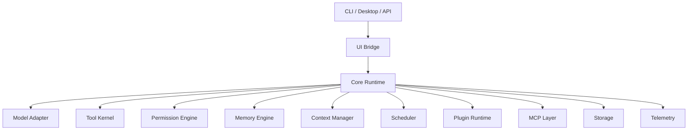

# agent

agent is a local-first runtime for building reliable AI agents. It provides the shared core for CLI, Desktop, background tasks, tools, memory, MCP, plugins, and multi-agent workflows.

The project focuses on one thing first: make agent execution observable, permissioned, recoverable, and replayable.

## Status

M01-M36 are implemented, including redacted observability evidence bundles, CLI debug exports, UI-safe snapshots, replay verification, deterministic evaluation suites, CI quality evidence gates, policy-aware MCP server export fixtures, a runnable MCP stdio server runtime, manifest-backed MCP export profiles, curated built-in MCP tool exports, profile inspection preflight diagnostics, manifest-backed MCP prompt exports, and safe MCP prompt arguments.

## Core Ideas

- One runtime core for CLI, TUI, and Desktop.
- Every important action becomes a typed event.
- Tool use goes through policy, sandboxing, and audit.
- Long-running work is checkpointed and recoverable.
- Models, tools, storage, UI, MCP, memory, and plugins stay replaceable.

## Tech Stack

- Rust workspace
- Tokio for async runtime paths
- Serde for durable and wire schemas
- SQLite first for local persistence
- Structured tracing and audit logs
- MCP-compatible extension surface
- CLI and TUI first, Desktop later through a shared UI bridge

## Architecture



## Planned Layout

```text
crates/
  agent-types/
  agent-core/
  agent-model/
  agent-storage/
  agent-tool/
  agent-policy/
  agent-sandbox/
  agent-context/
  agent-memory/
  agent-scheduler/
  agent-worktree/
  agent-team/
  agent-mcp/
  agent-skill/
  agent-plugin/
  agent-ui-bridge/
  agent-cli/
  agent-tui/
  agent-desktop/
docs/
  PRD.md
  architecture/
  adr/
  milestones/
  specs/
  plans/
  templates/
xtask/
```

## Development

Use the Rust-native xtask entrypoint for cross-platform workspace commands:

```bash
cargo xtask check
cargo xtask fmt
cargo xtask fmt-check
cargo xtask clippy
cargo xtask test
cargo xtask ci
cargo xtask eval
cargo xtask desktop-test
cargo xtask cli-prompt -- "hello agent"
cargo xtask cli-json -- "hello agent"
cargo xtask package-cli --channel dev
cargo xtask package-desktop --channel dev
agent-cli --observability-summary
agent-cli --observability-json
agent-cli mcp server status
agent-cli --json mcp server status
agent-cli mcp server stdio
agent-cli mcp server stdio --profile path/to/mcp-server-exports.json
agent-cli mcp server stdio --profile path/to/mcp-server-exports.json --workspace .
agent-cli mcp server profile inspect --profile path/to/mcp-server-exports.json
agent-cli eval validate --manifest path/to/scenario.eval.json
agent-cli eval run --manifest path/to/scenario.eval.json --out-dir target/agent-eval
agent-cli eval suite run --suite docs/eval/default.suite.json --out-dir target/agent-eval
```

Run `cargo xtask help` for the full command list.

## Quality Gate

Run the local and CI quality gate with:

```bash
cargo xtask ci
```

The gate writes redacted evidence artifacts to `target/agent-ci/`:

- `quality-gate-report.json`
- `quality-gate-summary.txt`

GitHub Actions uploads the same `target/agent-ci` directory for review.

Use `cargo xtask ci` as the release-readiness gate before merge or packaging. Inspect `quality-gate-summary.txt` for the human summary and `quality-gate-report.json` for machine-readable evidence; artifacts are redacted summaries, not raw command logs.

## MCP Server Export

Inspect local MCP server readiness without starting a daemon:

```bash
agent-cli mcp server status
agent-cli --json mcp server status
```

The status surface reports protocol version, capability flags, stdio fixture availability, and explicit export counts/names only. Exported tool calls and resource reads remain policy-gated in `agent-mcp`; status rendering does not execute tools or expose resource contents.

Inspect a manifest-backed export profile before starting stdio:

```bash
agent-cli mcp server profile inspect --profile path/to/mcp-server-exports.json
agent-cli mcp server profile inspect --profile path/to/mcp-server-exports.json --profile-name default --workspace .
agent-cli --json mcp server profile inspect --profile path/to/mcp-server-exports.json --workspace .
```

Profile inspection reports selected tools, resources, prompts, enabled/disabled state, and preflight diagnostics for missing workspaces, invalid workspace roots, unknown tools, missing resource files, and disabled exports hidden from active MCP listings. Inspection never reads resource contents or prompt message text, and keeps diagnostics bounded and redacted.

Run a local MCP stdio server process:

```bash
agent-cli mcp server stdio
agent-cli mcp server stdio --max-frames 1000
agent-cli mcp server stdio --profile path/to/mcp-server-exports.json --profile-name default
agent-cli mcp server stdio --profile path/to/mcp-server-exports.json --workspace .
```

The stdio command reads newline-delimited JSON-RPC frames from stdin and writes only MCP protocol responses to stdout. Diagnostics go to stderr, EOF closes the session cleanly, and `--json` is rejected for this command so script and MCP-client stdout stays protocol-only.

The default stdio profile is intentionally empty: no tools, resources, or prompts are exported until an explicit server export profile registers them. Tool calls and resource reads stay policy-gated in `agent-mcp`; prompt exports are read-only and explicit. Session summaries include bounded, redacted trace entries for methods, outcomes, and initialized state without raw tool arguments, resource contents, prompt message text, or secret-like values.

Use a manifest-backed profile to expose explicit resources:

```json
{
  "schema_version": 1,
  "profiles": [
    {
      "name": "default",
      "resources": [
        {
          "uri": "agent://readme",
          "name": "README",
          "path": "README.md",
          "mime_type": "text/markdown"
        }
      ]
    }
  ]
}
```

Profile resource paths are resolved relative to the manifest file directory and must stay under that directory. Tool declarations use the explicit `agent-mcp` export catalog contract, so callers opt in to exactly which local tools can be selected by a manifest.

Use `--workspace` with a manifest-backed profile to expose curated built-in workspace inspection tools:

```json
{
  "schema_version": 1,
  "profiles": [
    {
      "name": "default",
      "tools": [
        {
          "name": "workspace.read_file"
        }
      ]
    }
  ]
}
```

The built-in MCP stdio catalog is allow-listed to workspace inspection tools: `workspace.read_file`, `workspace.search_text`, `workspace.git_status`, and `workspace.git_diff`. Shell commands and file edits are not part of the built-in export catalog. Tool calls are scoped by the selected profile, resolved through the workspace sandbox, and still pass through policy before execution.

Add explicit prompt exports to the same manifest when an MCP client should discover reusable prompt templates:

```json
{
  "schema_version": 1,
  "profiles": [
    {
      "name": "default",
      "prompts": [
        {
          "name": "review",
          "description": "Review current changes",
          "arguments": [
            {
              "name": "topic",
              "description": "Review topic",
              "required": true
            },
            {
              "name": "tone",
              "description": "Optional tone",
              "required": false
            }
          ],
          "messages": [
            {
              "role": "system",
              "text": "Use a {{tone}} tone."
            },
            {
              "role": "user",
              "text": "Review {{topic}}."
            }
          ]
        }
      ]
    }
  ]
}
```

Prompt exports are available through MCP `prompts/list` and `prompts/get` after initialization. Prompt arguments are explicit string values: `prompts/list` returns declared argument descriptors, and `prompts/get` renders matching `{{argument}}` placeholders from `params.arguments`.

```json
{"jsonrpc":"2.0","id":1,"method":"initialize","params":{}}
{"jsonrpc":"2.0","id":2,"method":"prompts/get","params":{"name":"review","arguments":{"topic":"workspace diff","tone":"concise"}}}
```

Missing required arguments, unknown argument names, non-object `arguments`, and non-string argument values are rejected as invalid params. Disabled prompts remain in the profile for inspection but are hidden from active MCP listings and cannot be fetched by name. Prompt diagnostics and traces stay bounded and redacted; they do not expose raw prompt message text or argument values.

## CLI Release Packaging

Build and smoke-test a local CLI artifact:

```bash
cargo xtask package-cli --channel dev
```

Outputs are written to `target/agent-release/`:

- `agent-<version>-<target>-<channel>`: packaged CLI binary
- `agent-<version>-<target>-<channel>.sha256`: SHA-256 checksum
- `agent-<version>-<target>-<channel>.json`: release manifest

The packaging flow runs `--version`, `--config-check`, `startup-check`, and a fake-provider JSON prompt smoke before writing the manifest.

## Desktop Release Packaging

Build local Desktop release metadata and validate updater-safe manifests:

```bash
cargo xtask package-desktop --channel dev
```

Outputs are written to `target/agent-release/`:

- `agent-desktop-<version>-<target>-<channel>.plan.txt`: local bundle plan and smoke summary
- `agent-desktop-<version>-<target>-<channel>.update.json`: local update manifest
- `desktop-smoke-root/`: isolated Desktop smoke config/data/cache/log root

## Evaluation Harness

Validate and run deterministic regression scenarios:

```bash
agent-cli eval list --manifest path/to/scenario.eval.json
agent-cli eval validate --manifest path/to/scenario.eval.json
agent-cli eval run --manifest path/to/scenario.eval.json --out-dir target/agent-eval
agent-cli --json eval run --manifest path/to/scenario.eval.json
agent-cli eval suite list --suite docs/eval/default.suite.json
agent-cli eval suite validate --suite docs/eval/default.suite.json
agent-cli eval suite run --suite docs/eval/default.suite.json --out-dir target/agent-eval
agent-cli eval suite update-goldens --suite docs/eval/default.suite.json --dry-run
cargo xtask eval
```

When `--out-dir` is provided, reports are written as:

- `eval-run-report.json`
- `eval-summary.txt`

## Documentation

- [PRD](docs/PRD.md)
- [Architecture guide](docs/architecture/README.md)
- [Architecture decisions](docs/adr/)
- [Milestones](docs/milestones/README.md)
- [Latest completed spec](docs/specs/M36-05-hardening-docs.spec.md)
- [Latest completed plan](docs/plans/M36-05-hardening-docs.plan.md)
- [Latest completed milestone](docs/specs/M36-mcp-prompt-arguments-runtime.spec.md)
- [Milestone index](docs/milestones/README.md)
- [M19 technical design](docs/specs/M19-00-interactive-approval-technical-design.spec.md)
- [Templates](docs/templates/)
- [Agent notes](AGENTS.md)

## License

MIT. See [LICENSE](LICENSE).
