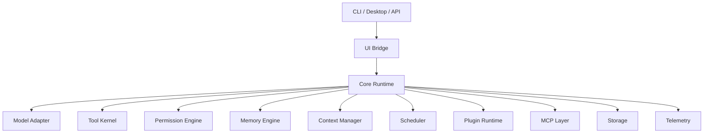

# agent

agent is a local-first runtime for building reliable AI agents. It provides the shared core for CLI, Desktop, background tasks, tools, memory, MCP, plugins, and multi-agent workflows.

The project focuses on one thing first: make agent execution observable, permissioned, recoverable, and replayable.

## Status

Architecture and planning are in progress. Implementation starts with the runtime spine: workspace scaffold, event model, event storage, fake model provider, turn engine, and replayable integration tests.

## Core Ideas

- One runtime core for CLI and Desktop.
- Every important action becomes a typed event.
- Tool use goes through policy, sandboxing, and audit.
- Long-running work is checkpointed and recoverable.
- Models, tools, storage, UI, MCP, memory, and plugins stay replaceable.

## Tech Stack

- Rust workspace
- Tokio for async runtime paths
- Serde for durable and wire schemas
- SQLite first for local persistence
- Structured tracing and audit logs
- MCP-compatible extension surface
- CLI first, Desktop later through a shared UI bridge

## Architecture



## Planned Layout

```text
crates/
  agent-types/
  agent-core/
  agent-model/
  agent-storage/
  agent-tool/
  agent-policy/
  agent-sandbox/
  agent-context/
  agent-memory/
  agent-scheduler/
  agent-mcp/
  agent-plugin/
  agent-ui-bridge/
  agent-cli/
  agent-desktop/
docs/
  PRD.md
  architecture/
  adr/
  milestones/
  specs/
  plans/
  templates/
```

## Documentation

- [PRD](docs/PRD.md)
- [Architecture guide](docs/architecture/README.md)
- [Architecture decisions](docs/adr/)
- [Milestones](docs/milestones/README.md)
- [Current milestone spec](docs/specs/M05-03-pinning-compact.spec.md)
- [Current milestone plan](docs/plans/M05-03-pinning-compact.plan.md)
- [Templates](docs/templates/)
- [Agent notes](AGENTS.md)

## License

MIT. See [LICENSE](LICENSE).
