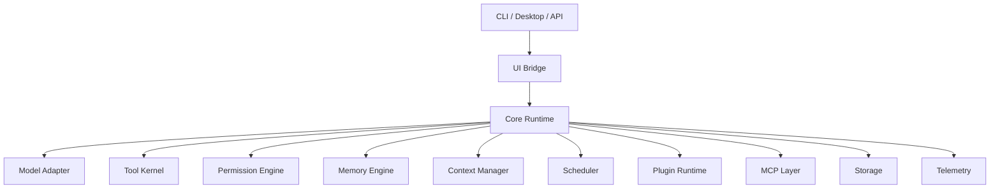

# agent

agent is a local-first runtime for building reliable AI agents. It provides the shared core for CLI, Desktop, background tasks, tools, memory, MCP, plugins, and multi-agent workflows.

The project focuses on one thing first: make agent execution observable, permissioned, recoverable, and replayable.

## Status

M01-M61 and the MX01 MCP epilogue are implemented. M55 is complete as the product-baseline reset that re-centers the repository on the main coding-agent roadmap, M56 proves a deterministic local coding-agent golden path through repo/session diagnostics, edit/diff, command/test evidence, final review, trace/audit, replay, and eval artifacts, M57 adds first-class multi-provider runtime support across OpenAI-compatible, Anthropic, Gemini, and local/Ollama-style providers with typed capability diagnostics and compatible fallback, M58 adds repo-aware project context intelligence with bounded summaries, lexical and hybrid retrieval, pinned context budget planning, quality traces, and deterministic eval coverage, M59 turns CLI/TUI usage into a terminal daily-driver workflow with session restore/switch, slash/status discovery, approval queues, diff and command panels, task status, and documented JSON/batch recipes, M60 delivers a shared-runtime Desktop daily-driver surface, and M61 makes plan/todo/task UX first-class with TodoWrite-compatible state, task controls, approval waits, notifications, artifacts, and smoke coverage. The repository has strong foundations for event-sourced runtime execution, typed storage and replay, tool policy and audit, model streaming, prompt/context management, memory, scheduler tasks, worktree/subagent foundations, plugins, Desktop bridge contracts, observability, evaluations, CI evidence, and a mature MCP extension layer including HTTP OAuth authorization-code token exchange plus P1-P3 MCP hardening for callbacks, protocol event summaries, sampling review contracts, management snapshots, and server export guardrails.

The product roadmap is now re-centered on the user-facing goal: a Claude Code / Codex Desktop-class local coding agent with excellent CLI/TUI and Desktop workflows plus first-class multi-provider support. MCP expansion remains parked as a primary track after M54; MX01 is an epilogue track and does not change the M55+ product roadmap priority.

See [Product Roadmap](docs/roadmap/PRODUCT_ROADMAP.md) and [Milestones](docs/milestones/README.md) for the current direction.

## Core Ideas

- One runtime core for CLI, TUI, and Desktop.
- Every important action becomes a typed event.
- Tool use goes through policy, sandboxing, and audit.
- Long-running work is checkpointed and recoverable.
- Models, tools, storage, UI, MCP, memory, and plugins stay replaceable.

## Tech Stack

- Rust workspace
- Tokio for async runtime paths
- Serde for durable and wire schemas
- SQLite first for local persistence
- Structured tracing and audit logs
- MCP-compatible extension surface
- CLI and TUI first, Desktop later through a shared UI bridge

## Architecture



## Planned Layout

```text
crates/
  agent-types/
  agent-core/
  agent-model/
  agent-storage/
  agent-tool/
  agent-policy/
  agent-sandbox/
  agent-context/
  agent-memory/
  agent-scheduler/
  agent-worktree/
  agent-team/
  agent-mcp/
  agent-skill/
  agent-plugin/
  agent-ui-bridge/
  agent-cli/
  agent-tui/
  agent-desktop/
docs/
  PRD.md
  architecture/
  adr/
  milestones/
  specs/
  plans/
  templates/
xtask/
```

## Development

Use the Rust-native xtask entrypoint for cross-platform workspace commands:

```bash
cargo xtask check
cargo xtask fmt
cargo xtask fmt-check
cargo xtask clippy
cargo xtask test
cargo xtask ci
cargo xtask eval
cargo xtask desktop-test
cargo xtask cli-prompt -- "hello agent"
cargo xtask cli-json -- "hello agent"
cargo xtask package-cli --channel dev
cargo xtask package-desktop --channel dev
agent-cli --observability-summary
agent-cli --observability-json
agent-cli mcp server status
agent-cli --json mcp server status
agent-cli mcp server stdio
agent-cli mcp server stdio --profile path/to/mcp-server-exports.json
agent-cli mcp server stdio --profile path/to/mcp-server-exports.json --workspace .
agent-cli mcp server profile inspect --profile path/to/mcp-server-exports.json
agent-cli eval validate --manifest path/to/scenario.eval.json
agent-cli eval run --manifest path/to/scenario.eval.json --out-dir target/agent-eval
agent-cli eval suite run --suite docs/eval/default.suite.json --out-dir target/agent-eval
```

Run `cargo xtask help` for the full command list.

`cargo xtask desktop-test` is the Desktop product gate. It runs the Desktop Rust contracts, UI bridge Desktop smoke, Tauri command tests, frontend Vitest suite, and frontend production build.

## M56 Golden Path

Run the deterministic M56 coding-agent acceptance path with:

```bash
cargo xtask eval
```

The gate runs `docs/eval/default.suite.json`, including the `default-m56-golden-path` local-coding scenario and the `default-m58-context-quality` context-quality scenario. It is fixture-driven and requires no provider credentials. It writes redacted evidence artifacts to:

- `target/agent-eval/eval-run-report.json`
- `target/agent-eval/eval-summary.txt`

For JSON output from the same suite path:

```bash
cargo run -p agent-cli --bin agent-cli -- --json eval suite run --suite docs/eval/default.suite.json --out-dir target/agent-eval
```

For the local final-review fixture alone:

```bash
cargo run -p agent-cli --bin agent-cli -- repo final-review --fixture local-coding
```

The default eval path is intentionally deterministic and credential-free. M57 extends the runtime with provider capability diagnostics, native Anthropic and Gemini adapters, local/Ollama-style endpoint support, and compatible-only fallback, while M58 adds repo-aware context quality coverage without requiring provider credentials.

## Quality Gate

Run the local and CI quality gate with:

```bash
cargo xtask ci
```

The gate writes redacted evidence artifacts to `target/agent-ci/`:

- `quality-gate-report.json`
- `quality-gate-summary.txt`

GitHub Actions uploads the same `target/agent-ci` directory for review.

Use `cargo xtask ci` as the release-readiness gate before merge or packaging. Inspect `quality-gate-summary.txt` for the human summary and `quality-gate-report.json` for machine-readable evidence; artifacts are redacted summaries, not raw command logs.

## MCP Client Roots

`agent-mcp` can model client-side MCP roots for external MCP servers used through gateway flows. Roots are explicit `file://` workspace roots, not filesystem permissions. They are validated before exposure, sorted deterministically, and surfaced in gateway reports as safe metadata.

```rust
use agent_mcp::{
    McpClientRootCandidate, McpClientRootRegistry,
};

let mut registry = McpClientRootRegistry::with_workspace_root(".")?;
registry.register(McpClientRootCandidate::new(".", Some("project")))?;
let roots = registry.list_result();
```

Disabled roots remain inspectable but are excluded from active root lists. Disabled, unhealthy, or unknown MCP servers receive no roots through gateway discovery. Root discovery failures become redacted gateway diagnostics and do not block tool discovery or tool registration. Roots never grant read, write, command, Git, browser, Desktop, or secret access; actual actions still go through local policy, sandbox, and tool execution paths.

## MCP Client Stdio

`agent-mcp` can start external MCP stdio server processes, drive `initialize` plus `tools/list`, and execute live `tools/call` requests through the typed gateway path. `McpStdioClient` owns newline-delimited JSON-RPC framing, request id matching, process timeouts, child cleanup, and typed mapping into `McpInitializeResult`, `McpToolListResult`, and `McpToolCallResult`.

```rust
use std::sync::Arc;

use agent_mcp::{McpClient as _, McpGateway, McpStdioClient};
use agent_tool::ToolRegistry;

let client = Arc::new(McpStdioClient::spawn(&server_config).await?);
let init = client.initialize(&server_config).await?;
let tools = client.list_tools(&server_config.id).await?;

let gateway = McpGateway::new(Arc::clone(&client));
let report = gateway.discover_tools(&[server_config.clone()]).await;
let mut registry = ToolRegistry::default();
gateway.register_tools(&mut registry, &report)?;
```

Tool listing is discovery metadata only; it does not grant permission to execute remote tools. Local policy gates the registered gateway tool before a remote `tools/call` is sent. Remote success payloads are returned as tool output by design, then bounded locally by gateway surfaces. Public diagnostics are bounded and redacted: process stderr, command env, unresolved secret refs, prompt text, local tool arguments, and raw remote failure details are not surfaced. `McpEnvValue::SecretRef` values must be resolved outside `agent-mcp` before spawning a stdio client process.

MX01 adds typed reentrant client callback contracts for `roots/list` and `sampling/createMessage` frames that may arrive while stdio or streamable HTTP tool work is in flight. Unknown callbacks and callback notifications without request ids are safely rejected or ignored, and callback reports are bounded and redacted. Callback handling still routes through the existing root and sampling provider boundaries; it does not bypass local policy, tool registration, sandboxing, or permission checks.

## MCP Client Streamable HTTP

`agent-mcp` can also drive streamable HTTP MCP server configs through the same typed client and gateway contracts. M45 implements request/response JSON-RPC over HTTP POST for `initialize`, `tools/list`, and `tools/call`. M46 adds bounded `text/event-stream` response parsing: SSE events are parsed into typed response frames, local request id matching selects the expected JSON-RPC response, and initialize/list/call work when the server answers with SSE frames. M47 captures safe response metadata for `Mcp-Session-Id`, `MCP-Protocol-Version`, and the latest accepted SSE event id, then sends session headers on later initialized requests. M48 adds typed GET stream request snapshots, a reqwest-backed bounded SSE stream-open boundary, and explicit stream event drain reports that update checkpoints after accepted events. M49 adds bounded reconnect policy, retry classification, reconnect runner composition, safe replay diagnostics, and typed reconnect trace reports. M50 adds an explicit supervisor tick boundary over the M49 reconnect runner, including bounded tick accounting, cancellation and lease preflight, and redacted supervisor reports for CLI/Desktop or scheduler surfaces.

```rust
use std::sync::Arc;

use agent_mcp::{McpClient as _, McpGateway, McpHttpClient};
use agent_tool::ToolRegistry;

let client = Arc::new(McpHttpClient::reqwest());
let init = client.initialize(&server_config).await?;
let tools = client.list_tools(&server_config.id).await?;

let gateway = McpGateway::new(Arc::clone(&client));
let report = gateway.discover_tools(&[server_config.clone()]).await;
let mut registry = ToolRegistry::default();
gateway.register_tools(&mut registry, &report)?;
```

HTTP configs use `McpTransportConfig::StreamableHttp`. Literal headers are sent with each request, while `McpEnvValue::SecretRef` header values must be resolved outside `agent-mcp` before request construction. Public diagnostics are bounded and redacted: raw URLs with credentials, header values, session ids, event ids, unresolved secret ref names, request bodies, local tool arguments, remote status bodies, raw SSE data, and raw remote failure details are not surfaced. Local policy still gates registered gateway tools before any remote HTTP `tools/call` is sent, and remote success payloads are bounded locally by gateway surfaces.

M49 stream reconnect remains bounded and explicit: clients can build a resume-aware GET stream request, open a typed `text/event-stream` response, retry according to `McpClientHttpReconnectPolicy`, advance the local checkpoint through `record_stream_open`, and inspect `McpClientHttpReconnectReport` plus `McpClientHttpReplayDiagnostic` without exposing raw session ids, event ids, headers, stream bodies, or remote failure payloads. Replay diagnostics prove whether the local request included `Last-Event-ID` and whether the local checkpoint advanced; they do not claim the remote server replayed every missed event.

M50 stream supervision is also explicit: the runtime exposes one bounded tick API that a scheduler may call, not an unmanaged background loop. A tick validates `McpClientHttpStreamSupervisorConfig`, checks tick budget, optionally applies `McpClientHttpStreamSupervisorControl` cancellation and lease preflight before stream side effects, composes the M49 reconnect runner, and produces a `McpClientHttpStreamSupervisorReport`.

```rust
use agent_mcp::{
    McpClientHttpStreamSupervisorConfig, McpClientHttpStreamSupervisorControl,
    McpClientHttpStreamSupervisorReport,
};

let supervisor = McpClientHttpStreamSupervisorConfig::new(server_config.id.clone());
let control = McpClientHttpStreamSupervisorControl::default();
let tick = client
    .supervise_stream_tick_with_control(&supervisor, &mut stream_transport, 0, &control)
    .await?;
let report = McpClientHttpStreamSupervisorReport::from_tick(&tick);
```

Supervisor reports expose status, completed tick count, public terminal summaries, and redacted reconnect summaries. They do not expose raw URLs, headers, session ids, event ids, stream bodies, scheduler internals, or remote failure payloads.

M51 adds the MCP HTTP OAuth authorization foundation without owning login UX or token lifecycle. `agent-mcp` exposes typed `McpClientHttpOAuthMetadata` and `McpClientHttpProtectedResourceMetadata`, parses caller-provided discovery JSON with redacted errors, builds `McpClientHttpAuthorizationReport` readiness diagnostics, and applies caller-provided `McpClientHttpAuthorization` bearer material only at explicit POST or GET stream request construction boundaries.

```rust
use agent_mcp::{
    McpClientHttpAuthorization, McpClientHttpRequest, McpClientHttpStreamRequest,
    build_mcp_client_http_authorization_report,
};

let report = build_mcp_client_http_authorization_report(
    &server_config,
    Some(&oauth_metadata),
    Some(&protected_resource_metadata),
);

let authorization = McpClientHttpAuthorization::new("caller-provided-access-token")?;
let post_request = McpClientHttpRequest::from_config_with_authorization(
    &server_config,
    request_body,
    &authorization,
)?;
let stream_request = McpClientHttpStreamRequest::from_config_with_authorization(
    &server_config,
    &authorization,
)?;
```

Authorization diagnostics and errors do not expose bearer tokens, authorization header values, client secrets, raw discovery bodies, unresolved secret ref names, refresh tokens, or remote auth failure payloads. Existing `Authorization` headers conflict with explicit bearer authorization. Browser login, Desktop auth UX, token storage, refresh, revocation, DCR execution, provider-specific OAuth flows, and server-specific replay guarantees remain later work.

M52 adds a token lifecycle foundation on top of that bearer boundary. `McpClientHttpOAuthTokenLease` represents caller-provided access-token material with optional expiry and scopes; `Debug` is redacted and the lease is intentionally not a durable serialization DTO. `McpClientHttpOAuthTokenSourceRef` is the durable-safe reference shape for an external auth or vault layer. `build_mcp_client_http_oauth_refresh_plan` deterministically classifies leases as usable, refresh-soon, expired, unknown-expiry, or scope-incompatible from caller-provided time and requirements. `build_mcp_client_http_request_with_oauth_token` and `build_mcp_client_http_stream_request_with_oauth_token` reject expired leases before applying `Authorization` headers, then delegate to the M51 request constructors.

```rust
use agent_mcp::{
    McpClientHttpOAuthTokenLease, build_mcp_client_http_oauth_refresh_plan,
    build_mcp_client_http_request_with_oauth_token,
};

let lease = McpClientHttpOAuthTokenLease::new(
    "caller-provided-access-token",
    Some(now_unix_ms + 60_000),
    vec!["mcp:tools".to_string()],
)?;
let plan = build_mcp_client_http_oauth_refresh_plan(
    &lease,
    now_unix_ms,
    10_000,
    &["mcp:tools".to_string()],
)?;
let request = build_mcp_client_http_request_with_oauth_token(
    &server_config,
    request_body,
    &lease,
    now_unix_ms,
)?;
```

Token lifecycle diagnostics and request factories do not expose access tokens, refresh tokens, authorization header values, client secrets, raw auth bodies, remote auth failures, or configured header values. Browser/device login, Desktop account UX, durable encrypted token storage, provider refresh calls, revocation, and dynamic client registration remain outside this milestone.

M53 adds a typed OAuth authorization-flow foundation for callers that own browser launch, callback hosting, remote token endpoint execution, and secret storage. `McpClientHttpOAuthPkceVerifier`, `McpClientHttpOAuthPkceChallenge`, and `McpClientHttpOAuthState` validate caller-provided flow material. `build_mcp_client_http_oauth_authorization_request_plan` creates a deterministic authorization URL plan. `validate_mcp_client_http_oauth_callback` validates returned code/state shape and classifies provider errors. `build_mcp_client_http_oauth_token_exchange_request` creates the final token exchange form DTO without executing a network call. Flow reports expose UI-safe diagnostics for authorization-ready, callback, and token-exchange-ready states.

```rust
use agent_mcp::{
    McpClientHttpOAuthAuthorizationRequestInput, McpClientHttpOAuthCallbackInput,
    McpClientHttpOAuthPkceChallenge, McpClientHttpOAuthPkceVerifier, McpClientHttpOAuthState,
    build_mcp_client_http_oauth_authorization_flow_report,
    build_mcp_client_http_oauth_authorization_request_plan,
    build_mcp_client_http_oauth_token_exchange_flow_report,
    build_mcp_client_http_oauth_token_exchange_request, validate_mcp_client_http_oauth_callback,
};

let input = McpClientHttpOAuthAuthorizationRequestInput::new(
    "mcp-client",
    "http://127.0.0.1:8080/oauth/callback",
    vec!["mcp:tools".to_string()],
)?;
let verifier = McpClientHttpOAuthPkceVerifier::new(
    "dBjftJeZ4CVP-mB92K27uhbUJU1p1r_wW1gFWFOEjXk",
)?;
let challenge = McpClientHttpOAuthPkceChallenge::s256(&verifier)?;
let state = McpClientHttpOAuthState::new("state-0123456789abcdef")?;
let authorization_plan = build_mcp_client_http_oauth_authorization_request_plan(
    &oauth_metadata,
    &input,
    &challenge,
    &state,
)?;
let authorization_report =
    build_mcp_client_http_oauth_authorization_flow_report(&authorization_plan);

let callback = McpClientHttpOAuthCallbackInput::new(
    Some("callback-code-from-provider"),
    Some("state-0123456789abcdef"),
    None::<String>,
    None::<String>,
)?;
let validation = validate_mcp_client_http_oauth_callback(&callback, &state)?;
let token_exchange = build_mcp_client_http_oauth_token_exchange_request(
    &oauth_metadata,
    &input,
    &verifier,
    &validation,
)?;
let exchange_report = build_mcp_client_http_oauth_token_exchange_flow_report(&token_exchange);
```

Authorization-flow diagnostics and reports do not expose PKCE verifiers, state values, authorization codes, callback queries, provider descriptions, access tokens, refresh tokens, authorization headers, client secrets, raw auth bodies, or remote auth failure payloads. Browser/device login, localhost callback servers, Desktop account UX, durable encrypted token storage, remote token exchange execution, provider refresh calls, revocation, and dynamic client registration remain outside this milestone.

M54 executes that token exchange DTO through a typed HTTP form POST boundary and converts successful bearer token responses into `McpClientHttpOAuthTokenLease` values. `McpClientHttpOAuthTokenExchangeTransport` owns the async exchange boundary, with fixture and reqwest implementations. `exchange_mcp_client_http_oauth_token` returns a redacted report plus optional secret-bearing token response. `build_mcp_client_http_oauth_token_lease_from_exchange_response` maps successful bearer responses into existing token lifecycle contracts using caller-provided time for expiry calculation.

```rust
use agent_mcp::{
    McpClientHttpOAuthTokenExchangeTransport, build_mcp_client_http_oauth_token_lease_from_exchange_response,
    exchange_mcp_client_http_oauth_token,
};

let outcome = exchange_mcp_client_http_oauth_token(&mut transport, &token_exchange).await?;
if let Some(response) = outcome.response.as_ref() {
    let lease = build_mcp_client_http_oauth_token_lease_from_exchange_response(
        response,
        now_unix_ms,
    )?;
}
```

Token exchange diagnostics and debug output do not expose authorization codes, PKCE verifiers, access tokens, refresh tokens, form bodies, authorization headers, client secrets, raw provider responses, or remote auth failure payloads. M54 does not implement browser/device login, callback hosting, Desktop account UX, durable encrypted token vaults, refresh-token persistence, refresh execution, revocation, dynamic client registration, or provider-specific OAuth quirks.

MX01 adds typed MCP protocol event reports for progress, logging, task, and elicitation notifications. Bounded JSON-RPC frames are parsed into normalized, UI-safe summaries for CLI/JSON or bridge consumers, with raw prompts, tokens, secrets, headers, provider payloads, and remote failure bodies kept out of public diagnostics.

MX01 still does not implement the P0 OAuth/Auth product closure: browser/device login, localhost callback servers, Desktop account picker UX, durable encrypted token vaults, refresh-token persistence, provider refresh execution, token revocation execution, dynamic client registration execution, OS keychain integration, or provider-specific login UX.

## MCP Sampling

`agent-mcp` can model MCP `sampling/createMessage` requests from external servers without handing model credentials or local tool access to those servers. M40 implements typed sampling contracts, a conservative request validator, deterministic fixture execution, and gateway availability diagnostics. M41 adds an `agent-core` bridge that maps safe text-only sampling requests to local `agent-model` providers. M42 adds fixture-grade JSON-RPC stdio frame dispatch for server-initiated `sampling/createMessage` requests through the same local provider path.

Given a configured `server_id`, `server_config`, and fixture `initialize_result`:

```rust
use agent_mcp::{
    FixtureMcpClient, McpCreateMessageRequestParams, McpCreateMessageResult,
    McpSamplingContent, McpSamplingMessage, McpSamplingRole, create_mcp_sampling_message,
};

let request = McpCreateMessageRequestParams::new(
    vec![McpSamplingMessage::user(McpSamplingContent::text("Summarize this fixture input."))],
    256,
);

let result = McpCreateMessageResult::new(
    McpSamplingRole::Assistant,
    McpSamplingContent::text("Fixture summary."),
    "fixture-model",
    Some("endTurn"),
)?;

let client = FixtureMcpClient::new()
    .with_server(server_id.clone(), initialize_result)
    .with_sampling_result(server_id.clone(), result);
let response = create_mcp_sampling_message(&client, &server_config, request).await?;
```

Use the core bridge when a validated sampling request should execute through the local model abstraction:

```rust
use std::sync::Arc;

use agent_core::{
    McpModelSamplingProvider, McpSamplingModelBridgeConfig, McpSamplingModelBridgeIds,
};
use agent_model::{FakeModelProvider, FakeModelScript};

let sampling_provider = McpModelSamplingProvider::new(
    Arc::new(FakeModelProvider::new(FakeModelScript::text("Local model answer."))),
    McpSamplingModelBridgeConfig {
        provider: "local-provider".to_string(),
        model: "local-model".to_string(),
    },
    McpSamplingModelBridgeIds {
        conversation_id,
        turn_id,
        correlation_id,
    },
);
let response = create_mcp_sampling_message(&sampling_provider, &server_config, request).await?;
```

Use the stdio dispatcher when tests or a future transport wrapper need to turn one MCP JSON-RPC sampling request frame into a JSON-RPC response frame:

```rust
use agent_mcp::{
    MCP_SAMPLING_CREATE_MESSAGE_METHOD, handle_mcp_sampling_stdio_frame,
};
use serde_json::json;

let frame = json!({
    "jsonrpc": "2.0",
    "id": "sample-1",
    "method": MCP_SAMPLING_CREATE_MESSAGE_METHOD,
    "params": {
        "messages": [
            {
                "role": "user",
                "content": {
                    "type": "text",
                    "text": "Summarize this fixture input."
                }
            }
        ],
        "maxTokens": 256
    }
})
.to_string();

let response_frame = handle_mcp_sampling_stdio_frame(&client, &server_config, &frame).await;
```

The safe subset rejects empty message lists, invalid token limits, unsupported `tools` / `toolChoice`, and `includeContext` values other than `none` before model streaming. The model bridge also rejects image, audio, tool-use, tool-result, and model `ToolCall` paths. Server model preferences remain advisory; local provider and model config always select the actual model runtime.

Gateway reports, bridge errors, stdio error frames, and public diagnostics expose bounded status codes only; they do not include request messages, system prompts, response content, media payloads, provider metadata, model credentials, or local secret names. Sampling success frames contain the provider response by design. Sampling does not grant filesystem, command, Git, browser, Desktop, local secret, or local tool permissions.

MX01 adds sampling approval request, decision, and report contracts; task-augmented sampling metadata; redacted review summaries; and default-deny tool-loop policy. These are productization contracts, not a complete approval UI. Tool-enabled sampling loops are not enabled by default, and live transport multiplexing, full Desktop review surfaces, multimodal conversion, and explicitly approved tool-loop execution remain later product work.

## MCP Management Snapshot

MX01 adds UI-safe MCP management snapshots in `agent-mcp` plus independent bridge DTOs in `agent-ui-bridge`. Snapshots summarize server status, transport kind, roots, sampling availability, stream status, auth status, last diagnostics, and extension health in bounded, serializable, redacted shapes for future CLI/Desktop rendering.

Management snapshots are status reports only. They do not create permission leases, expose raw headers or tokens, read resource contents, reveal prompt text, or grant MCP servers local filesystem, command, Git, browser, Desktop, secret, or network authority.

## MCP Server Export

Inspect local MCP server readiness without starting a daemon:

```bash
agent-cli mcp server status
agent-cli --json mcp server status
```

The status surface reports protocol version, capability flags, stdio fixture availability, and explicit export counts/names only. Exported tool calls and resource reads remain policy-gated in `agent-mcp`; status rendering does not execute tools or expose resource contents.

Inspect a manifest-backed export profile before starting stdio:

```bash
agent-cli mcp server profile inspect --profile path/to/mcp-server-exports.json
agent-cli mcp server profile inspect --profile path/to/mcp-server-exports.json --profile-name default --workspace .
agent-cli --json mcp server profile inspect --profile path/to/mcp-server-exports.json --workspace .
```

Profile inspection reports selected tools, resources, prompts, enabled/disabled state, and preflight diagnostics for missing workspaces, invalid workspace roots, unknown tools, missing resource files, and disabled exports hidden from active MCP listings. Inspection never reads resource contents or prompt message text, and keeps diagnostics bounded and redacted.

Run a local MCP stdio server process:

```bash
agent-cli mcp server stdio
agent-cli mcp server stdio --max-frames 1000
agent-cli mcp server stdio --profile path/to/mcp-server-exports.json --profile-name default
agent-cli mcp server stdio --profile path/to/mcp-server-exports.json --workspace .
```

The stdio command reads newline-delimited JSON-RPC frames from stdin and writes only MCP protocol responses to stdout. Diagnostics go to stderr, EOF closes the session cleanly, and `--json` is rejected for this command so script and MCP-client stdout stays protocol-only.

The default stdio profile is intentionally empty: no tools, resources, or prompts are exported until an explicit server export profile registers them. Tool calls and resource reads stay policy-gated in `agent-mcp`; prompt exports are read-only and explicit. Session summaries include bounded, redacted trace entries for methods, outcomes, and initialized state without raw tool arguments, resource contents, prompt message text, or secret-like values.

Use a manifest-backed profile to expose explicit resources:

```json
{
  "schema_version": 1,
  "profiles": [
    {
      "name": "default",
      "resources": [
        {
          "uri": "agent://readme",
          "name": "README",
          "path": "README.md",
          "mime_type": "text/markdown"
        }
      ]
    }
  ]
}
```

Profile resource paths are resolved relative to the manifest file directory and must stay under that directory. Tool declarations use the explicit `agent-mcp` export catalog contract, so callers opt in to exactly which local tools can be selected by a manifest.

Use resource templates when an MCP client should discover a parameterized resource surface and read concrete URIs through `resources/read`:

```json
{
  "schema_version": 1,
  "profiles": [
    {
      "name": "default",
      "resource_templates": [
        {
          "uri_template": "agent://workspace/file/{path}",
          "name": "Workspace file",
          "description": "Read a workspace file",
          "path_template": "{path}",
          "mime_type": "text/plain"
        }
      ]
    }
  ]
}
```

Resource templates are available through MCP `resources/templates/list` after initialization. Template-backed `resources/read` accepts concrete URIs that match a declared `uriTemplate`; matched variable values render into `path_template`, and resolved paths must stay under the manifest directory.

```json
{"jsonrpc":"2.0","id":1,"method":"initialize","params":{}}
{"jsonrpc":"2.0","id":2,"method":"resources/templates/list","params":{}}
{"jsonrpc":"2.0","id":3,"method":"resources/read","params":{"uri":"agent://workspace/file/README.md"}}
```

Disabled resource templates remain inspectable but hidden from active listings. Template reads are policy-gated at the declared `uriTemplate` scope, reject path traversal and ambiguous matches, bound returned contents, and keep diagnostics redacted without exposing file contents.

Use `--workspace` with a manifest-backed profile to expose curated built-in workspace inspection tools:

```json
{
  "schema_version": 1,
  "profiles": [
    {
      "name": "default",
      "tools": [
        {
          "name": "workspace.read_file"
        }
      ]
    }
  ]
}
```

The built-in MCP stdio catalog is allow-listed to workspace inspection tools: `workspace.read_file`, `workspace.search_text`, `workspace.git_status`, and `workspace.git_diff`. Shell commands and file edits are not part of the built-in export catalog. Tool calls are scoped by the selected profile, resolved through the workspace sandbox, and still pass through policy before execution.

MX01 adds manifest `capability` declarations and `McpServerExportPolicyPreview` contracts for server export expansion guardrails. Read-only tool exports continue on the existing path. Enabled side-effecting declarations for command execution, file edits, Git writes, browser control, secret access, or network access are rejected by default, and disabled dangerous declarations can be inspected safely through policy preview without opening those capabilities.

Add explicit prompt exports to the same manifest when an MCP client should discover reusable prompt templates:

```json
{
  "schema_version": 1,
  "profiles": [
    {
      "name": "default",
      "prompts": [
        {
          "name": "review",
          "description": "Review current changes",
          "arguments": [
            {
              "name": "topic",
              "description": "Review topic",
              "required": true
            },
            {
              "name": "tone",
              "description": "Optional tone",
              "required": false
            }
          ],
          "messages": [
            {
              "role": "system",
              "text": "Use a {{tone}} tone."
            },
            {
              "role": "user",
              "text": "Review {{topic}}."
            }
          ]
        }
      ]
    }
  ]
}
```

Prompt exports are available through MCP `prompts/list` and `prompts/get` after initialization. Prompt arguments are explicit string values: `prompts/list` returns declared argument descriptors, and `prompts/get` renders matching `{{argument}}` placeholders from `params.arguments`.

```json
{"jsonrpc":"2.0","id":1,"method":"initialize","params":{}}
{"jsonrpc":"2.0","id":2,"method":"prompts/get","params":{"name":"review","arguments":{"topic":"workspace diff","tone":"concise"}}}
```

Missing required arguments, unknown argument names, non-object `arguments`, and non-string argument values are rejected as invalid params. Disabled prompts remain in the profile for inspection but are hidden from active MCP listings and cannot be fetched by name. Prompt diagnostics and traces stay bounded and redacted; they do not expose raw prompt message text or argument values.

Add static completion values when an MCP client should suggest known prompt argument or resource template variable values through `completion/complete`:

```json
{
  "schema_version": 1,
  "profiles": [
    {
      "name": "default",
      "prompts": [
        {
          "name": "review",
          "arguments": [
            {
              "name": "topic",
              "required": true
            }
          ],
          "argument_completions": [
            {
              "argument": "topic",
              "values": ["workspace diff", "worktree status"]
            }
          ],
          "messages": [
            {
              "role": "user",
              "text": "Review {{topic}}."
            }
          ]
        }
      ],
      "resource_templates": [
        {
          "uri_template": "agent://workspace/file/{path}",
          "name": "Workspace file",
          "path_template": "{path}",
          "variable_completions": [
            {
              "variable": "path",
              "values": ["README.md", "src/lib.rs"]
            }
          ]
        }
      ]
    }
  ]
}
```

Completion requests are available after initialization and return bounded MCP completion results:

```json
{"jsonrpc":"2.0","id":1,"method":"initialize","params":{}}
{"jsonrpc":"2.0","id":2,"method":"completion/complete","params":{"ref":{"type":"ref/prompt","name":"review"},"argument":{"name":"topic","value":"work"}}}
{"jsonrpc":"2.0","id":3,"method":"completion/complete","params":{"ref":{"type":"ref/resource","uri":"agent://workspace/file/{path}"},"argument":{"name":"path","value":"READ"}}}
```

Completion values are explicit static manifest metadata. Completion does not read files, render prompt messages, execute tools, call models, or issue permission leases. Secret-like completion values are rejected, disabled exports are hidden from completion, and diagnostics stay bounded and redacted.

## CLI Release Packaging

Build and smoke-test a local CLI artifact:

```bash
cargo xtask package-cli --channel dev
```

Outputs are written to `target/agent-release/`:

- `agent-<version>-<target>-<channel>`: packaged CLI binary
- `agent-<version>-<target>-<channel>.sha256`: SHA-256 checksum
- `agent-<version>-<target>-<channel>.json`: release manifest

The packaging flow runs `--version`, `--config-check`, `startup-check`, and a fake-provider JSON prompt smoke before writing the manifest.

## Desktop Release Packaging

Build local Desktop release metadata and validate updater-safe manifests:

```bash
cargo xtask package-desktop --channel dev
```

Outputs are written to `target/agent-release/`:

- `agent-desktop-<version>-<target>-<channel>.plan.txt`: local bundle plan and smoke summary
- `agent-desktop-<version>-<target>-<channel>.update.json`: local update manifest
- `desktop-smoke-root/`: isolated Desktop smoke config/data/cache/log root

## Evaluation Harness

Validate and run deterministic regression scenarios:

```bash
agent-cli eval list --manifest path/to/scenario.eval.json
agent-cli eval validate --manifest path/to/scenario.eval.json
agent-cli eval run --manifest path/to/scenario.eval.json --out-dir target/agent-eval
agent-cli --json eval run --manifest path/to/scenario.eval.json
agent-cli eval suite list --suite docs/eval/default.suite.json
agent-cli eval suite validate --suite docs/eval/default.suite.json
agent-cli eval suite run --suite docs/eval/default.suite.json --out-dir target/agent-eval
agent-cli eval suite update-goldens --suite docs/eval/default.suite.json --dry-run
cargo xtask eval
```

When `--out-dir` is provided, reports are written as:

- `eval-run-report.json`
- `eval-summary.txt`

## Documentation

- [PRD](docs/PRD.md)
- [Architecture guide](docs/architecture/README.md)
- [Architecture decisions](docs/adr/)
- [Milestones](docs/milestones/README.md)
- [Latest completed spec](docs/specs/M52-05-hardening-docs.spec.md)
- [Latest completed plan](docs/plans/M52-05-hardening-docs.plan.md)
- [Latest completed milestone](docs/specs/M52-mcp-http-oauth-token-lifecycle-runtime.spec.md)
- [Milestone index](docs/milestones/README.md)
- [M19 technical design](docs/specs/M19-00-interactive-approval-technical-design.spec.md)
- [Templates](docs/templates/)
- [Agent notes](AGENTS.md)

## License

MIT. See [LICENSE](LICENSE).
