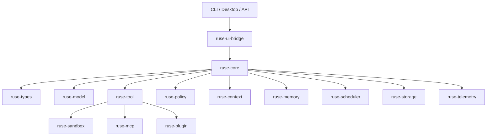

# Architecture Guide

This directory defines the cross-cutting engineering rules for `agent`. Product intent lives in `docs/PRD.md`; milestone scope lives in `docs/milestones/README.md`; implementation slices live in `docs/specs/` and `docs/plans/`.

Architecture docs answer questions that should stay stable across milestones:

- Which crate owns which responsibility.
- How runtime state becomes durable events.
- How async work is cancelled, timed out, and joined.
- How errors become diagnostics, audit entries, and recovery decisions.
- How configuration is layered and migrated.
- How storage, artifacts, checkpoints, and replay work.
- How permissions, sandboxing, secrets, and audit logs constrain side effects.
- How plugins, MCP, skills, providers, tools, and UI clients extend the runtime.
- How tests prove behavior before development moves forward.

## System Shape

## Required Reading Order

1. [Crate Boundaries](crate-boundaries.md)
2. [Event Sourcing](event-sourcing.md)
3. [Storage](storage.md)
4. [Security Policy](security-policy.md)
5. [Async Runtime](async-runtime.md)
6. [Error Model](error-model.md)
7. [Configuration](configuration.md)
8. [Extensibility](extensibility.md)
9. [Plugin System](plugin-system.md)
10. [Testing Strategy](testing-strategy.md)

## Development Gate

Before implementing a milestone slice:

- The matching spec exists in `docs/specs/`.
- The matching plan exists in `docs/plans/`.
- The plan names concrete files, tests, commands, and acceptance criteria.
- The design follows these architecture docs.
- Any deliberate exception is recorded as an ADR in `docs/adr/`.
