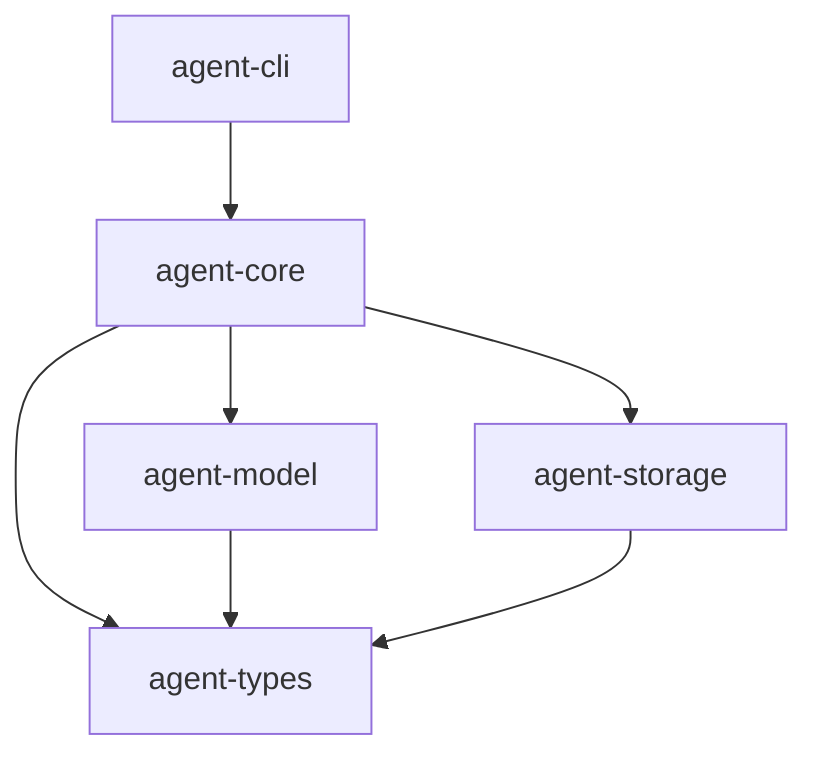

# M01-01 Workspace Scaffold Spec

## Purpose

Create the initial Rust workspace and crate skeleton for the Runtime Spine MVP. This slice establishes the buildable project shape, crate naming, minimal dependency direction, verification commands, and smoke tests that later M01 slices build on.

## Product Context

This spec supports Milestone 1: Runtime Spine MVP. The milestone goal is to create the smallest event-sourced Rust runtime that can execute and replay a deterministic agent turn. This first slice creates the stable workspace foundation for that work.

## Scope

M01-01 delivers:

- Root Cargo workspace.
- Minimal runtime-spine crate set:
  - `agent-types`
  - `agent-core`
  - `agent-model`
  - `agent-storage`
  - `agent-cli`
- Workspace-level package metadata and lint policy.
- Minimal crate APIs that prove crate linkage.
- CLI smoke binary.
- Standard verification commands.

The following items are scheduled for later M01 slices:

- M01-02 defines typed IDs, events, states, and serialization contracts.
- M01-03 defines event stores and replay APIs.
- M01-04 defines the fake streaming model provider.
- M01-05 defines the turn engine.
- M01-06 wires the full deterministic fake turn.

## Architecture

The scaffold creates only the crates required for the runtime spine. Later milestones will add the rest of the platform crates from the PRD when those capabilities become active.



The crate dependency direction is intentionally one-way:

- `agent-types` has no internal workspace dependencies.
- `agent-model` may depend on `agent-types`.
- `agent-storage` may depend on `agent-types`.
- `agent-core` may depend on `agent-types`, `agent-model`, and `agent-storage`.
- `agent-cli` may depend on `agent-core`.

## File Layout

```text
Cargo.toml
crates/
  agent-types/
    Cargo.toml
    src/lib.rs
  agent-model/
    Cargo.toml
    src/lib.rs
  agent-storage/
    Cargo.toml
    src/lib.rs
  agent-core/
    Cargo.toml
    src/lib.rs
  agent-cli/
    Cargo.toml
    src/main.rs
    tests/cli_smoke.rs
```

## Workspace Policy

- Rust edition: `2024`.
- Minimum Rust version: `1.85`.
- License: `MIT`.
- Resolver: `2`.
- Unsafe code: forbidden in every crate.
- Each crate exposes one minimal smoke API so `cargo test --workspace` proves compilation and linkage.

## Crate Responsibilities

| Crate | M01-01 Responsibility | Later Responsibility |
|---|---|---|
| `agent-types` | Shared crate identity and base compile target. | IDs, events, state enums, error types, serialization schemas. |
| `agent-model` | Model layer compile target and dependency on `agent-types`. | Provider trait, model events, fake provider, provider capability model. |
| `agent-storage` | Storage layer compile target and dependency on `agent-types`. | Event store traits, in-memory store, SQLite store, replay support. |
| `agent-core` | Core compile target and dependency on model/storage/types. | Turn state machine, runtime orchestration, event emission, checkpoint hooks. |
| `agent-cli` | Binary compile target and smoke test. | TTY, JSON mode, REPL, approvals, trace commands. |

## API Contracts

M01-01 APIs are intentionally tiny and stable enough for smoke tests:

```rust
pub fn crate_name() -> &'static str
```

Each library crate exposes a crate identity function. `agent-core` also exposes:

```rust
pub fn runtime_banner() -> String
```

`agent-cli --version` prints:

```text
agent-cli 0.1.0
```

## Testing Strategy

M01-01 uses local, deterministic tests:

- Unit tests in each library crate validate crate identity and dependency linkage.
- Integration test in `agent-cli` validates the binary smoke path.
- Workspace commands validate formatting, linting, and tests.

Required verification commands:

```bash
cargo fmt --all -- --check
cargo clippy --workspace --all-targets -- -D warnings
cargo test --workspace
```

## Acceptance Criteria

- `cargo metadata --no-deps` succeeds.
- `cargo fmt --all -- --check` succeeds.
- `cargo clippy --workspace --all-targets -- -D warnings` succeeds.
- `cargo test --workspace` succeeds.
- `cargo run -p agent-cli -- --version` prints `agent-cli 0.1.0`.
- The workspace contains only runtime-spine crates needed by M01-01.

## Completion Signal

M01-01 is complete when the scaffold is committed with passing verification and the next active slice is `M01-02-event-model`.
