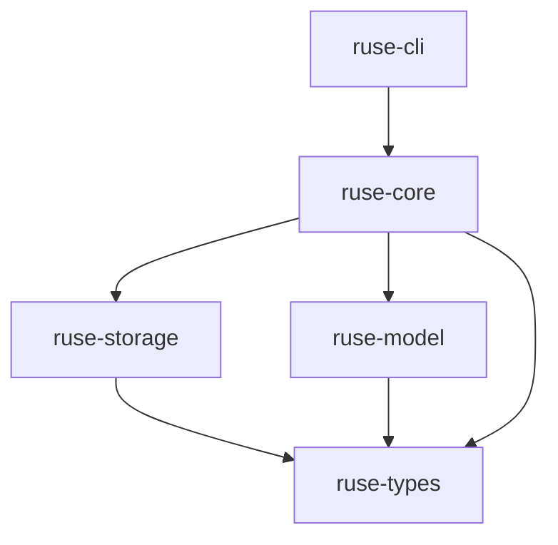

# M01-02 Event Model Spec

## Purpose

Define the typed event model for the Runtime Spine MVP. This slice creates the shared language used by the runtime, storage, replay, CLI, and future Desktop surfaces to describe agent execution without depending on provider-specific or UI-specific details.

## Product Context

Milestone 1 needs deterministic event replay before it can safely add storage, model simulation, and the turn engine. M01-02 defines the durable event envelope, domain identifiers, runtime states, actor metadata, payload taxonomy, serialization rules, and compatibility expectations that later M01 slices consume.

## Scope

M01-02 delivers the event model inside `ruse-types`:

- Domain ID newtypes.
- Event sequence type.
- Runtime actor model.
- Runtime event envelope.
- Event payload enum for the M01 runtime spine.
- Turn and task state enums.
- Error and warning event payloads.
- Serialization, deserialization, ordering, and schema-version contracts.
- Snapshot and round-trip tests for the event model.

The following capabilities are owned by later slices:

- M01-03 owns event persistence, SQLite, and replay store APIs.
- M01-04 owns model provider traits and fake model provider behavior.
- M01-05 owns turn engine orchestration.
- M02 owns tool registry, permission engine, sandbox, and audit policy.
- M03 owns CLI event rendering.

## Architecture

The event model belongs in `ruse-types` because every runtime crate needs to depend on it without creating dependency cycles.



M01-02 should keep `ruse-types` independent from runtime behavior. It defines data contracts only.

## File Layout

```text
crates/
  ruse-types/
    Cargo.toml
    src/
      lib.rs
      ids.rs
      actor.rs
      event.rs
      state.rs
      error.rs
      schema.rs
      timestamp.rs
    tests/
      event_json.rs
```

## Dependencies

M01-02 may add these dependencies to `ruse-types`:

| Dependency | Purpose |
|---|---|
| `serde` | Serialize and deserialize public data contracts. |
| `serde_json` | JSON tests and future storage payloads. |
| `uuid` | Stable UUID-backed IDs with serde support. |
| `time` | UTC timestamps with serde support. |
| `thiserror` | Typed error definitions for validation and conversion. |

The event model should not depend on Tokio, storage libraries, model SDKs, CLI libraries, or database drivers.

## Domain Identifiers

All IDs are strongly typed newtypes instead of raw strings:

| Type | Meaning |
|---|---|
| `WorkspaceId` | Workspace trust and policy boundary. |
| `SessionId` | UI/runtime connection boundary. |
| `ConversationId` | Durable conversation thread. |
| `TurnId` | One complete agent turn. |
| `TaskId` | Durable background or foreground task. |
| `AgentId` | Runtime agent role instance. |
| `TeamId` | Coordinated group of agents. |
| `EventId` | Unique event identity. |
| `CorrelationId` | Groups causally related events. |
| `CheckpointId` | Identifies a durable checkpoint snapshot. |

Each ID must support:

- `new()` for random creation.
- `from_uuid(uuid::Uuid)`.
- `as_uuid()`.
- `Display`.
- `FromStr`.
- `Serialize`.
- `Deserialize`.
- `Copy`, `Clone`, `Eq`, `PartialEq`, `Ord`, `PartialOrd`, `Hash`, `Debug`.

Serialized ID representation is a plain UUID string.

`causation_id` uses `Option<EventId>` in the event envelope instead of a separate ID type because it points to another concrete event.

## Schema Version

`SchemaVersion` is a compact numeric wrapper for durable event compatibility.

Rules:

- Version `1` is the only valid M01-02 schema version.
- Serialized representation is a positive integer.
- `SchemaVersion::current()` returns version `1`.
- Deserializing version `0` fails.
- Deserializing a future version succeeds only when the caller explicitly opts into future-version tolerance.

## Event Sequence

`EventSeq` is a monotonically increasing `u64` within a conversation event stream.

Rules:

- The first persisted event in a conversation has sequence `1`.
- Sequence `0` is invalid for persisted events.
- Storage assigns final sequence numbers in M01-03.
- In-memory event construction may use an unset sequence marker before persistence.

Recommended representation:

```rust
pub struct EventSeq(NonZeroU64);
```

## Actor Model

Every event records who or what caused it.

| Type | Meaning |
|---|---|
| `ActorKind::User` | Human user input or approval. |
| `ActorKind::Agent` | Runtime agent action. |
| `ActorKind::System` | Runtime-generated lifecycle event. |
| `ActorKind::Tool` | Tool executor event. |
| `ActorKind::Scheduler` | Background task scheduler event. |
| `ActorKind::Plugin` | Plugin-originated event. |
| `ActorKind::McpServer` | MCP-originated event. |

`ActorRef` fields:

- `kind`
- `id`
- `display_name`

`id` is a string because external actors may not use the runtime's UUID scheme. `display_name` is optional and safe for UI presentation.

## Runtime Event Envelope

Every durable event uses the same envelope:

```rust
pub struct RuntimeEvent {
    pub schema_version: SchemaVersion,
    pub id: EventId,
    pub seq: Option<EventSeq>,
    pub occurred_at: Timestamp,
    pub workspace_id: WorkspaceId,
    pub conversation_id: ConversationId,
    pub turn_id: Option<TurnId>,
    pub task_id: Option<TaskId>,
    pub agent_id: Option<AgentId>,
    pub team_id: Option<TeamId>,
    pub actor: ActorRef,
    pub correlation_id: CorrelationId,
    pub causation_id: Option<EventId>,
    pub payload: RuntimeEventPayload,
}
```

Rules:

- `schema_version` starts at `1`.
- `occurred_at` is UTC.
- `seq` is `None` before persistence and `Some(EventSeq)` after persistence.
- `conversation_id` is required for M01 events.
- `turn_id` is required for turn-scoped events and absent for workspace/session bootstrap events.
- `correlation_id` groups all events belonging to the same user request, task run, or replay.
- `causation_id` points to the direct triggering event when known.
- Event payloads must remain provider-agnostic and UI-agnostic.

## M01 Runtime Event Payloads

M01 only needs enough payloads to describe a deterministic fake turn and its replay path.

```rust
pub enum RuntimeEventPayload {
    WorkspaceOpened(WorkspaceOpened),
    SessionStarted(SessionStarted),
    ConversationStarted(ConversationStarted),
    UserInputReceived(UserInputReceived),
    TurnStarted(TurnStarted),
    TurnStateChanged(TurnStateChanged),
    ContextAssembled(ContextAssembled),
    ModelStreamStarted(ModelStreamStarted),
    ModelOutputDelta(ModelOutputDelta),
    ModelStreamCompleted(ModelStreamCompleted),
    FinalResponseProduced(FinalResponseProduced),
    TurnCompleted(TurnCompleted),
    TurnFailed(TurnFailed),
    TaskStateChanged(TaskStateChanged),
    CheckpointRecorded(CheckpointRecorded),
    ReplayStarted(ReplayStarted),
    ReplayCompleted(ReplayCompleted),
    RuntimeWarning(RuntimeWarning),
    RuntimeError(RuntimeError),
}
```

Payload field requirements:

| Payload | Required Fields |
|---|---|
| `WorkspaceOpened` | `root_path`, `trust_level` |
| `SessionStarted` | `client_kind`, `client_version` |
| `ConversationStarted` | `title` |
| `UserInputReceived` | `message` |
| `TurnStarted` | `input_summary` |
| `TurnStateChanged` | `from`, `to`, `reason` |
| `ContextAssembled` | `message_count`, `estimated_tokens` |
| `ModelStreamStarted` | `provider`, `model`, `request_id` |
| `ModelOutputDelta` | `delta` |
| `ModelStreamCompleted` | `finish_reason`, `output_token_count` |
| `FinalResponseProduced` | `message` |
| `TurnCompleted` | `final_state`, `summary` |
| `TurnFailed` | `state`, `error` |
| `TaskStateChanged` | `task_id`, `from`, `to`, `reason` |
| `CheckpointRecorded` | `checkpoint_id`, `label` |
| `ReplayStarted` | `source_conversation_id`, `source_turn_id` |
| `ReplayCompleted` | `source_conversation_id`, `source_turn_id`, `event_count` |
| `RuntimeWarning` | `code`, `message` |
| `RuntimeError` | `code`, `message`, `recoverable` |

## Supporting Enums

M01-02 also defines small enums used by event payloads:

| Enum | Values | Serialized Form |
|---|---|---|
| `WorkspaceTrustLevel` | `Trusted`, `Untrusted` | `trusted`, `untrusted` |
| `ClientKind` | `Cli`, `Desktop`, `Api`, `Test` | `cli`, `desktop`, `api`, `test` |
| `ModelFinishReason` | `Stop`, `Length`, `Cancelled`, `Error` | `stop`, `length`, `cancelled`, `error` |

## Turn State

M01 defines the full public turn state enum even though the first turn engine will use only part of it.

```text
Accepted
Prepared
ContextBuilt
ModelStreaming
ToolProposed
PermissionEvaluating
ToolExecuting
Observed
Finalizing
Persisted
Done
WaitingApproval
WaitingIo
Cancelled
Failed
Recovered
```

Rules:

- State names serialize as snake_case.
- `Done`, `Cancelled`, and `Failed` are terminal states.
- `WaitingApproval` and `WaitingIo` are resumable states.
- `Recovered` indicates a turn continued after checkpoint or replay reconstruction.

## Task State

M01 defines task state now because event envelopes already reference `TaskId`.

```text
Created
Queued
Running
WaitingApproval
Sleeping
Paused
Succeeded
Failed
Cancelled
Expired
```

Rules:

- State names serialize as snake_case.
- `Succeeded`, `Failed`, `Cancelled`, and `Expired` are terminal states.
- M01-02 only defines the enum; scheduler behavior is implemented in a later milestone.

## Timestamp

`Timestamp` wraps `time::OffsetDateTime`.

Rules:

- All timestamps are UTC.
- Serialized format is RFC 3339.
- Construction should provide `Timestamp::now_utc()`.
- Tests should use fixed timestamps for snapshots.

## Error Types

`AgentError` is the shared serializable runtime error shape:

```rust
pub struct AgentError {
    pub code: String,
    pub message: String,
    pub recoverable: bool,
}
```

`AgentError` is data, not the only Rust error type. Later crates can define richer internal errors and convert them into this stable event shape.

## Serialization Contract

The JSON event representation is the first durable wire format.

Rules:

- Struct fields serialize as `snake_case`.
- Enum variants serialize as `snake_case`.
- Payload enum uses internally tagged serde representation:

```rust
#[serde(tag = "type", content = "data")]
```

- Unknown fields should be ignored during deserialization when safe.
- Missing required fields should fail deserialization.
- Snapshot tests lock representative JSON for at least:
  - `UserInputReceived`
  - `TurnStateChanged`
  - `ModelOutputDelta`
  - `FinalResponseProduced`
  - `RuntimeError`

## Compatibility Policy

M01-02 starts schema version `1`.

Rules:

- Additive optional fields are allowed in version `1`.
- Renaming fields, changing enum serialized names, or changing ID formats requires a schema migration plan.
- Removing payload variants requires a schema migration plan.
- New payload variants are allowed when readers handle unknown future variants through migration-aware storage or version gates.

## Security and Privacy

- Event payloads may contain user text and model output; they are durable by design.
- Secret values must not be encoded in M01 event payloads.
- `root_path` is stored as a display path string for local-first debugging; later privacy modes may redact or relativize it.
- Error payloads should carry stable codes and human-readable messages, but not raw environment dumps.

## Testing Strategy

M01-02 tests must prove:

- ID newtypes round-trip through string, UUID, and JSON.
- `EventSeq` rejects zero.
- `Timestamp` serializes fixed UTC values as RFC 3339.
- Representative events round-trip through JSON.
- Representative event snapshots remain stable.
- Turn and task states serialize as snake_case.
- `RuntimeEvent` with `seq = None` can serialize before persistence.
- `RuntimeEvent` with `seq = Some(...)` can serialize after persistence.

## Acceptance Criteria

- `ruse-types` exposes the event model modules through `lib.rs`.
- `cargo test -p ruse-types` passes.
- `cargo test --workspace` passes after M01-02 implementation.
- Representative JSON snapshots are reviewed and committed.
- No runtime crate outside `ruse-types` defines duplicate ID, event, actor, or state types.

## Completion Signal

M01-02 is complete when the event model is implemented, tested, and ready for `M01-03-storage-replay` to persist and replay `RuntimeEvent` values without changing the public event contract.
