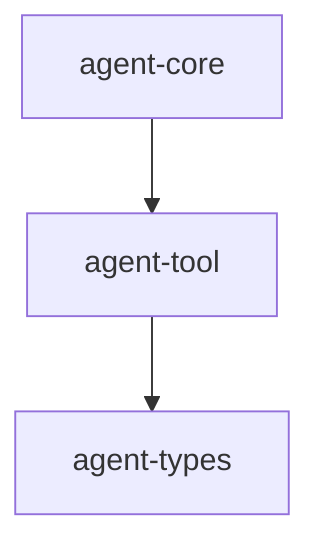

# M02-01 Tool Registry Spec

## Purpose

Introduce the provider-neutral tool kernel: typed tool definitions, JSON input/output contracts, validation, and duplicate-safe registry lookup.

## Product Context

This slice starts M02 Tool, Policy, and Audit Kernel. It gives the runtime one place to discover tools before policy decisions, sandboxing, audit records, or model-driven tool loops are added.

## Scope

This spec delivers:

- `agent-tool` crate
- tool name validation
- tool definition and JSON schema contract
- tool input/output envelopes
- `Tool` trait
- `ToolRegistry` registration and lookup
- duplicate registration rejection

Owned by other specs:

- permission decisions and leases: `M02-02-policy-engine`
- read-only filesystem tools: `M02-03-read-only-builtins`
- runtime audit event payloads: `M02-04-audit-trail`
- model-driven tool loop: `M02-05-tool-loop-integration`

## Architecture

`agent-tool` depends only on shared lower-level crates and does not depend on `agent-core`, `agent-policy`, or UI crates. The registry is deterministic and local-first.



## File Layout

```text
crates/
  agent-tool/
    Cargo.toml
    src/
      lib.rs
      definition.rs
      error.rs
      registry.rs
      tool.rs
    tests/
      registry.rs
Cargo.toml
```

## Public Contracts

```rust
pub struct ToolName(String);

pub struct ToolDefinition {
    pub name: ToolName,
    pub description: String,
    pub input_schema: serde_json::Value,
}

pub struct ToolInput {
    pub value: serde_json::Value,
}

pub struct ToolOutput {
    pub value: serde_json::Value,
}

pub trait Tool: Send + Sync {
    fn definition(&self) -> ToolDefinition;
    fn execute(&self, input: ToolInput) -> Result<ToolOutput, ToolError>;
}

pub struct ToolRegistry;
```

`ToolName` accepts lowercase ASCII names with digits, `_`, `-`, and `.`. Empty names and whitespace are invalid.

## State and Failure Handling

- Registry insertion succeeds once per tool name.
- Duplicate insertion returns `ToolRegistryError::DuplicateTool`.
- Unknown lookup returns `None`.
- Invalid tool names return typed validation errors.
- Tool execution errors stay local to `ToolError` until the audit slice maps them into runtime events.

## Security and Privacy

- Tool definitions may describe capabilities but do not grant permission.
- Tool input is untrusted JSON.
- Secrets must not be embedded in definitions or test fixtures.

## Testing Strategy

- unit tests for tool name validation
- registry tests for registration, lookup, and duplicate rejection
- execution test with an in-memory echo tool
- serialization test for stable public definition shape

## Acceptance Criteria

- `agent-tool` is a workspace crate.
- A test tool can be registered, looked up, and executed.
- Duplicate names are rejected deterministically.
- Workspace fmt, clippy, and tests pass.

## Completion Signal

M02-01 is complete when `agent-tool` exposes the public registry contracts and focused registry tests pass.
