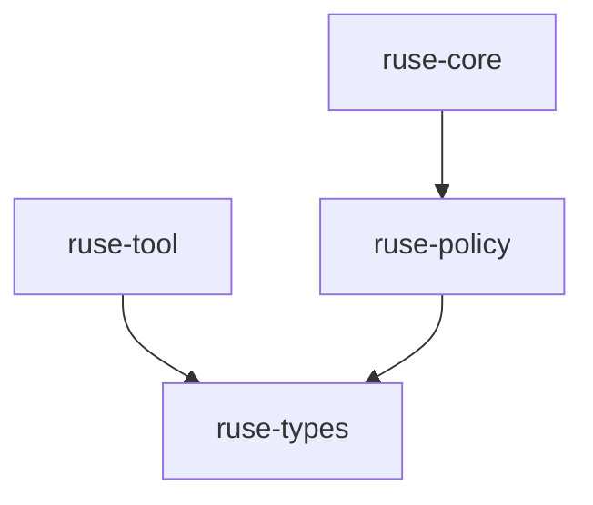

# M02-02 Policy Engine Spec

## Purpose

Introduce permission requests, deterministic policy decisions, and permission leases for tool execution.

## Product Context

This slice gives M02 a single authorization path. Tools can be discovered by `ruse-tool`, but execution must pass through `ruse-policy` before audit and runtime integration.

## Scope

This spec delivers:

- `ruse-policy` crate
- capability and resource scope contract
- `PermissionRequest`
- `PolicyDecision`
- `PermissionLease`
- static policy engine for deterministic tests
- allow, deny, and ask decisions

Owned by other specs:

- tool registry and tool execution contract: `M02-01-tool-registry`
- sandboxed read-only built-ins: `M02-03-read-only-builtins`
- policy audit event payloads: `M02-04-audit-trail`
- turn/tool loop integration: `M02-05-tool-loop-integration`

## Architecture

`ruse-policy` depends on `ruse-types` for actor, timestamp, and correlation IDs. It does not depend on `ruse-tool`; the integration layer maps tool definitions to permission requests.



## File Layout

```text
crates/
  ruse-policy/
    Cargo.toml
    src/
      lib.rs
      capability.rs
      decision.rs
      engine.rs
      error.rs
      lease.rs
      request.rs
    tests/
      policy_engine.rs
Cargo.toml
```

## Public Contracts

```rust
pub enum CapabilityAction {
    Read,
    Search,
    Execute,
    Network,
}

pub enum ResourceKind {
    File,
    Workspace,
    Command,
    Network,
    Tool,
}

pub struct ResourceScope {
    pub kind: ResourceKind,
    pub pattern: String,
}

pub struct PermissionRequest {
    pub id: String,
    pub actor: ruse_types::ActorRef,
    pub action: CapabilityAction,
    pub scope: ResourceScope,
    pub reason: String,
    pub correlation_id: ruse_types::CorrelationId,
}

pub enum PolicyDecision {
    Allow { reason: String },
    Deny { reason: String },
    Ask { reason: String },
}

pub struct PermissionLease {
    pub id: String,
    pub request_id: String,
    pub decision: PolicyDecision,
    pub issued_at: ruse_types::Timestamp,
}
```

## State and Failure Handling

- A policy engine returns exactly one decision per request.
- `Allow` may create a lease.
- `Deny` and `Ask` do not create executable leases in M02.
- Invalid request fields return typed `PolicyError`.

## Security and Privacy

- Default policy posture is `Ask`, not `Allow`.
- Decisions include reasons for audit.
- Requests must not carry secrets in `reason` or `pattern`.

## Testing Strategy

- unit tests for serializable request/decision shape
- static engine tests for allow, deny, ask
- lease tests for request linkage and timestamp presence
- default posture test proving unknown capabilities ask

## Acceptance Criteria

- `ruse-policy` is a workspace crate.
- Policy decisions are deterministic and serializable.
- Allow decisions can produce leases.
- Deny and ask decisions short-circuit execution in later integration.

## Completion Signal

M02-02 is complete when focused policy tests pass and public contracts are ready for `ruse-core` integration.
