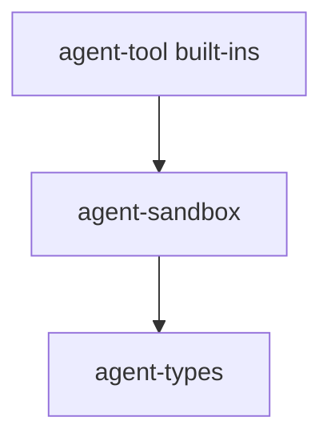

# M02-03 Read-Only Built-ins Spec

## Purpose

Add sandboxed read-only workspace tools that can be registered and executed without mutating the filesystem.

## Product Context

This slice makes the tool kernel useful while preserving a conservative M02 security posture. It provides local file read and text search tools behind path confinement.

## Scope

This spec delivers:

- `agent-sandbox` crate
- workspace path confinement
- read-only file tool
- text search tool
- tool definitions for built-ins
- read-only execution tests

Owned by other specs:

- registry contracts: `M02-01-tool-registry`
- policy decisions and leases: `M02-02-policy-engine`
- audit events: `M02-04-audit-trail`
- model tool loop: `M02-05-tool-loop-integration`

## Architecture

`agent-sandbox` owns path resolution and traversal rejection. `agent-tool` owns built-in tool implementations and calls the sandbox before reading files.



## File Layout

```text
crates/
  agent-sandbox/
    Cargo.toml
    src/
      lib.rs
      path.rs
    tests/
      path.rs
  agent-tool/
    src/
      builtins/
        mod.rs
        read_file.rs
        search_text.rs
    tests/
      read_only_builtins.rs
Cargo.toml
```

## Public Contracts

```rust
pub struct WorkspaceSandbox {
    pub root: std::path::PathBuf,
}

impl WorkspaceSandbox {
    pub fn resolve_read_path(&self, relative_path: &str) -> Result<std::path::PathBuf, SandboxError>;
}

pub struct ReadFileTool;
pub struct SearchTextTool;
```

Read file input:

```json
{ "path": "README.md" }
```

Search text input:

```json
{ "path": "src", "query": "RuntimeEvent" }
```

## State and Failure Handling

- Paths outside the workspace are rejected.
- Absolute paths are rejected unless they resolve under the workspace root.
- Missing files return typed tool errors.
- Search returns an empty result set when no match exists.

## Security and Privacy

- Built-ins are read-only.
- Symlink traversal must remain inside the workspace root.
- Tool output should cap large file contents in later context-management milestones; M02 only records raw output in tests with small fixtures.

## Testing Strategy

- sandbox tests for normal paths, `..`, absolute paths, and symlinks
- read file tests with temporary workspace fixtures
- search tests with deterministic fixture files
- no mutation test proving file metadata/content is unchanged

## Acceptance Criteria

- Read-only built-ins can be registered in `ToolRegistry`.
- Built-ins reject traversal outside the workspace.
- Built-ins return deterministic JSON output.
- Workspace fmt, clippy, and tests pass.

## Completion Signal

M02-03 is complete when read-only built-in tests pass and the tools are ready for policy/audit integration.
