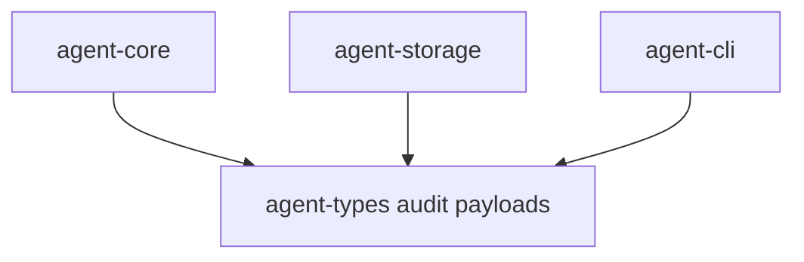

# M02-04 Audit Trail Spec

## Purpose

Add typed runtime events for tool proposals, permission decisions, execution results, and observations.

## Product Context

This slice makes tool behavior auditable and replayable. It extends the M01 event model so CLI and Desktop can later render a consistent tool timeline.

## Scope

This spec delivers:

- tool call audit payloads in `agent-types`
- permission request and decision audit payloads
- tool execution success and failure payloads
- stable JSON tests for new event variants
- ordered audit trace fixture

Owned by other specs:

- tool execution contract: `M02-01-tool-registry`
- policy contract: `M02-02-policy-engine`
- built-in tools: `M02-03-read-only-builtins`
- orchestration of tool loop events: `M02-05-tool-loop-integration`

## Architecture

Audit payloads live in `agent-types` because runtime events are durable and consumed by storage, core, CLI, Desktop, and replay. Higher-level crates construct these payloads but do not define durable event shape.



## File Layout

```text
crates/
  agent-types/
    src/
      event.rs
      tool.rs
      lib.rs
    tests/
      tool_audit_json.rs
```

## Public Contracts

```rust
pub struct ToolCallProposed {
    pub call_id: String,
    pub tool_name: String,
    pub input_json: serde_json::Value,
}

pub struct PermissionDecisionRecorded {
    pub request_id: String,
    pub decision: String,
    pub reason: String,
}

pub struct ToolExecutionCompleted {
    pub call_id: String,
    pub output_json: serde_json::Value,
}

pub struct ToolExecutionFailed {
    pub call_id: String,
    pub error_code: String,
    pub message: String,
    pub recoverable: bool,
}
```

`RuntimeEventPayload` gains variants for each audit payload.

## State and Failure Handling

- Tool proposal precedes permission decision.
- Allowed execution records start and completion or failure.
- Denied execution records a decision and no execution event.
- Unknown future variants remain schema-versioned through existing event envelope rules.

## Security and Privacy

- Audit events must not persist secrets.
- Tool inputs and outputs are untrusted JSON.
- Sensitive output redaction is a future policy layer; M02 fixtures must avoid secret-like values.

## Testing Strategy

- JSON snapshot-style tests for new payload variants
- event ordering test using in-memory store
- replay test proving audit events are not re-executed

## Acceptance Criteria

- New audit payloads serialize deterministically.
- Ordered audit fixtures can be persisted and replayed.
- M01 event JSON tests continue to pass.

## Completion Signal

M02-04 is complete when audit event contracts are covered and ready for core tool loop integration.
