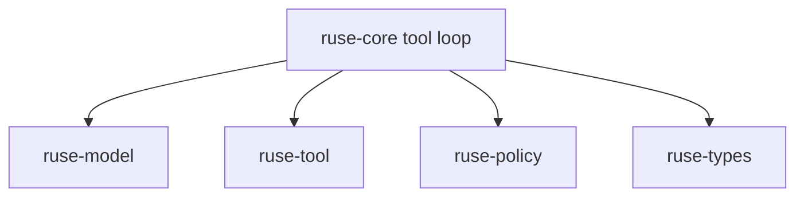

# M02-05 Tool Loop Integration Spec

## Purpose

Connect fake model tool proposals to registry lookup, policy decision, tool execution, audit events, and final observation.

## Product Context

This slice completes M02 by proving that the runtime can validate, authorize, execute, record, and observe a tool call without UI-specific logic.

## Scope

This spec delivers:

- model stream tool-call event
- core tool loop runner
- allow path execution
- deny path short circuit
- ask path deterministic waiting state
- persisted audit event order

Owned by other specs:

- registry contracts: `M02-01-tool-registry`
- policy contracts: `M02-02-policy-engine`
- read-only built-ins: `M02-03-read-only-builtins`
- audit payloads: `M02-04-audit-trail`

## Architecture

`ruse-core` orchestrates the loop by depending on `ruse-model`, `ruse-tool`, `ruse-policy`, and `ruse-types`. Tool implementations and policy engines stay replaceable through traits.



## File Layout

```text
crates/
  ruse-model/
    src/
      stream.rs
      fake.rs
    tests/
      fake_tool_call.rs
  ruse-core/
    src/
      tool_loop.rs
      lib.rs
    tests/
      tool_loop.rs
```

## Public Contracts

```rust
pub enum ModelStreamEvent {
    Started { request_id: String },
    Delta { text: String },
    ToolCall { call_id: String, tool_name: String, input_json: serde_json::Value },
    Completed { finish_reason: String, output_token_count: u32 },
}

pub struct ToolLoop;
```

The tool loop accepts a model stream, a registry, and a policy engine. It returns a `ToolLoopOutcome` with final observation text and emitted runtime events.

## State and Failure Handling

- Missing tool returns a recoverable runtime error event.
- Invalid input returns a tool validation event and no execution.
- Deny returns a deterministic denied outcome.
- Ask returns a waiting-approval state without executing.
- Allow records proposal, decision, execution start, completion, and observation.

## Security and Privacy

- Model tool calls are untrusted.
- Policy is evaluated before execution.
- Approval-required decisions never execute automatically.
- Tool output enters observation only after audit recording.

## Testing Strategy

- fake model emits a tool call
- allow decision executes read-only tool
- deny decision emits no execution event
- ask decision reaches waiting state
- audit events persist in expected order

## Acceptance Criteria

- A fake model can propose a tool call.
- Runtime validates, authorizes, executes, records, and observes the call.
- Denied and approval-required calls become deterministic runtime states.
- Workspace fmt, clippy, and tests pass.

## Completion Signal

M02-05 is complete when M02 acceptance criteria pass and the active focus can advance to M03.
