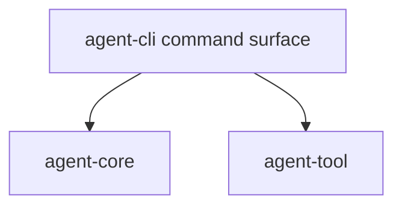

# M03-01 CLI TTY Shell Spec

## Purpose

Add a CLI command surface that can run in TTY, batch, and smoke-test modes while sharing runtime contracts with later Desktop clients.

## Product Context

This slice starts M03 Local Coding Loop. It gives users a practical command entry point before edit, shell, and Git tools are wired into the loop.

## Scope

This spec delivers:

- `agent-cli` library module for command parsing
- CLI mode detection for version, banner, batch prompt, and TTY shell
- slash command parsing for `/help`, `/status`, and `/exit`
- deterministic command output contract for tests
- CLI smoke tests that do not require a live model

Owned by other specs:

- file editing: `M03-02-file-edit-tool`
- shell command execution: `M03-03-shell-tool`
- Git inspection: `M03-04-git-tools`
- end-to-end local coding loop: `M03-05-local-coding-e2e`

## Architecture

`agent-cli` owns presentation and command parsing. Runtime orchestration remains in `agent-core`; CLI commands call typed runtime/tool contracts rather than embedding runtime behavior in `main.rs`.



## File Layout

```text
crates/
  agent-cli/
    src/
      lib.rs
      main.rs
      command.rs
      output.rs
    tests/
      cli_modes.rs
      slash_commands.rs
```

## Public Contracts

```rust
pub enum CliCommand {
    Version,
    RuntimeBanner,
    BatchPrompt { prompt: String },
    TtyShell,
}

pub enum SlashCommand {
    Help,
    Status,
    Exit,
}

pub struct CliOutput {
    pub stdout: String,
    pub exit: bool,
}
```

## State and Failure Handling

- `--version` prints version and exits.
- no args prints the runtime banner and exits.
- `--prompt <text>` runs deterministic batch mode and exits.
- slash commands never call model providers in this slice.
- unknown slash commands return a recoverable CLI error message.

## Security and Privacy

- CLI parsing treats all user input as untrusted text.
- No secrets are read from environment variables in this slice.
- TTY mode does not execute tools until later slices add permission gates.

## Testing Strategy

- parser unit tests for each `CliCommand`
- slash command tests for help/status/exit/unknown
- CLI binary tests for `--version`, no args, and `--prompt`
- output snapshot-style assertions using exact strings

## Acceptance Criteria

- CLI command parsing is test-covered.
- Existing version and runtime banner smoke tests still pass.
- Batch prompt mode returns deterministic output.
- Workspace fmt, clippy, and tests pass.

## Completion Signal

M03-01 is complete when CLI parser and slash command tests pass and active focus can advance to M03-02.
