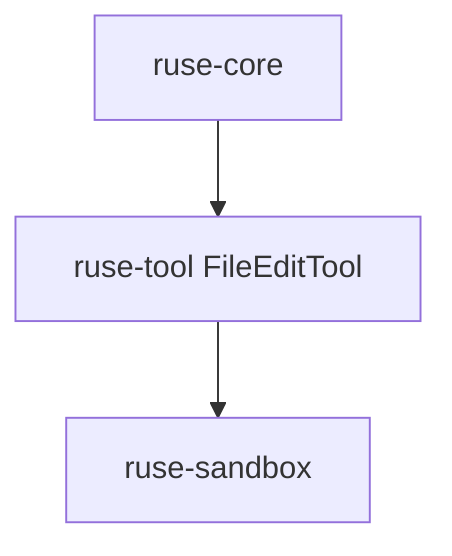

# M03-02 File Edit Tool Spec

## Purpose

Add a diff-oriented file edit tool that can preview and apply workspace-confined text edits with audit-friendly output.

## Product Context

This slice gives the local coding loop controlled file mutation. It builds on the tool registry and sandbox from M02 while keeping edits explicit and inspectable.

## Scope

This spec delivers:

- file edit request contract
- unified diff preview contract
- workspace-confined apply behavior
- create-or-replace file support
- rejection of path traversal
- focused tests for preview and apply

Owned by other specs:

- CLI presentation of diffs: `M03-05-local-coding-e2e`
- shell command execution: `M03-03-shell-tool`
- Git diff inspection: `M03-04-git-tools`

## Architecture

`ruse-tool` owns the edit tool and diff contract. `ruse-sandbox` continues to own workspace path confinement. `ruse-core` later orchestrates approval and audit around the tool call.



## File Layout

```text
crates/
  ruse-tool/
    src/
      builtins/
        edit_file.rs
        mod.rs
    tests/
      file_edit_tool.rs
```

## Public Contracts

```rust
pub struct FileEditTool;

pub struct FileEditRequest {
    pub path: String,
    pub expected: Option<String>,
    pub replacement: String,
    pub apply: bool,
}

pub struct FileEditResult {
    pub path: String,
    pub applied: bool,
    pub diff: String,
}
```

Tool input JSON:

```json
{ "path": "src/lib.rs", "expected": "old text", "replacement": "new text", "apply": false }
```

## State and Failure Handling

- preview mode returns a diff without changing files.
- apply mode writes only when `expected` matches current content if provided.
- mismatched expected content returns a typed validation error.
- traversal outside the workspace is rejected before file reads or writes.

## Security and Privacy

- File edits are workspace-confined.
- Tool output contains file content snippets only from explicit fixtures in tests.
- Future policy approval gates apply before mutation in integration slices.

## Testing Strategy

- preview test proves file content is unchanged
- apply test proves replacement content is written
- mismatch test proves no write occurs
- traversal test proves sandbox rejection
- registry test proves the tool can be registered

## Acceptance Criteria

- `FileEditTool` produces deterministic diff output.
- Apply mode mutates only the targeted workspace file.
- Workspace fmt, clippy, and tests pass.

## Completion Signal

M03-02 is complete when file edit tool tests pass and active focus can advance to M03-03.
