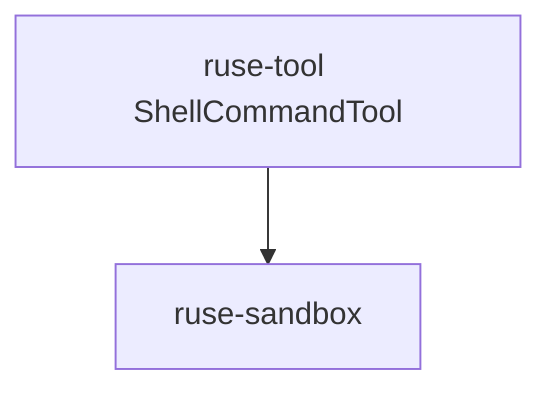

# M03-03 Shell Tool Spec

## Purpose

Add a controlled shell command tool with working directory confinement, timeout handling, and captured stdout/stderr.

## Product Context

This slice lets the local coding loop run approved verification commands. It keeps process execution explicit and auditable.

## Scope

This spec delivers:

- shell command request contract
- timeout and exit status capture
- cwd confinement under workspace root
- deterministic stdout/stderr output
- environment allowlist contract

Owned by other specs:

- approval UX: `M03-05-local-coding-e2e`
- Git-specific commands: `M03-04-git-tools`

## Architecture

`ruse-tool` owns `ShellCommandTool`. `ruse-sandbox` validates cwd. The tool uses `std::process::Command` with a timeout loop suitable for local tests.



## File Layout

```text
crates/
  ruse-tool/
    src/
      builtins/
        shell_command.rs
        mod.rs
    tests/
      shell_command_tool.rs
```

## Public Contracts

```rust
pub struct ShellCommandTool;

pub struct ShellCommandResult {
    pub status: i32,
    pub stdout: String,
    pub stderr: String,
    pub timed_out: bool,
}
```

Tool input JSON:

```json
{ "program": "cargo", "args": ["test"], "cwd": ".", "timeout_ms": 30000, "env": {} }
```

## State and Failure Handling

- timeout kills the process and returns `timed_out = true`.
- missing program returns a typed execution error.
- cwd outside the workspace is rejected.
- non-zero exit status is returned as data, not a tool framework error.

## Security and Privacy

- No shell string interpolation in this slice; commands are program plus args.
- Environment is empty except explicitly supplied allowlisted keys.
- cwd must resolve inside workspace root.

## Testing Strategy

- successful command test using a platform-safe command
- non-zero status test
- timeout test
- cwd traversal rejection test
- captured stdout/stderr exact assertions

## Acceptance Criteria

- Shell tool executes approved program/args with deterministic captured output.
- Timeout and non-zero status behavior are test-covered.
- Workspace fmt, clippy, and tests pass.

## Completion Signal

M03-03 is complete when shell tool tests pass and active focus can advance to M03-04.
