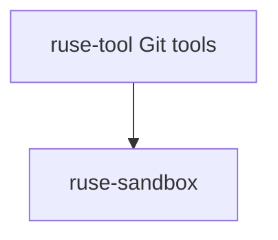

# M03-04 Git Tools Spec

## Purpose

Add read-only Git inspection tools for status and diff so the local coding loop can report repository state.

## Product Context

This slice gives the CLI coding loop repository awareness without adding mutation commands. It supports final summaries and audit-friendly changed-file reporting.

## Scope

This spec delivers:

- Git status tool
- Git diff tool
- cwd confinement
- deterministic fixture tests
- JSON output contracts for changed files and diff text

Owned by other specs:

- shell command tool: `M03-03-shell-tool`
- final local coding E2E summary: `M03-05-local-coding-e2e`

## Architecture

`ruse-tool` owns Git tools and may use `std::process::Command` to invoke `git`. `ruse-sandbox` validates repository cwd before execution.



## File Layout

```text
crates/
  ruse-tool/
    src/
      builtins/
        git_status.rs
        git_diff.rs
        mod.rs
    tests/
      git_tools.rs
```

## Public Contracts

```rust
pub struct GitStatusTool;
pub struct GitDiffTool;
```

Status output JSON:

```json
{ "files": [{ "path": "README.md", "status": "modified" }] }
```

Diff output JSON:

```json
{ "diff": "..." }
```

## State and Failure Handling

- non-Git directories return a typed execution error.
- status with no changes returns an empty file list.
- diff with no changes returns an empty string.
- cwd outside workspace is rejected.

## Security and Privacy

- Tools are read-only Git inspections.
- No Git mutation commands are introduced.
- Output may include file content from diffs; tests use non-sensitive fixtures.

## Testing Strategy

- fixture repository initialization test
- clean status test
- modified file status test
- diff output test
- cwd traversal rejection test

## Acceptance Criteria

- Git status and diff tools can be registered and executed.
- Output JSON is deterministic for fixture repositories.
- Workspace fmt, clippy, and tests pass.

## Completion Signal

M03-04 is complete when Git tool tests pass and active focus can advance to M03-05.
