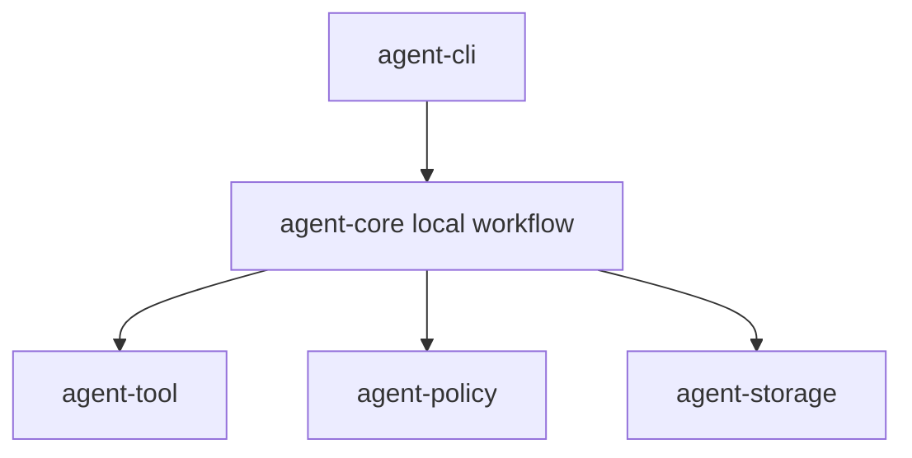

# M03-05 Local Coding E2E Spec

## Purpose

Connect CLI, tools, policy, audit events, and final reporting into a deterministic local coding workflow.

## Product Context

This slice completes M03 by proving a user can inspect a repository, preview/apply an edit, run an approved command, and receive an audit-aware summary.

## Scope

This spec delivers:

- local coding workflow fixture
- approved read/edit/shell/Git tool sequence
- denied command branch
- final summary contract
- persisted and replayable audit trail

Owned by other specs:

- checkpoint and trace replay commands: M04
- memory and context compaction: M05
- JSON UI bridge: M06

## Architecture

`agent-core` owns a deterministic local coding workflow runner for tests. `agent-cli` presents the result. Existing tool, policy, storage, and audit contracts remain replaceable.



## File Layout

```text
crates/
  agent-core/
    src/
      local_coding.rs
      lib.rs
    tests/
      local_coding_e2e.rs
  agent-cli/
    tests/
      local_coding.rs
```

## Public Contracts

```rust
pub struct LocalCodingOutcome {
    pub final_answer: String,
    pub changed_files: Vec<String>,
    pub command_results: Vec<String>,
    pub audit_event_count: usize,
}
```

## State and Failure Handling

- allow decisions execute tools and record audit events.
- denied commands do not execute and appear in final summary.
- workflow output is deterministic for fixture repositories.
- replay reconstructs final answer and audit count from events.

## Security and Privacy

- all side-effecting actions pass policy decisions.
- shell commands use program plus args, not shell interpolation.
- fixture repositories contain no secrets.

## Testing Strategy

- core E2E fixture test for read/edit/shell/Git sequence
- deny branch test
- replay final summary test
- CLI smoke test for local coding summary command
- full workspace verification

## Acceptance Criteria

- A user can inspect a repository, read files, propose edits, and run approved commands.
- Tool calls remain visible, permissioned, persisted, and replayable.
- CLI reports final answer, changed files, command results, and audit summary.
- Workspace fmt, clippy, and tests pass.

## Completion Signal

M03-05 is complete when M03 acceptance criteria pass and active focus can advance to M04.
