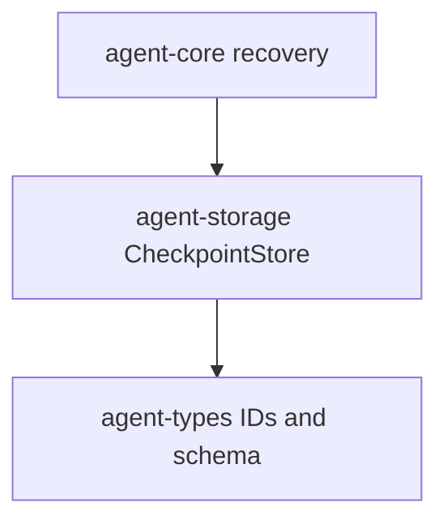

# M04-01 Checkpoint Store Spec

## Purpose

Add a durable checkpoint contract so a turn or task can record a compact recovery point tied to the event stream.

## Product Context

This slice starts M04 by giving recovery a stable storage primitive. Later M04 slices use checkpoints to avoid replaying an entire conversation and to resume after interrupted work.

## Scope

This spec delivers:

- `CheckpointRecord` durable data contract
- `CheckpointStore` trait
- in-memory checkpoint store for tests
- SQLite checkpoint table and store
- checkpoint lookup by conversation and turn

Owned by other specs:

- idempotency for side-effecting tool calls: `M04-02-idempotency`
- recovery planning and resume logic: `M04-03-recovery-flow`
- trace rendering: `M04-04-trace-commands`

## Architecture

`agent-storage` owns checkpoint persistence. `agent-types` already owns `CheckpointId`, `ConversationId`, `TurnId`, `EventSeq`, `SchemaVersion`, and `Timestamp`, so the checkpoint store should reuse those types rather than inventing string IDs.



## File Layout

```text
crates/
  agent-storage/
    src/
      checkpoint.rs
      lib.rs
      memory.rs
      sqlite.rs
    tests/
      checkpoint_store.rs
```

## Public Contracts

```rust
pub struct CheckpointRecord {
    pub checkpoint_id: CheckpointId,
    pub conversation_id: ConversationId,
    pub turn_id: Option<TurnId>,
    pub label: String,
    pub event_seq: EventSeq,
    pub state_json: serde_json::Value,
    pub schema_version: SchemaVersion,
    pub created_at: Timestamp,
}

pub trait CheckpointStore {
    fn put_checkpoint(&mut self, checkpoint: CheckpointRecord) -> Result<(), StorageError>;
    fn latest_checkpoint(
        &self,
        conversation_id: ConversationId,
        turn_id: Option<TurnId>,
    ) -> Result<Option<CheckpointRecord>, StorageError>;
}
```

## State and Failure Handling

- A checkpoint is immutable once stored.
- Duplicate `CheckpointId` values return `StorageError::DuplicateCheckpoint`.
- `label` must be non-empty.
- `event_seq` anchors the checkpoint to the last event included in the snapshot.
- SQLite writes use the same connection lifecycle as the existing event store.

## Security and Privacy

- `state_json` must not contain secrets in tests or fixture data.
- Checkpoints store runtime state only; they do not grant permissions or bypass policy.
- The checkpoint record must be serializable and inspectable for audit/debug flows.

## Testing Strategy

- checkpoint JSON serialization shape test
- in-memory put/latest tests
- SQLite put/latest tests
- duplicate checkpoint rejection test
- conversation and turn filtering test

## Acceptance Criteria

- `agent-storage` exposes `CheckpointRecord` and `CheckpointStore`.
- In-memory and SQLite checkpoint stores pass the same behavior tests.
- Existing event-store tests continue to pass.

## Completion Signal

M04-01 is complete when checkpoint store tests pass and active focus can advance to `M04-02-idempotency`.
