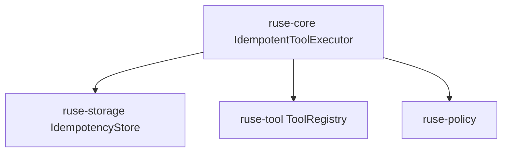

# M04-02 Idempotency Spec

## Purpose

Prevent completed side-effecting tool calls from running twice during retry or recovery.

## Product Context

M03 introduced editable files and shell commands. M04 must make retries safe by recording completed side effects and returning the recorded result when the same idempotency key is seen again.

## Scope

This spec delivers:

- `IdempotencyKey` contract
- `ToolEffectRecord` durable record
- `IdempotencyStore` trait
- idempotent tool execution wrapper in `ruse-core`
- tests proving duplicate side effects are skipped

Owned by other specs:

- checkpoint storage: `M04-01-checkpoint-store`
- recovery plan orchestration: `M04-03-recovery-flow`
- trace presentation: `M04-04-trace-commands`

## Architecture

`ruse-storage` owns the durable effect record. `ruse-core` owns orchestration that checks the store before executing a side-effecting tool. `ruse-tool` remains unaware of retry policy.



## File Layout

```text
crates/
  ruse-storage/
    src/
      idempotency.rs
      lib.rs
      memory.rs
      sqlite.rs
    tests/
      idempotency_store.rs
  ruse-core/
    src/
      idempotency.rs
      lib.rs
    tests/
      idempotent_tool_replay.rs
```

## Public Contracts

```rust
pub struct IdempotencyKey(String);

pub struct ToolEffectRecord {
    pub key: IdempotencyKey,
    pub call_id: String,
    pub tool_name: String,
    pub input_hash: String,
    pub output_json: serde_json::Value,
    pub completed_at: Timestamp,
}

pub trait IdempotencyStore {
    fn record_effect(&mut self, record: ToolEffectRecord) -> Result<(), StorageError>;
    fn get_effect(&self, key: &IdempotencyKey) -> Result<Option<ToolEffectRecord>, StorageError>;
}
```

## State and Failure Handling

- Reusing a key with the same input hash returns the recorded output.
- Reusing a key with a different input hash returns a validation error.
- A failed tool call is not recorded as a completed effect.
- Policy denial is not treated as a completed side effect.

## Security and Privacy

- `input_hash` stores a digest, not raw sensitive input.
- Recorded output follows existing tool-output privacy rules.
- Idempotency does not bypass permission checks for first execution.

## Testing Strategy

- key validation and serialization tests
- in-memory and SQLite effect-store tests
- idempotent tool executor returns recorded output on replay
- mismatched input hash test
- failed tool calls are not recorded

## Acceptance Criteria

- Completed side-effecting tool calls can be replayed without re-execution.
- Duplicate keys with incompatible input are rejected.
- Existing `ToolLoop` behavior remains intact for callers that do not use idempotency.

## Completion Signal

M04-02 is complete when idempotency store and idempotent execution tests pass and active focus can advance to `M04-03-recovery-flow`.
