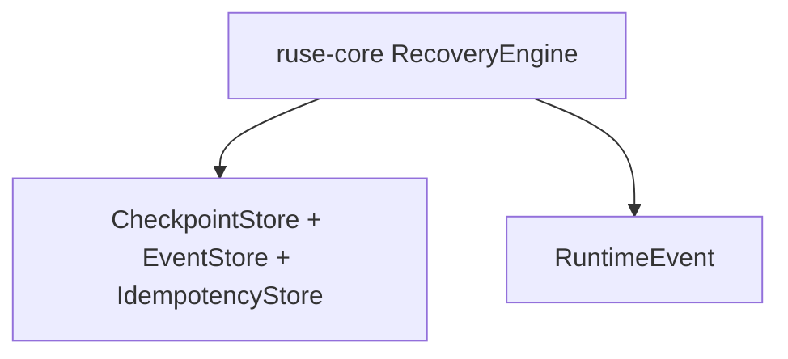

# M04-03 Recovery Flow Spec

## Purpose

Resume an interrupted turn from the latest checkpoint plus the event log tail.

## Product Context

This slice turns checkpoint and idempotency primitives into a recovery workflow. It is the first user-visible reliability path in M04, even though the UI remains test-oriented until trace commands land.

## Scope

This spec delivers:

- `RecoveryPlan` contract
- recovery planner that selects checkpoint plus replay cursor
- recovery runner that rebuilds derived state
- idempotency-aware resume path
- interrupted local coding fixture test

Owned by other specs:

- checkpoint persistence: `M04-01-checkpoint-store`
- idempotency storage and executor: `M04-02-idempotency`
- trace commands for user inspection: `M04-04-trace-commands`

## Architecture

`ruse-core` owns recovery planning and execution. It consumes `ruse-storage` traits and existing runtime events, but it does not depend on CLI or Desktop code.



## File Layout

```text
crates/
  ruse-core/
    src/
      recovery.rs
      lib.rs
    tests/
      recovery_flow.rs
```

## Public Contracts

```rust
pub struct RecoveryPlan {
    pub conversation_id: ConversationId,
    pub checkpoint_id: Option<CheckpointId>,
    pub replay_from: EventSeq,
    pub pending_call_ids: Vec<String>,
}

pub struct RecoveryOutcome {
    pub plan: RecoveryPlan,
    pub replayed_event_count: usize,
    pub resumed: bool,
}
```

## State and Failure Handling

- If a checkpoint exists, replay starts at `checkpoint.event_seq + 1`.
- If no checkpoint exists, replay starts at sequence `1`.
- Completed idempotent side effects are reused, not re-executed.
- Missing checkpoint references return a typed recovery error.
- Corrupt event payloads stop recovery with diagnostic context.

## Security and Privacy

- Recovery must not widen policy or sandbox permissions.
- Recovered state is derived from durable events and checkpoints only.
- Test fixtures must not include secrets in checkpoint state.

## Testing Strategy

- recovery plan without checkpoint
- recovery plan from latest checkpoint
- interrupted turn resumes from checkpoint plus tail events
- completed side-effecting call is not duplicated
- corrupt checkpoint or missing event returns recoverable error

## Acceptance Criteria

- Recovery can resume a fixture workflow from checkpoint plus event log.
- Replayed side effects are guarded by idempotency.
- The recovery result records how many events were replayed.

## Completion Signal

M04-03 is complete when recovery flow tests pass and active focus can advance to `M04-04-trace-commands`.
