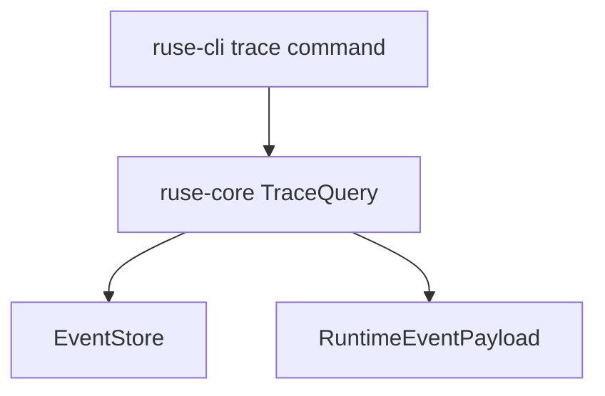

# M04-04 Trace Commands Spec

## Purpose

Expose model, tool, policy, checkpoint, recovery, and final-state traces in a deterministic CLI-readable form.

## Product Context

Once recovery exists, users and developers need a way to inspect what happened. This slice creates the trace query contract that later Desktop timeline views can consume through the UI bridge.

## Scope

This spec delivers:

- `TraceQuery` contract
- `TraceEntry` view model
- trace builder over runtime events
- CLI smoke command for a local trace fixture
- snapshot-style tests for trace output

Owned by other specs:

- UI bridge event schema: M06
- Desktop visual timeline: M10
- exported audit bundles: M12

## Architecture

`ruse-core` owns trace query and trace entry construction. `ruse-cli` owns text rendering. Storage remains behind `EventStore`.



## File Layout

```text
crates/
  ruse-core/
    src/
      trace.rs
      lib.rs
    tests/
      trace_query.rs
  ruse-cli/
    src/
      command.rs
    tests/
      trace_commands.rs
```

## Public Contracts

```rust
pub struct TraceQuery {
    pub conversation_id: ConversationId,
    pub include_tools: bool,
    pub include_policy: bool,
    pub include_checkpoints: bool,
    pub include_final: bool,
}

pub struct TraceEntry {
    pub seq: u64,
    pub kind: String,
    pub summary: String,
}
```

## State and Failure Handling

- Empty conversations return an empty trace.
- Unknown or unsupported event payloads render as `runtime_event` with a stable summary.
- CLI trace fixture failures print an explicit error.
- Trace rendering never executes tools or mutates storage.

## Security and Privacy

- Trace summaries redact secret-like values and do not render raw secret payloads.
- Tool outputs are summarized, not blindly dumped, unless a later export command requests full trace bundles.
- CLI output is deterministic for tests.

## Testing Strategy

- trace query filters tool and policy events
- checkpoint and final events render stable summaries
- CLI `--trace-summary` fixture output test
- empty trace test
- redaction test for secret-like metadata

## Acceptance Criteria

- Users can inspect tool, policy, checkpoint, recovery, and final response traces through CLI.
- Trace entries are stable enough for snapshot tests.
- The trace contract can later feed Desktop without depending on CLI formatting.

## Completion Signal

M04-04 is complete when trace query and CLI trace tests pass and active focus can advance to `M04-05-replay-compatibility`.
