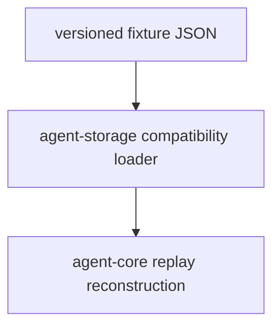

# M04-05 Replay Compatibility Spec

## Purpose

Add compatibility fixtures that prove old event traces, checkpoints, and recovery records can still replay after schema evolution.

## Product Context

The runtime is event-sourced. M04 closes by making replay compatibility an explicit quality gate before later milestones add memory, MCP, schedulers, subagents, Desktop, and plugins.

## Scope

This spec delivers:

- versioned replay fixture format
- old trace fixture for M01-M04 events
- compatibility replay test harness
- schema mismatch diagnostics
- M04 completion verification

Owned by other specs:

- schema migrations across all domains: M12
- audit export bundles: M12

## Architecture

`agent-storage` owns fixture loading and replay compatibility checks. `agent-core` owns derived-state reconstruction for runtime-level traces.



## File Layout

```text
crates/
  agent-storage/
    tests/
      replay_compatibility.rs
      fixtures/
        m04_trace_v1.json
  agent-core/
    tests/
      recovery_compatibility.rs
```

## Public Contracts

```rust
pub struct ReplayCompatibilityReport {
    pub fixture_name: String,
    pub event_count: usize,
    pub checkpoint_count: usize,
    pub compatible: bool,
}
```

## State and Failure Handling

- Fixture schema version must be explicit.
- Unsupported future fixture versions fail with a typed diagnostic.
- Missing required fixture fields fail before replay starts.
- Compatible old fixtures replay to the same final summary and audit count.

## Security and Privacy

- Fixtures contain no secrets, credentials, real user paths, or private repository content.
- Compatibility reports expose counts and summaries, not raw sensitive data.

## Testing Strategy

- fixture JSON parse test
- old trace replay test
- checkpoint fixture replay test
- unsupported future version diagnostic test
- M04 full workspace verification

## Acceptance Criteria

- At least one M04 fixture can be replayed from JSON.
- Replay compatibility failures produce useful diagnostics.
- M04 milestone status can be marked complete.

## Completion Signal

M04-05 is complete when replay compatibility tests pass, M04 is marked complete, and active focus can advance to M05.
