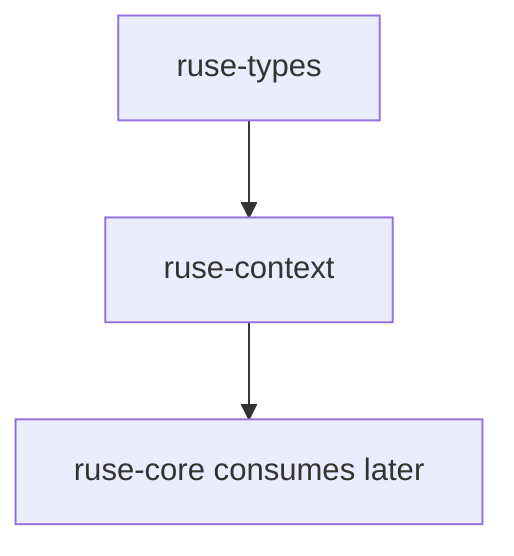

# M05-01 Prompt Layers Spec

## Purpose

Define deterministic prompt layer contracts so the runtime can assemble system, product, project, tool, memory, runtime, and user prompt content without UI-specific logic or provider-specific request shapes.

## Product Context

This slice starts M05 Context and Memory MVP. Later budget planning, compaction, and memory retrieval depend on prompt layers having stable ordering, typed metadata, and reproducible serialization.

## Scope

This spec delivers:

- `ruse-context` crate scaffold
- `PromptLayerKind`, `PromptLayer`, `PromptMessage`, and `PromptBundle` contracts
- deterministic prompt layer ordering by priority and insertion order
- input validation for empty IDs and empty content
- serialization tests for prompt layer contracts

Owned by other specs:

- token budget inclusion and truncation: M05-02
- pinned messages and compaction: M05-03
- memory records and retrieval: M05-04 and M05-05
- provider request formatting: model adapter milestones

## Architecture

`ruse-context` owns context assembly contracts and has no dependency on `ruse-core`, UI crates, storage, tools, or model providers. `ruse-core` can consume `PromptBundle` later, but this slice keeps orchestration out of the new crate.



## File Layout

```text
Cargo.toml
crates/
  ruse-context/
    Cargo.toml
    src/
      lib.rs
      prompt.rs
      error.rs
    tests/
      prompt_layers.rs
```

## Public Contracts

```rust
pub enum PromptLayerKind {
    System,
    Product,
    Project,
    Skill,
    Tool,
    Memory,
    Runtime,
    User,
}

pub struct PromptLayer {
    pub id: String,
    pub kind: PromptLayerKind,
    pub priority: i32,
    pub content: String,
    pub token_estimate: u32,
}

pub struct PromptMessage {
    pub role: String,
    pub content: String,
}

pub struct PromptBundle {
    pub layers: Vec<PromptLayer>,
    pub messages: Vec<PromptMessage>,
    pub estimated_tokens: u32,
}

pub fn assemble_prompt_bundle(layers: Vec<PromptLayer>) -> Result<PromptBundle, ContextError>;
```

Ordering rule: higher `priority` sorts first; ties preserve caller insertion order. Message roles derive from layer kind: `System`, `Product`, `Project`, `Skill`, `Tool`, `Memory`, and `Runtime` become `system`; `User` becomes `user`.

## State and Failure Handling

- Empty layer IDs fail with `ContextError::InvalidLayer`.
- Whitespace-only content fails with `ContextError::InvalidLayer`.
- Empty input returns an empty `PromptBundle`.
- The assembler is pure and has no side effects.

## Security and Privacy

- Prompt layers do not fetch files, memory, tools, or secrets.
- Secret redaction is not performed in this slice; producers must avoid placing raw secrets in layer content.
- Serialized prompt bundles are test fixtures only and are not persisted by this slice.

## Testing Strategy

- Unit tests prove deterministic ordering and tie stability.
- Serialization tests prove stable JSON shape for `PromptLayer`.
- Validation tests prove empty IDs and empty content are rejected.
- Crate dependency checks prove `ruse-context` does not depend on `ruse-core`.

## Acceptance Criteria

- `ruse-context` builds as a workspace crate.
- `assemble_prompt_bundle` returns deterministic message order.
- Invalid layers produce typed errors.
- `cargo test -p ruse-context prompt_layers` passes.

## Completion Signal

M05-01 is complete when prompt layer tests pass, `ruse-context` is in the workspace, and active focus advances to `M05-02-budget-planner`.
