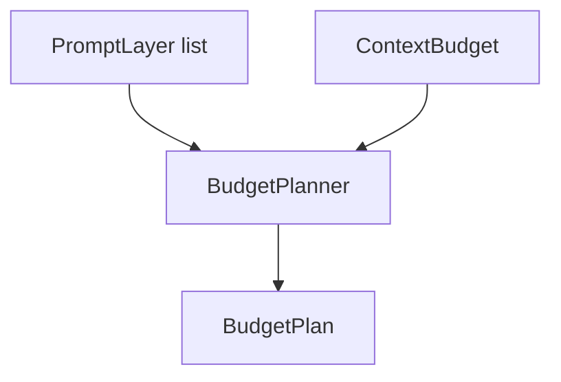

# M05-02 Budget Planner Spec

## Purpose

Add token budget planning for prompt layers so context assembly can select required content, fit optional content into a bounded budget, and report deterministic omissions.

## Product Context

M05-01 creates ordered prompt layers. This slice adds the budget gate that prevents context growth from overwhelming model limits and gives later compaction/memory slices a clear planning target.

## Scope

This spec delivers:

- `ContextBudget` contract
- `BudgetClass` and `BudgetDecision` contracts
- deterministic budget planner
- required-layer overflow diagnostics
- optional-layer omission reporting

Owned by other specs:

- actual compaction of omitted content: M05-03
- semantic memory retrieval ranking: later memory milestones
- provider-specific tokenizers: model adapter milestones

## Architecture

`agent-context` owns budget planning and uses token estimates already present on `PromptLayer`. The planner is deterministic and pure; it does not call a model tokenizer or mutate storage.



## File Layout

```text
crates/
  agent-context/
    src/
      budget.rs
      lib.rs
    tests/
      budget_planner.rs
```

## Public Contracts

```rust
pub struct ContextBudget {
    pub max_tokens: u32,
    pub reserved_response_tokens: u32,
}

pub enum BudgetClass {
    Required,
    Optional,
}

pub struct BudgetItem {
    pub layer: PromptLayer,
    pub class: BudgetClass,
}

pub enum BudgetDecision {
    Included,
    Omitted { reason: String },
}

pub struct BudgetPlan {
    pub included: Vec<PromptLayer>,
    pub omitted: Vec<(PromptLayer, String)>,
    pub used_tokens: u32,
    pub available_tokens: u32,
}

pub fn plan_context_budget(
    budget: ContextBudget,
    items: Vec<BudgetItem>,
) -> Result<BudgetPlan, ContextError>;
```

Available prompt tokens equal `max_tokens - reserved_response_tokens`. Required items must fit or the planner returns an error. Optional items are included in input order while capacity remains.

## State and Failure Handling

- `max_tokens <= reserved_response_tokens` fails with `ContextError::InvalidBudget`.
- A required layer that exceeds available capacity fails with `ContextError::BudgetExceeded`.
- Optional layers that do not fit are omitted with reason `budget_exceeded`.
- Empty items return a plan with zero used tokens.

## Security and Privacy

- Omitted content reasons do not include layer content.
- Planner does not inspect or redact prompt text.
- Budget reports may be persisted later but this slice only returns in-memory values.

## Testing Strategy

- Budget allocation tests prove required layers are included first.
- Overflow tests prove required overflow fails.
- Optional omission tests prove deterministic omitted order and reasons.
- Serialization tests prove `ContextBudget` shape.

## Acceptance Criteria

- `plan_context_budget` produces deterministic included/omitted sets.
- Required overflow is a typed error.
- Optional overflow does not fail the turn.
- `cargo test -p agent-context budget_planner` passes.

## Completion Signal

M05-02 is complete when budget planner tests pass and active focus advances to `M05-03-pinning-compact`.
