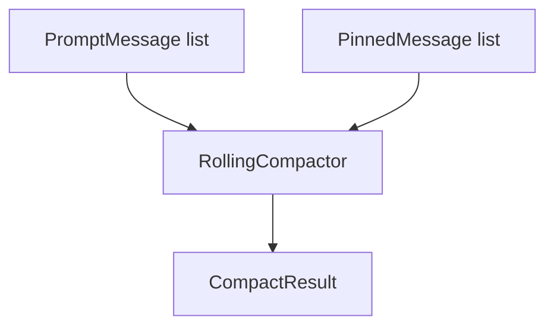

# M05-03 Pinning and Compact Spec

## Purpose

Add pinned message and rolling compaction contracts so long conversations can shrink context while preserving explicit constraints, user instructions, and recovery-critical facts.

## Product Context

Budget planning can omit optional layers, but the runtime still needs a deterministic way to keep pinned constraints and summarize older messages. This slice provides the first compact strategy for M05.

## Scope

This spec delivers:

- `PinnedMessage` contract
- `CompactionSummary` contract
- `CompactRequest` and `CompactResult` contracts
- deterministic rolling compactor
- validation that pinned messages survive compaction

Owned by other specs:

- semantic compression and hierarchical summaries: later context milestones
- model-assisted summaries: provider milestones
- memory storage of summaries: M05-04 and later

## Architecture

`agent-context` owns compaction contracts. The initial compactor is deterministic and extractive: it preserves pins and joins compactable message snippets into a bounded summary without calling a model.



## File Layout

```text
crates/
  agent-context/
    src/
      compact.rs
      lib.rs
    tests/
      pinning_compact.rs
```

## Public Contracts

```rust
pub struct PinnedMessage {
    pub id: String,
    pub reason: String,
    pub message: PromptMessage,
}

pub struct CompactionSummary {
    pub text: String,
    pub source_message_count: usize,
    pub estimated_tokens: u32,
}

pub struct CompactRequest {
    pub messages: Vec<PromptMessage>,
    pub pinned: Vec<PinnedMessage>,
    pub max_summary_tokens: u32,
}

pub struct CompactResult {
    pub pinned: Vec<PinnedMessage>,
    pub summary: Option<CompactionSummary>,
    pub dropped_message_count: usize,
}

pub fn compact_messages(request: CompactRequest) -> Result<CompactResult, ContextError>;
```

## State and Failure Handling

- Duplicate pinned IDs fail with `ContextError::InvalidPin`.
- `max_summary_tokens == 0` fails when non-pinned messages need a summary.
- Empty messages and empty pins return an empty result.
- Pinned messages are never dropped or rewritten.

## Security and Privacy

- Compaction does not summarize secrets differently from other text; upstream producers must avoid raw secrets.
- Summary text is deterministic and suitable for replay fixtures.
- Pin reasons are audit-friendly and must not include secret values.

## Testing Strategy

- Pin preservation tests prove pins survive in original order.
- Summary stability tests prove repeated compaction returns identical text.
- Duplicate pin tests prove typed failure.
- Budget tests prove summary token estimate stays within `max_summary_tokens`.

## Acceptance Criteria

- Long message lists compact into a deterministic summary.
- Pinned messages survive compaction unchanged.
- Invalid pin input fails with typed diagnostics.
- `cargo test -p agent-context pinning_compact` passes.

## Completion Signal

M05-03 is complete when pinning and compaction tests pass and active focus advances to `M05-04-conversation-memory`.
