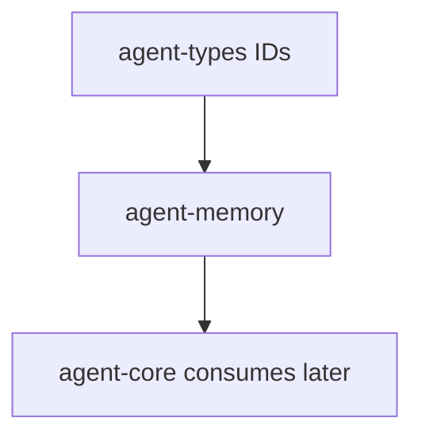

# M05-04 Conversation Memory Spec

## Purpose

Add conversation-scoped memory records and retrieval so a conversation can persist durable facts, decisions, and preferences without mixing them into project-wide memory.

## Product Context

Prompt assembly and compaction create bounded context. This slice adds the first memory store scope used by later turns in the same conversation.

## Scope

This spec delivers:

- `agent-memory` crate scaffold
- `MemoryRecord`, `MemoryScope`, `MemorySensitivity`, and `MemorySource` contracts
- in-memory conversation memory store
- add, retrieve, and delete behavior for conversation scope
- stable serialization tests for memory records

Owned by other specs:

- project-scoped memory and audit: M05-05
- semantic embeddings and reranking: later memory milestones
- import/export: M12

## Architecture

`agent-memory` owns memory contracts and retrieval behavior. It depends on `agent-types` for typed IDs and does not depend on `agent-core`, `agent-context`, UI crates, or model providers.



## File Layout

```text
Cargo.toml
crates/
  agent-memory/
    Cargo.toml
    src/
      lib.rs
      record.rs
      store.rs
      error.rs
    tests/
      conversation_memory.rs
```

## Public Contracts

```rust
pub enum MemoryScope {
    Conversation(ConversationId),
    Project { workspace_id: WorkspaceId },
}

pub enum MemorySensitivity {
    Public,
    Internal,
    Sensitive,
}

pub struct MemorySource {
    pub event_id: Option<EventId>,
    pub description: String,
}

pub struct MemoryRecord {
    pub id: String,
    pub scope: MemoryScope,
    pub text: String,
    pub source: MemorySource,
    pub confidence: u8,
    pub sensitivity: MemorySensitivity,
}

pub trait MemoryStore {
    fn add(&mut self, record: MemoryRecord) -> Result<(), MemoryError>;
    fn list(&self, scope: &MemoryScope) -> Result<Vec<MemoryRecord>, MemoryError>;
    fn delete(&mut self, scope: &MemoryScope, id: &str) -> Result<bool, MemoryError>;
}
```

## State and Failure Handling

- Empty memory IDs fail with `MemoryError::InvalidRecord`.
- Empty text fails with `MemoryError::InvalidRecord`.
- Confidence must be `1..=100`.
- Duplicate IDs within the same scope fail with `MemoryError::DuplicateRecord`.
- Delete returns `false` when no record exists.

## Security and Privacy

- `MemorySensitivity::Sensitive` records are stored but not automatically injected into prompts by this slice.
- Retrieval by scope prevents conversation memory from leaking into other conversations.
- Source descriptions must not contain secrets.

## Testing Strategy

- Conversation add/list/delete tests.
- Scope isolation tests using two `ConversationId` values.
- Validation tests for empty text and invalid confidence.
- Stable JSON shape test for `MemoryRecord`.

## Acceptance Criteria

- `agent-memory` builds as a workspace crate.
- Conversation memory can be added, retrieved by scope, and deleted.
- Memory records are serializable and scoped.
- `cargo test -p agent-memory conversation_memory` passes.

## Completion Signal

M05-04 is complete when conversation memory tests pass and active focus advances to `M05-05-project-memory`.
