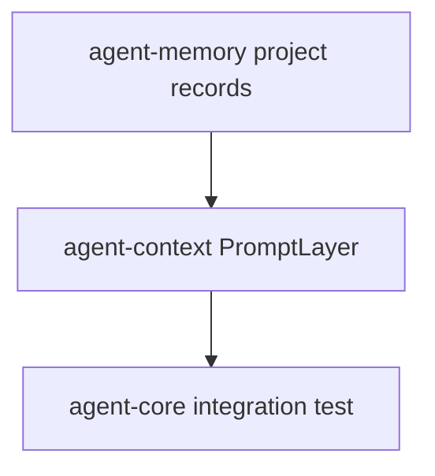

# M05-05 Project Memory Spec

## Purpose

Add project-scoped memory with audit events so durable project knowledge can be added, retrieved, and deleted under a workspace boundary.

## Product Context

M05 closes when scoped memory can support real project workflows. Conversation memory is private to one thread; project memory must be workspace-scoped, auditable, and safe to delete.

## Scope

This spec delivers:

- project memory operations over `MemoryScope::Project`
- `MemoryAuditEntry` contract
- audit emission for add and delete
- integration tests proving project memory can feed context assembly
- M05 completion verification

Owned by other specs:

- long-term user preference memory: later memory milestones
- memory import/export and retention controls: M12
- vector search and semantic retrieval: later memory milestones

## Architecture

`agent-memory` owns project memory storage behavior. `agent-core` owns integration tests that combine project memory records with prompt layers through `agent-context`.



## File Layout

```text
crates/
  agent-memory/
    src/
      audit.rs
      lib.rs
    tests/
      project_memory.rs
  agent-core/
    tests/
      m05_context_memory_integration.rs
```

## Public Contracts

```rust
pub enum MemoryAuditAction {
    Added,
    Deleted,
}

pub struct MemoryAuditEntry {
    pub action: MemoryAuditAction,
    pub scope: MemoryScope,
    pub record_id: String,
    pub reason: String,
}

pub trait AuditedMemoryStore: MemoryStore {
    fn audit_entries(&self) -> Vec<MemoryAuditEntry>;
}
```

Project memory uses `MemoryScope::Project { workspace_id }`. Add and successful delete operations append audit entries. Failed validation does not append audit entries.

## State and Failure Handling

- Project records are isolated by `WorkspaceId`.
- Duplicate IDs within the same project scope fail.
- Delete returns `false` and emits no audit entry when the record does not exist.
- Audit entries are returned in operation order.

## Security and Privacy

- Project memory is workspace-scoped and must not leak across workspaces.
- Sensitive project memory is retrievable by explicit memory APIs but is not automatically injected into prompt bundles by this slice.
- Audit entries include IDs, scopes, actions, and reasons, not raw memory text.

## Testing Strategy

- Project add/list/delete tests.
- Workspace isolation tests.
- Audit tests for add/delete order.
- Core integration test converts project memory into `PromptLayerKind::Memory` and assembles a deterministic prompt bundle.
- Full workspace verification closes M05.

## Acceptance Criteria

- Project memory can be added, retrieved, audited, and deleted.
- Project memory can contribute deterministic memory prompt layers.
- M05 milestone status is marked complete.
- `cargo test --workspace m05_context_memory` passes.

## Completion Signal

M05-05 is complete when project memory and integration tests pass, M05 is marked complete, and active focus advances to M06 planning or implementation.
