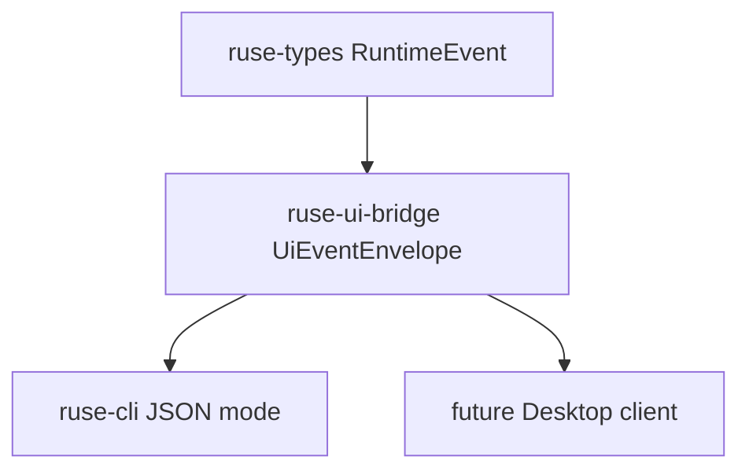

# M06-01 UI Event Schema Spec

## Purpose

Create the UI bridge crate and define the stable UI event schema that CLI JSON mode and Desktop clients consume.

## Product Context

M06 turns runtime events into UI-facing contracts. This slice creates the read side of that bridge: typed, serializable UI events derived from existing `RuntimeEvent` values without linking UI clients directly to `ruse-core`.

## Scope

This spec delivers:

- `ruse-ui-bridge` crate scaffold
- `UiEventEnvelope`
- `UiEventPayload`
- `UiDiagnosticLevel`
- `normalize_runtime_event`
- focused tests for JSON shape, runtime normalization, and redaction-safe tool events

Owned by other specs:

- UI command schema: `M06-02-ui-command-schema`
- NDJSON CLI mode: `M06-03-cli-json-mode`
- wider bridge snapshot fixtures: `M06-04-bridge-snapshots`

## Architecture

`ruse-ui-bridge` depends on `ruse-types` and owns UI-facing wire contracts. It must not depend on `ruse-core`, `ruse-cli`, Desktop code, storage, model providers, or tool execution crates.



## File Layout

```text
crates/
  ruse-ui-bridge/
    Cargo.toml
    src/
      lib.rs
      event.rs
      error.rs
    tests/
      ui_event_schema.rs
```

## Public Contracts

```rust
pub struct UiEventEnvelope {
    pub schema_version: SchemaVersion,
    pub event_id: EventId,
    pub seq: Option<EventSeq>,
    pub occurred_at: Timestamp,
    pub conversation_id: ConversationId,
    pub turn_id: Option<TurnId>,
    pub task_id: Option<TaskId>,
    pub correlation_id: CorrelationId,
    pub payload: UiEventPayload,
}

#[serde(tag = "type", content = "data", rename_all = "snake_case")]
pub enum UiEventPayload {
    Workspace { root_path: String, trust_level: String },
    Session { client_kind: String, client_version: String },
    UserMessage { message: String },
    TurnState { state: TurnState, reason: String },
    ModelDelta { delta: String },
    FinalResponse { message: String },
    ToolCall { call_id: String, tool_name: String },
    ToolResult { call_id: String, ok: bool, summary: String },
    Permission { request_id: String, decision: String, reason: String },
    Checkpoint { checkpoint_id: CheckpointId, label: String },
    Diagnostic {
        level: UiDiagnosticLevel,
        code: String,
        message: String,
        recoverable: bool,
    },
    Progress { message: String },
}

#[serde(rename_all = "snake_case")]
pub enum UiDiagnosticLevel {
    Warning,
    Error,
}

pub fn normalize_runtime_event(event: &RuntimeEvent) -> UiEventEnvelope;
```

Normalization keeps runtime identity fields intact and maps payload details to UI-safe summaries. Tool input and output JSON are not copied into UI events in this slice.

## State and Failure Handling

- Normalization is pure and deterministic.
- Unknown or low-value runtime events become `UiEventPayload::Progress`.
- Runtime warnings and errors become `Diagnostic` payloads.
- Tool execution failures become `ToolResult { ok: false, summary }`.

## Security and Privacy

- UI events must not expose raw tool input JSON, raw tool output JSON, secrets, or provider-specific private metadata.
- UI clients receive event identity, correlation, safe summaries, and progress data.
- Serialization must use snake_case payload tags for compatibility.

## Testing Strategy

- Unit/integration tests in `ruse-ui-bridge` validate stable JSON shape.
- Runtime normalization tests build deterministic `RuntimeEvent` fixtures.
- Tool call tests assert raw secret-like input values are absent from serialized UI events.

## Acceptance Criteria

- `ruse-ui-bridge` is a workspace member.
- UI event contracts serialize and deserialize.
- `normalize_runtime_event` maps core runtime events into UI-safe payloads.
- `cargo test -p ruse-ui-bridge ui_event_schema` passes.

## Completion Signal

M06-01 is complete when the UI event schema is implemented, focused tests pass, and the active focus advances to `M06-02-ui-command-schema`.
