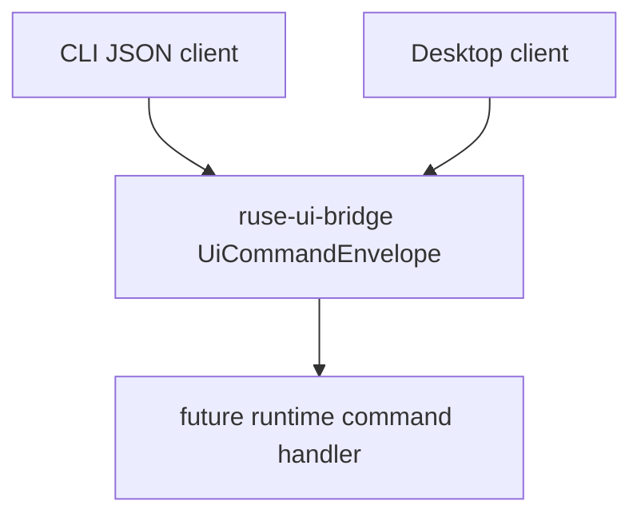

# M06-02 UI Command Schema Spec

## Purpose

Define the stable command schema that CLI JSON clients and Desktop clients use to request runtime actions.

## Product Context

After M06-01 exposes UI events, the bridge needs a write-side contract. This slice defines typed UI commands without executing them yet, so command validation can be tested separately from runtime orchestration.

## Scope

This spec delivers:

- `UiCommandEnvelope`
- `UiClientInfo`
- `UiCommand`
- `UiPermissionDecision`
- deserialization and rejection tests for command JSON

Owned by other specs:

- mapping commands into real runtime actions: later M06 or post-M06 orchestration slices
- CLI JSON streaming output: `M06-03-cli-json-mode`
- Desktop command wiring: M10

## Architecture

Command contracts live in `ruse-ui-bridge`. They depend on `ruse-types` IDs and state filters, but they do not depend on `ruse-core`.



## File Layout

```text
crates/
  ruse-ui-bridge/
    src/
      command.rs
      lib.rs
    tests/
      ui_command_schema.rs
```

## Public Contracts

```rust
pub struct UiCommandEnvelope {
    pub schema_version: SchemaVersion,
    pub command_id: CorrelationId,
    pub client: UiClientInfo,
    pub command: UiCommand,
}

pub struct UiClientInfo {
    pub kind: ClientKind,
    pub version: String,
}

#[serde(tag = "type", content = "data", rename_all = "snake_case")]
pub enum UiCommand {
    StartTurn {
        workspace_id: WorkspaceId,
        conversation_id: ConversationId,
        prompt: String,
    },
    CancelTurn {
        conversation_id: ConversationId,
        turn_id: TurnId,
        reason: String,
    },
    PermissionResponse {
        request_id: String,
        decision: UiPermissionDecision,
        reason: String,
    },
    TraceRequest {
        conversation_id: ConversationId,
        include_tools: bool,
        include_policy: bool,
        include_checkpoints: bool,
        include_final: bool,
    },
    Ping,
}

#[serde(rename_all = "snake_case")]
pub enum UiPermissionDecision {
    Allow,
    Deny,
}
```

Command structs use `#[serde(deny_unknown_fields)]` where practical. Empty prompts, empty permission request IDs, and empty reasons are rejected by explicit validation helpers.

## State and Failure Handling

- Deserialization rejects unknown command types.
- Validation rejects empty user-controlled strings where an action would be ambiguous.
- Invalid command payloads do not reach runtime execution.
- Command IDs are correlation IDs so request/response flows can be traced.

## Security and Privacy

- Commands are untrusted input.
- Permission responses must carry a human/client reason.
- Commands declare intent only; they do not grant capabilities or bypass policy.

## Testing Strategy

- JSON round-trip tests for each command variant.
- Invalid command type deserialization tests.
- Validation tests for empty prompt, empty permission request ID, and empty cancellation reason.
- Snapshot-style JSON assertions using `serde_json::json!`.

## Acceptance Criteria

- UI command contracts are exported from `ruse-ui-bridge`.
- Command JSON shape is stable and snake_case.
- Invalid commands fail before runtime execution.
- `cargo test -p ruse-ui-bridge ui_command_schema` passes.

## Completion Signal

M06-02 is complete when command contracts and validation tests pass, and active focus advances to `M06-03-cli-json-mode`.
