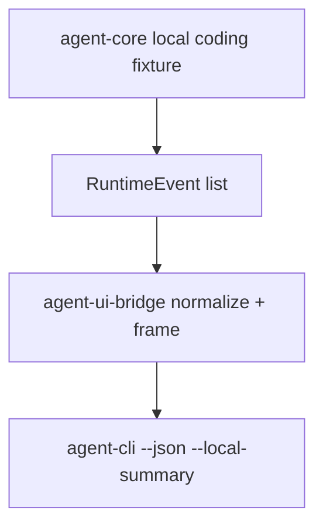

# M06-03 CLI JSON Mode Spec

## Purpose

Add CLI JSON mode that emits newline-delimited UI bridge frames for automation and future Desktop integration.

## Product Context

The CLI already has deterministic text commands. This slice adds a machine-facing mode over the same runtime data, proving that CLI and UI clients can consume one normalized bridge contract.

## Scope

This spec delivers:

- `OutputMode`
- `CliInvocation`
- `parse_cli_invocation`
- JSON output mode for `--local-summary`
- `UiJsonFrame`
- JSON line encoding helpers
- CLI tests that parse emitted lines back into typed bridge frames

Owned by other specs:

- UI event schema: `M06-01-ui-event-schema`
- command schema: `M06-02-ui-command-schema`
- snapshot coverage for a broader set of events: `M06-04-bridge-snapshots`

## Architecture

`agent-cli` depends on `agent-ui-bridge` only at the UI boundary. Runtime fixture execution stays in `agent-core`; normalization and JSON frame shape stay in `agent-ui-bridge`.



## File Layout

```text
crates/
  agent-ui-bridge/
    src/
      frame.rs
      lib.rs
    tests/
      json_frame.rs
  agent-cli/
    Cargo.toml
    src/
      command.rs
      main.rs
    tests/
      json_mode.rs
```

## Public Contracts

```rust
#[serde(tag = "type", content = "data", rename_all = "snake_case")]
pub enum UiJsonFrame {
    Event(UiEventEnvelope),
    Done { event_count: u64 },
    Error { code: String, message: String, recoverable: bool },
}

pub fn encode_json_frame(frame: &UiJsonFrame) -> Result<String, UiBridgeError>;

#[derive(Copy, Clone, Debug, Eq, PartialEq)]
pub enum OutputMode {
    Text,
    Json,
}

#[derive(Clone, Debug, Eq, PartialEq)]
pub struct CliInvocation {
    pub command: CliCommand,
    pub output_mode: OutputMode,
}

pub fn parse_cli_invocation<I, S>(args: I) -> Result<CliInvocation, CliError>
where
    I: IntoIterator<Item = S>,
    S: Into<String>;
```

`--json` is an output mode flag. `--json --local-summary` emits one JSON frame per normalized runtime event followed by a `done` frame.

## State and Failure Handling

- Text mode behavior remains backward compatible.
- JSON mode emits parseable lines; each line is one JSON object.
- Render failures emit an `error` frame when possible.
- CLI argument errors still exit with code 2 through `main`.

## Security and Privacy

- JSON mode must use `agent-ui-bridge` normalization so raw tool input/output remains excluded.
- The CLI must not invent a second JSON shape outside the bridge.

## Testing Strategy

- CLI parser tests for `--json --local-summary`.
- CLI render tests parse each output line into `UiJsonFrame`.
- Existing text mode tests continue to pass unchanged.
- Frame encoding tests prove no extra trailing data inside a line.

## Acceptance Criteria

- `agent-cli --json --local-summary` prints NDJSON bridge frames.
- Existing text commands still render the same output.
- `cargo test -p agent-cli json_mode` and `cargo test -p agent-ui-bridge json_frame` pass.

## Completion Signal

M06-03 is complete when CLI JSON mode is implemented over bridge frames and active focus advances to `M06-04-bridge-snapshots`.
