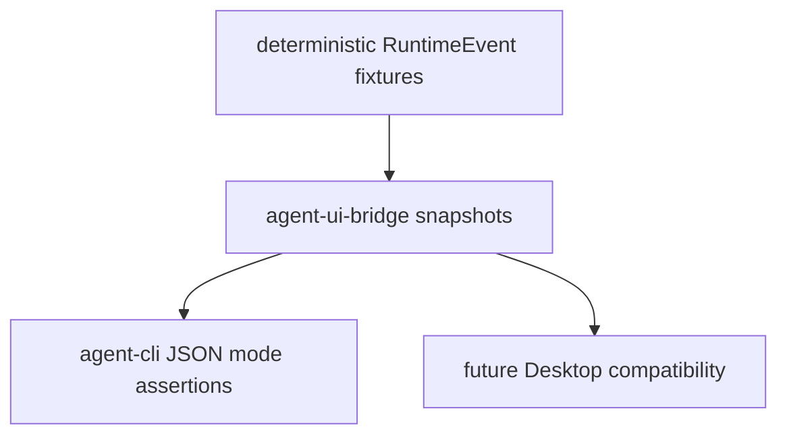

# M06-04 Bridge Snapshots Spec

## Purpose

Add stable bridge snapshot tests that lock UI event, command, and JSON frame shapes before Desktop work begins.

## Product Context

M06 is the contract layer between shared runtime and user interfaces. This slice makes those contracts regression-resistant by testing deterministic serialized shapes for representative runtime flows.

## Scope

This spec delivers:

- UI event snapshot tests
- UI command snapshot tests
- JSON frame snapshot tests
- end-to-end local fixture normalization test
- M06 completion documentation updates

Owned by other specs:

- implementation of event schema: `M06-01-ui-event-schema`
- implementation of command schema: `M06-02-ui-command-schema`
- CLI JSON mode: `M06-03-cli-json-mode`

## Architecture

Snapshot tests live near the bridge crate that owns the wire contract. CLI JSON tests may reuse the same expected frame shape but should not duplicate bridge normalization logic.



## File Layout

```text
crates/
  agent-ui-bridge/
    tests/
      bridge_snapshots.rs
      fixtures/
        m06_model_delta_event.json
        m06_start_turn_command.json
        m06_done_frame.json
  agent-cli/
    tests/
      json_mode.rs
docs/
  milestones/
    README.md
```

## Public Contracts

This slice does not introduce new public runtime contracts. It freezes the public contracts created by M06-01 through M06-03:

- `UiEventEnvelope`
- `UiEventPayload`
- `UiCommandEnvelope`
- `UiCommand`
- `UiJsonFrame`

## State and Failure Handling

- Snapshot fixtures carry schema version `1`.
- Fixture deserialization failures are test failures.
- Unexpected serialized shape changes are test failures unless a deliberate compatibility update is documented.
- M06 completion requires all slice plans checked and standard verification passing.

## Security and Privacy

- Snapshot fixtures must contain no real secrets.
- Tool-related snapshots include secret-like input values in runtime fixtures and assert they are absent from UI output.
- JSON frames expose summaries, not raw tool payloads.

## Testing Strategy

- `serde_json::json!` assertions for stable event, command, and frame values.
- Fixture round-trip tests from JSON files.
- CLI JSON mode test verifies every output line is a valid `UiJsonFrame`.
- Full workspace verification closes M06.

## Acceptance Criteria

- Bridge snapshots fail on accidental wire-shape changes.
- CLI JSON mode and bridge snapshots share the same frame schema.
- M06 is marked complete in `docs/milestones/README.md`.
- `cargo fmt --all -- --check`, `cargo clippy --workspace --all-targets -- -D warnings`, and `cargo test --workspace` pass.

## Completion Signal

M06-04 and M06 are complete when bridge snapshots pass, M06 documentation is updated, and active focus advances to M07 planning.
