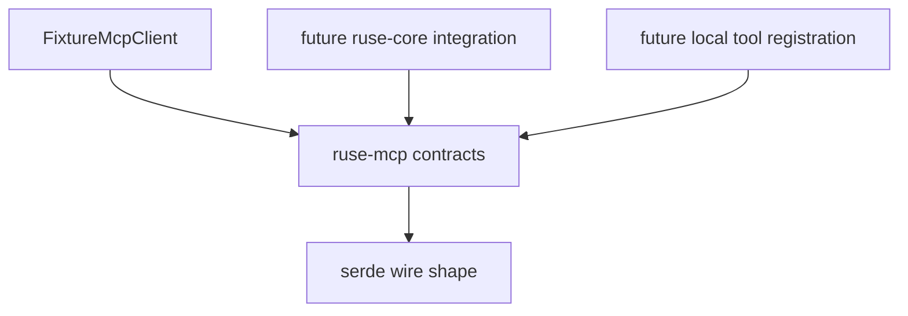

# M07-01 MCP Client Spec

## Purpose

Create the `ruse-mcp` crate and define the minimal MCP client contracts for server configuration, initialization, deterministic tool discovery, and health checks.

## Product Context

M07 starts external capability discovery. This slice creates the protocol-facing foundation without spawning real MCP server processes or making network calls. Later slices map discovered MCP tools into local policy, tool registration, and trace events.

The protocol grounding is the official MCP `2025-11-25` specification: clients initialize a server with `initialize`, discover tools with `tools/list`, and later execute tools with `tools/call`. This slice implements only initialization, discovery contracts, and fixture-backed health behavior.

## Scope

This spec delivers:

- `ruse-mcp` crate scaffold
- `McpServerId`
- `McpServerConfig`
- `McpTransportConfig`
- `McpServerStatus`
- `McpServerHealth`
- `McpServerCapabilities`
- `McpToolDescriptor`
- `McpInitializeResult`
- `McpToolListResult`
- `McpClient` trait
- `FixtureMcpClient`
- `check_mcp_server_health`

Owned by other specs:

- MCP-to-local policy mapping: `M07-02-mcp-policy-mapping`
- skill root discovery: `M07-03-skill-discovery`
- runtime trace events for MCP and skills: `M07-04-mcp-skill-traceability`
- real stdio and Streamable HTTP transports: future milestone or later M07 extension after fixture contracts are stable

## Architecture

`ruse-mcp` owns MCP protocol-facing contracts and deterministic client test fixtures. It depends on shared serialization/error libraries and must not depend on `ruse-core`, `ruse-cli`, `ruse-ui-bridge`, storage, model providers, or Desktop code in this slice.



## File Layout

```text
crates/
  ruse-mcp/
    Cargo.toml
    src/
      lib.rs
      client.rs
      config.rs
      error.rs
      tool.rs
    tests/
      mcp_client.rs
```

## Public Contracts

```rust
pub struct McpServerId(String);

pub struct McpServerConfig {
    pub id: McpServerId,
    pub display_name: String,
    pub transport: McpTransportConfig,
    pub enabled: bool,
    pub timeout_ms: u64,
}

#[serde(tag = "kind", rename_all = "snake_case")]
pub enum McpTransportConfig {
    Stdio {
        command: String,
        args: Vec<String>,
        env: BTreeMap<String, McpEnvValue>,
    },
    StreamableHttp {
        url: String,
        headers: BTreeMap<String, McpEnvValue>,
    },
}

#[serde(tag = "kind", content = "value", rename_all = "snake_case")]
pub enum McpEnvValue {
    Literal(String),
    SecretRef(String),
}

#[serde(rename_all = "snake_case")]
pub enum McpServerStatus {
    Disabled,
    NotInitialized,
    Healthy,
    Unhealthy,
}

pub struct McpServerHealth {
    pub server_id: McpServerId,
    pub status: McpServerStatus,
    pub message: String,
}

pub struct McpServerCapabilities {
    pub tools: bool,
    pub prompts: bool,
    pub resources: bool,
}

pub struct McpInitializeResult {
    pub server_id: McpServerId,
    pub protocol_version: String,
    pub server_name: String,
    pub server_version: Option<String>,
    pub capabilities: McpServerCapabilities,
}

pub struct McpToolDescriptor {
    pub server_id: McpServerId,
    pub name: String,
    pub title: Option<String>,
    pub description: String,
    pub input_schema: serde_json::Value,
}

pub struct McpToolListResult {
    pub server_id: McpServerId,
    pub tools: Vec<McpToolDescriptor>,
}

#[async_trait]
pub trait McpClient: Send + Sync {
    async fn initialize(
        &self,
        config: &McpServerConfig,
    ) -> Result<McpInitializeResult, McpError>;

    async fn list_tools(&self, server_id: &McpServerId) -> Result<McpToolListResult, McpError>;
}

pub async fn check_mcp_server_health(
    client: &dyn McpClient,
    config: &McpServerConfig,
) -> McpServerHealth;
```

Validation rules:

- `McpServerId` must be non-empty and contain only ASCII lowercase letters, digits, `_`, `-`, or `.`.
- `McpServerConfig.display_name` must be non-empty after trimming.
- `timeout_ms` must be greater than zero.
- stdio `command` must be non-empty.
- Streamable HTTP `url` must start with `http://` or `https://`.
- `McpToolDescriptor.name` must be non-empty after trimming.
- raw secret values must be represented as `McpEnvValue::SecretRef` when they point at local secrets.

## State and Failure Handling

- Disabled server config returns `McpServerStatus::Disabled` from health checks without calling the client.
- Successful `initialize` followed by successful `tools/list` returns `Healthy`.
- Missing fixture data returns `Unhealthy` with a stable diagnostic message.
- Invalid config returns `McpError::InvalidConfig`.
- Client failures are recoverable and become `Unhealthy`; this slice does not retry.

## Security and Privacy

- MCP server configs are untrusted input.
- MCP tool descriptors are untrusted input.
- Secret references may be serialized; secret values must not appear in diagnostics, fixture snapshots, or health messages.
- This slice does not execute MCP tools and does not grant permissions.

## Testing Strategy

- Unit tests validate server IDs, config validation, and transport validation.
- Fixture client tests prove `initialize` and `tools/list` behavior without a live MCP server.
- Health tests cover disabled, healthy, and unhealthy paths.
- Serialization tests cover snake_case tagged transport and env values.

## Acceptance Criteria

- `ruse-mcp` is a workspace member.
- MCP configs and discovery contracts serialize and deserialize.
- `FixtureMcpClient` can initialize a configured server and return deterministic tool descriptors.
- `check_mcp_server_health` reports disabled, healthy, and unhealthy states.
- `cargo test -p ruse-mcp mcp_client` passes.

## Completion Signal

M07-01 is complete when the MCP client contracts are implemented, focused tests pass, full workspace verification passes, and the active focus advances to `M07-02-mcp-policy-mapping`.
