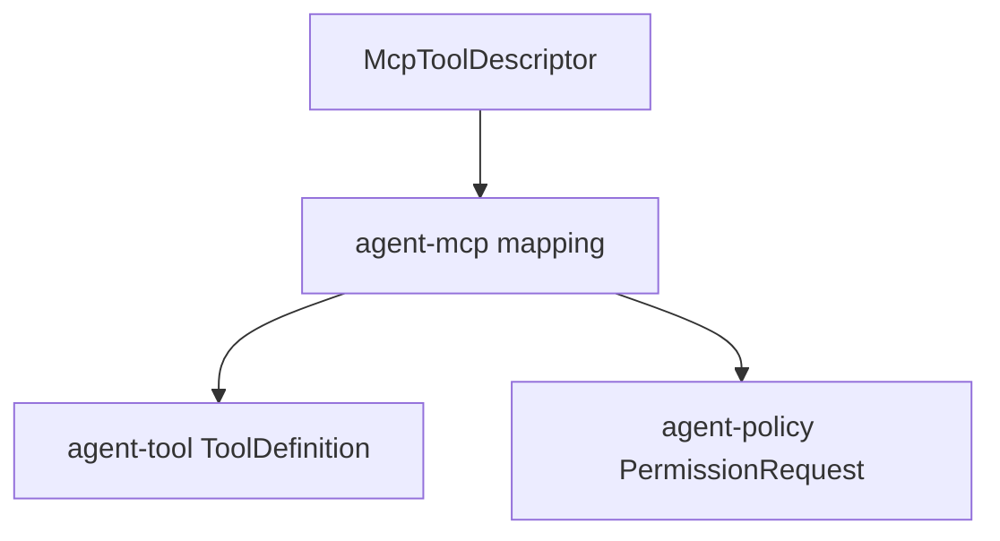

# M07-02 MCP Policy Mapping Spec

## Purpose

Map discovered MCP tools into local tool definitions and permission requests so MCP capabilities enter the runtime through the same policy path as built-in tools.

## Product Context

M07-01 discovers external MCP tools. This slice prevents those tools from becoming a side channel: every discovered MCP tool receives a local tool name, a local input schema, and a permission mapping that can be audited before future execution.

## Scope

This spec delivers:

- `McpLocalToolName`
- `McpToolDefinition`
- `McpPermissionProfile`
- `McpPolicyMapping`
- `McpPermissionRequest`
- conversion from `McpToolDescriptor` to `agent_tool::ToolDefinition`
- conversion from `McpPolicyMapping` to `agent_policy::PermissionRequest`

Owned by other specs:

- MCP server initialization and discovery: `M07-01-mcp-client`
- actual MCP tool execution through `tools/call`: future slice after policy mapping is stable
- trace event emission for source and permission metadata: `M07-04-mcp-skill-traceability`

## Architecture

`agent-mcp` maps MCP descriptors into local contracts. It may depend on `agent-tool` and `agent-policy` for conversion targets. `agent-policy` and `agent-tool` must not depend on `agent-mcp`.



## File Layout

```text
crates/
  agent-mcp/
    src/
      policy.rs
      tool_mapping.rs
    tests/
      mcp_policy_mapping.rs
```

## Public Contracts

```rust
pub struct McpLocalToolName {
    pub server_id: McpServerId,
    pub remote_name: String,
    pub local_name: ToolName,
}

pub struct McpToolDefinition {
    pub descriptor: McpToolDescriptor,
    pub local_name: ToolName,
    pub definition: ToolDefinition,
}

#[serde(rename_all = "snake_case")]
pub enum McpPermissionProfile {
    ToolOnly,
    ReadOnly,
    Network,
    Execute,
}

pub struct McpPolicyMapping {
    pub server_id: McpServerId,
    pub remote_tool_name: String,
    pub local_tool_name: ToolName,
    pub profile: McpPermissionProfile,
    pub scope: ResourceScope,
    pub reason: String,
}

pub fn local_tool_name_for_mcp_tool(
    server_id: &McpServerId,
    remote_name: &str,
) -> Result<ToolName, McpError>;

pub fn mcp_descriptor_to_tool_definition(
    descriptor: &McpToolDescriptor,
) -> Result<McpToolDefinition, McpError>;

pub fn default_policy_mapping_for_mcp_tool(
    descriptor: &McpToolDescriptor,
) -> Result<McpPolicyMapping, McpError>;

pub fn permission_request_for_mcp_mapping(
    mapping: &McpPolicyMapping,
    actor: ActorRef,
) -> PermissionRequest;
```

Mapping rules:

- Local MCP tool names use `mcp.<server_id>.<remote_tool_name>`.
- Remote names are normalized to the existing `ToolName` character set by lowercasing ASCII letters and replacing unsupported characters with `_`.
- Empty remote names are rejected.
- Default profile is `ToolOnly`.
- Default scope is `ResourceKind::Tool` with pattern `mcp:<server_id>:<remote_tool_name>`.
- Default action is `CapabilityAction::Execute` because the local runtime is executing an external capability, even when the remote tool later performs a narrower operation.
- Schema JSON is copied as untrusted data and not executed during mapping.

## State and Failure Handling

- Mapping is pure and deterministic.
- Invalid remote names return `McpError::InvalidToolDescriptor`.
- Invalid local names return `McpError::InvalidToolDescriptor` with the original remote name.
- Permission conversion never grants access; it only creates a request for the policy engine.

## Security and Privacy

- MCP tool names, descriptions, and schemas are untrusted.
- Mapping must not infer filesystem, network, or command permissions from free-form descriptions.
- Permission profile defaults to the narrow `ToolOnly` profile.
- Future user or config overrides can widen permissions, but this slice only records explicit mapping data.

## Testing Strategy

- Unit tests validate local tool name normalization.
- Conversion tests validate `ToolDefinition` shape and JSON schema preservation.
- Policy tests validate default `PermissionRequest` action, scope, actor, and reason.
- Rejection tests cover empty names and unsupported normalized output.

## Acceptance Criteria

- MCP descriptors convert into local `ToolDefinition` values.
- MCP descriptors convert into explicit `PermissionRequest` values.
- No MCP tool bypasses `agent-policy` contracts.
- `cargo test -p agent-mcp mcp_policy_mapping` passes.

## Completion Signal

M07-02 is complete when MCP tool descriptors can be mapped to local tool and policy contracts, focused tests pass, full workspace verification passes, and the active focus advances to `M07-03-skill-discovery`.
