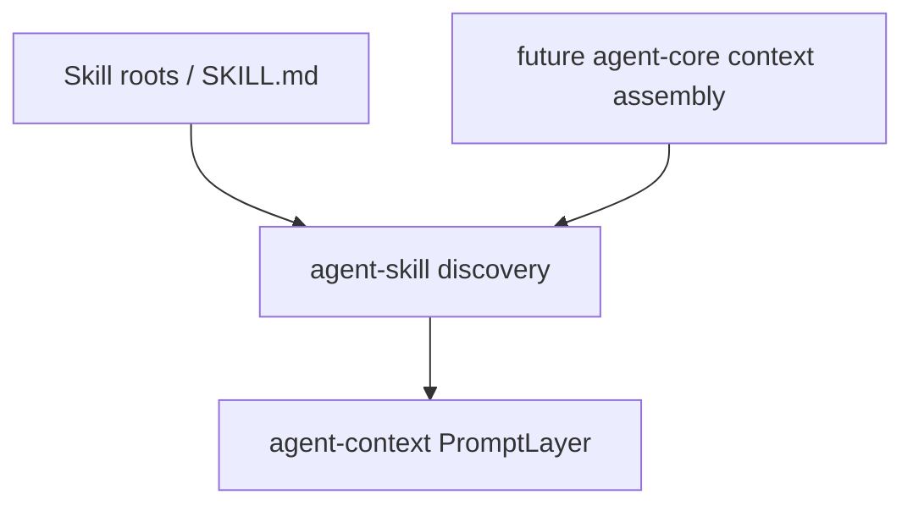

# M07-03 Skill Discovery Spec

## Purpose

Create skill discovery contracts that load local skill roots, parse skill metadata, track source paths, and turn skill instructions into traceable prompt contributions.

## Product Context

Skills are reusable instructions and workflow rules. M05 already supports prompt layers, including `PromptLayerKind::Skill`; this slice adds the skill discovery layer that feeds those prompt layers without hard-coding skills into the runtime.

## Scope

This spec delivers:

- `agent-skill` crate scaffold
- `SkillId`
- `SkillRoot`
- `SkillSource`
- `SkillManifest`
- `SkillPromptContribution`
- `DiscoveredSkill`
- `SkillDiscoveryConfig`
- `discover_skills`
- `skill_prompt_layer`

Owned by other specs:

- MCP server discovery: `M07-01-mcp-client`
- MCP policy mapping: `M07-02-mcp-policy-mapping`
- trace event emission for skills: `M07-04-mcp-skill-traceability`
- remote skill installation and plugin packaging: future plugin milestones

## Architecture

`agent-skill` owns skill metadata parsing and prompt contribution creation. It may depend on `agent-context` to create `PromptLayer` values. It must not depend on `agent-core`, `agent-cli`, `agent-ui-bridge`, storage, model providers, MCP, or plugin runtime.



## File Layout

```text
crates/
  agent-skill/
    Cargo.toml
    src/
      lib.rs
      discovery.rs
      error.rs
      manifest.rs
      prompt.rs
    tests/
      skill_discovery.rs
```

## Public Contracts

```rust
pub struct SkillId(String);

pub struct SkillRoot {
    pub path: PathBuf,
    pub enabled: bool,
}

pub struct SkillDiscoveryConfig {
    pub roots: Vec<SkillRoot>,
}

pub struct SkillSource {
    pub root_path: PathBuf,
    pub manifest_path: PathBuf,
}

pub struct SkillManifest {
    pub id: SkillId,
    pub name: String,
    pub description: String,
    pub version: Option<String>,
}

pub struct SkillPromptContribution {
    pub skill_id: SkillId,
    pub layer_id: String,
    pub content: String,
    pub priority: i32,
    pub token_estimate: u32,
    pub source_path: PathBuf,
}

pub struct DiscoveredSkill {
    pub manifest: SkillManifest,
    pub source: SkillSource,
    pub prompt: SkillPromptContribution,
}

pub fn discover_skills(config: &SkillDiscoveryConfig) -> Result<Vec<DiscoveredSkill>, SkillError>;

pub fn skill_prompt_layer(contribution: &SkillPromptContribution) -> PromptLayer;
```

Discovery rules:

- A skill root is a directory containing `SKILL.md`.
- Disabled roots are ignored.
- `SKILL.md` starts with YAML front matter containing at least `name` and `description`.
- `SkillId` is derived from `name` by lowercasing ASCII letters and replacing unsupported characters with `-`.
- The prompt contribution content is the Markdown body after front matter.
- Empty prompt bodies are rejected.
- Discovery order is deterministic by canonical-ish path string order after filtering.

## State and Failure Handling

- Discovery is pure with respect to runtime state; it reads files and returns data.
- Missing disabled roots are ignored.
- Missing enabled roots return `SkillError::RootNotFound`.
- Missing `SKILL.md` returns `SkillError::ManifestNotFound`.
- Invalid front matter returns `SkillError::InvalidManifest`.
- Invalid prompt body returns `SkillError::InvalidPrompt`.

## Security and Privacy

- Skill files are untrusted repository or user input.
- This slice reads only `SKILL.md`; it does not execute scripts, load assets, or follow arbitrary include directives.
- Source paths are tracked for audit and traceability.
- Prompt content can influence model behavior, so every contribution must preserve source metadata.

## Testing Strategy

- Fixture tests create temporary skill roots with valid and invalid `SKILL.md` files.
- Parser tests cover required fields, invalid front matter, and empty prompt bodies.
- Prompt tests assert `PromptLayerKind::Skill`, stable layer IDs, priorities, token estimates, and source-derived content.
- Determinism tests prove output order is stable.

## Acceptance Criteria

- `agent-skill` is a workspace member.
- Valid local skill roots become `DiscoveredSkill` records.
- Skill prompt contributions convert into `agent-context` prompt layers.
- Invalid skill roots fail with typed errors.
- `cargo test -p agent-skill skill_discovery` passes.

## Completion Signal

M07-03 is complete when local skill discovery and prompt contribution contracts are implemented, focused tests pass, full workspace verification passes, and the active focus advances to `M07-04-mcp-skill-traceability`.
