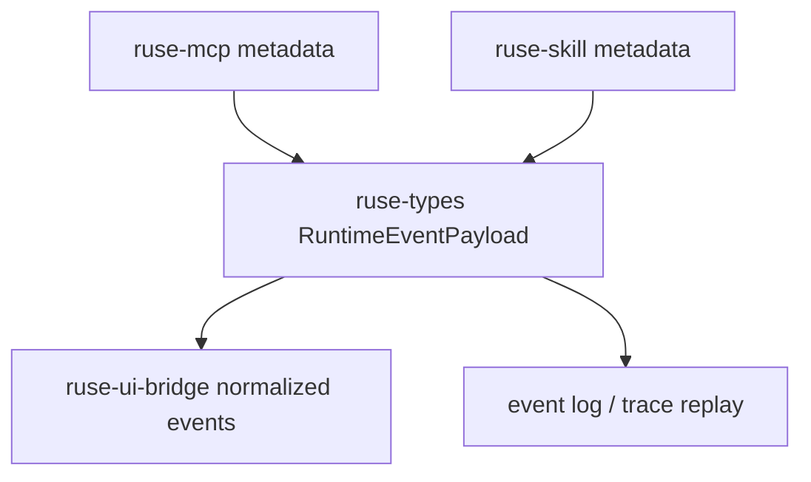

# M07-04 MCP and Skill Traceability Spec

## Purpose

Expose MCP discovery, MCP permission mapping, and skill prompt contribution metadata through runtime trace contracts so external capabilities remain explainable and auditable.

## Product Context

M07 adds external capability sources. This slice makes those sources visible in event logs, CLI trace output, JSON bridge payloads, and future Desktop timelines without exposing raw secrets or raw untrusted tool payloads.

## Scope

This spec delivers:

- runtime event payloads for MCP server health, MCP tool discovery, MCP policy mapping, skill discovery, and skill prompt contribution
- UI bridge normalization for the new trace-safe payloads
- focused trace tests proving source and permission metadata survive serialization
- milestone completion updates for M07

Owned by other specs:

- MCP client contracts: `M07-01-mcp-client`
- MCP policy mapping: `M07-02-mcp-policy-mapping`
- skill discovery: `M07-03-skill-discovery`
- rich Desktop timeline rendering: M10 Desktop Preview

## Architecture

Traceable source metadata belongs in `ruse-types` runtime events. UI-safe summaries belong in `ruse-ui-bridge`. Runtime orchestration can emit these events later through `ruse-core`, but this slice keeps event contracts and normalization deterministic and testable without live model, MCP server, or Desktop code.



## File Layout

```text
crates/
  ruse-types/
    src/
      external.rs
      event.rs
      lib.rs
  ruse-ui-bridge/
    src/
      event.rs
    tests/
      m07_traceability.rs
  crates/ruse-core/
    tests/
      m07_mcp_skill_traceability.rs
```

## Public Contracts

```rust
#[serde(rename_all = "snake_case")]
pub enum ExternalSourceKind {
    McpServer,
    Skill,
}

pub struct McpServerHealthRecorded {
    pub server_id: String,
    pub status: String,
    pub message: String,
}

pub struct McpToolsDiscovered {
    pub server_id: String,
    pub tool_count: u32,
    pub local_tool_names: Vec<String>,
}

pub struct McpPolicyMappingRecorded {
    pub server_id: String,
    pub remote_tool_name: String,
    pub local_tool_name: String,
    pub action: String,
    pub resource_kind: String,
    pub resource_pattern: String,
}

pub struct SkillDiscoveredRecorded {
    pub skill_id: String,
    pub name: String,
    pub source_path: String,
}

pub struct SkillPromptContributionRecorded {
    pub skill_id: String,
    pub layer_id: String,
    pub priority: i32,
    pub token_estimate: u32,
    pub source_path: String,
}
```

`RuntimeEventPayload` gains variants for these payloads. `UiEventPayload` gains summary variants or maps them into `Progress`/`Diagnostic` summaries while preserving source IDs and safe metadata.

Serialization rules:

- Runtime events keep source IDs, local names, counts, permission action, resource kind, and resource pattern.
- Runtime events do not include raw MCP tool input, raw MCP tool output, full MCP schemas, secret values, or full skill prompt bodies.
- UI events expose summaries safe for logs and Desktop views.

## State and Failure Handling

- Trace event creation is pure and deterministic.
- Invalid or missing source metadata is rejected before event creation.
- UI normalization must not panic when it receives trace payloads.
- Existing replay fixtures must remain compatible or receive an explicit schema version update.

## Security and Privacy

- Trace payloads are audit metadata, not execution authority.
- Source paths may reveal local paths; UI bridge summaries should preserve enough source identity for debugging while avoiding raw prompt bodies and secrets.
- MCP schemas and skill content stay out of trace payloads in this slice.

## Testing Strategy

- `ruse-types` serialization tests prove stable snake_case event shape.
- `ruse-ui-bridge` tests prove new payloads normalize without leaking raw prompt bodies or schemas.
- `ruse-core` integration tests build deterministic event fixtures for MCP discovery and skill prompt contribution.
- Replay compatibility tests run with the full workspace test suite.

## Acceptance Criteria

- MCP and skill metadata can be represented as runtime events.
- UI bridge can normalize the new trace payloads.
- Serialized trace payloads contain source and permission metadata, not raw secrets or prompt bodies.
- M07 milestone status advances to complete.
- Standard verification commands pass.

## Completion Signal

M07-04 is complete when traceability contracts are implemented, focused tests pass, full workspace verification passes, M07 is marked complete, and the active focus advances to M08 planning.
