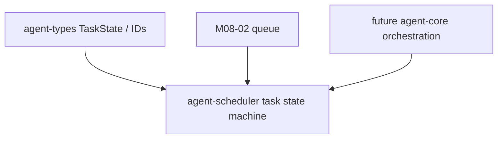

# M08-01 Task State Machine Spec

## Purpose

Create the `agent-scheduler` crate and define the durable task-run state machine used by background and recurring work.

## Product Context

M08 introduces long-running work. This slice establishes task identity, task kind, run metadata, and legal state transitions before queueing, leases, quotas, or notifications exist.

## Scope

This spec delivers:

- `agent-scheduler` crate scaffold
- `TaskKind`
- `TaskPriority`
- `TaskRun`
- `TaskTransition`
- `TaskTransitionError`
- `transition_task_state`

Owned by other specs:

- queue, leases, pause/resume, cancellation, and retries: `M08-02-queue-leases`
- quota evaluation: `M08-03-quotas`
- task notifications and trace payloads: `M08-04-notifications`

## Architecture

`agent-scheduler` depends on `agent-types` for IDs, timestamps, and `TaskState`. It does not depend on `agent-core`, storage, UI crates, model providers, tools, or MCP in this slice.



## File Layout

```text
crates/
  agent-scheduler/
    Cargo.toml
    src/
      lib.rs
      error.rs
      task.rs
    tests/
      task_state_machine.rs
```

## Public Contracts

```rust
#[serde(rename_all = "snake_case")]
pub enum TaskKind {
    OneShot,
    Background,
    Cron,
}

#[serde(rename_all = "snake_case")]
pub enum TaskPriority {
    Low,
    Normal,
    High,
}

pub struct TaskRun {
    pub task_id: TaskId,
    pub workspace_id: WorkspaceId,
    pub conversation_id: Option<ConversationId>,
    pub kind: TaskKind,
    pub state: TaskState,
    pub priority: TaskPriority,
    pub created_at: Timestamp,
    pub updated_at: Timestamp,
    pub attempt: u32,
    pub max_attempts: u32,
    pub summary: String,
}

pub struct TaskTransition {
    pub from: TaskState,
    pub to: TaskState,
    pub reason: String,
    pub at: Timestamp,
}

pub fn transition_task_state(
    run: &TaskRun,
    transition: TaskTransition,
) -> Result<TaskRun, SchedulerError>;
```

Transition rules:

- `Created -> Queued`
- `Queued -> Running`
- `Running -> WaitingApproval | Sleeping | Paused | Succeeded | Failed | Cancelled`
- `WaitingApproval -> Running | Cancelled`
- `Sleeping -> Queued | Cancelled | Expired`
- `Paused -> Queued | Cancelled`
- terminal states cannot transition

## State and Failure Handling

- State transitions are pure and deterministic.
- Invalid transitions return `SchedulerError::InvalidTransition`.
- Empty summaries and empty transition reasons return validation errors.
- `attempt` is not incremented by this slice; retry behavior is owned by `M08-02`.

## Security and Privacy

- Task summaries are audit-facing metadata and must not contain secrets in tests or fixtures.
- This slice does not execute background work.
- State transition callers remain responsible for permission checks before side effects.

## Testing Strategy

- Unit tests cover allowed transitions.
- Rejection tests cover invalid and terminal transitions.
- Serialization tests cover stable `TaskRun` and enum shapes.
- Validation tests cover empty summaries and reasons.

## Acceptance Criteria

- `agent-scheduler` is a workspace member.
- `TaskRun` serializes and deserializes with stable snake_case state/kind/priority values.
- Legal transitions return an updated run.
- Illegal transitions return typed errors.
- `cargo test -p agent-scheduler task_state_machine` passes.

## Completion Signal

M08-01 is complete when task state machine contracts are implemented, focused tests pass, full workspace verification passes, and the active focus advances to `M08-02-queue-leases`.
