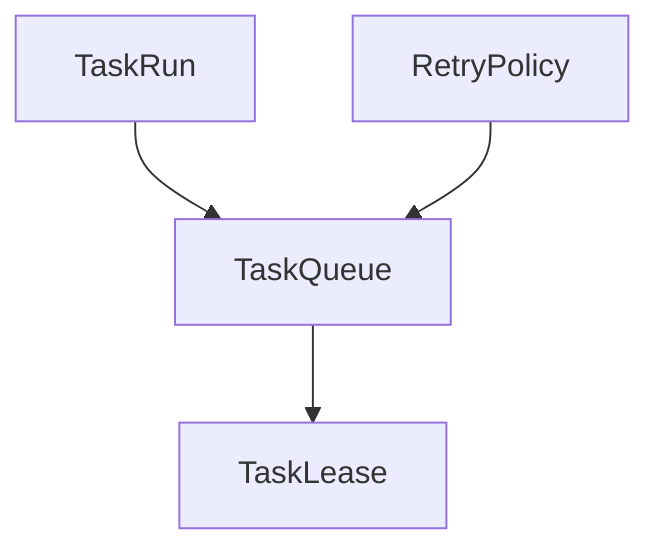

# M08-02 Queue and Leases Spec

## Purpose

Add an in-memory scheduler queue with task acquisition leases, cancellation, pause/resume, and retry scheduling contracts.

## Product Context

M08-01 defines legal task states. This slice makes those task runs schedulable and recoverable without yet enforcing global quotas or UI notifications.

## Scope

This spec delivers:

- `TaskQueue` trait
- `InMemoryTaskQueue`
- `TaskLeaseId`
- `TaskLease`
- `LeaseStatus`
- `RetryPolicy`
- `RetryDecision`
- queue operations for enqueue, acquire, complete, fail, cancel, pause, resume, and release expired leases

Owned by other specs:

- task state contracts: `M08-01-task-state-machine`
- quota limits: `M08-03-quotas`
- notifications and trace payloads: `M08-04-notifications`
- SQLite-backed queue storage: later production hardening after in-memory contracts stabilize

## Architecture

Queue and lease behavior lives in `ruse-scheduler`. This slice remains deterministic and testable in memory. Durable SQLite integration can later implement the same trait through `ruse-storage`.



## File Layout

```text
crates/
  ruse-scheduler/
    src/
      queue.rs
      lease.rs
      retry.rs
    tests/
      queue_leases.rs
```

## Public Contracts

```rust
pub trait TaskQueue {
    fn enqueue(&mut self, run: TaskRun) -> Result<(), SchedulerError>;
    fn acquire_next(&mut self, worker_id: &str, now: Timestamp)
        -> Result<Option<TaskLease>, SchedulerError>;
    fn complete(&mut self, lease_id: &TaskLeaseId, now: Timestamp)
        -> Result<TaskRun, SchedulerError>;
    fn fail(
        &mut self,
        lease_id: &TaskLeaseId,
        error: String,
        now: Timestamp,
    ) -> Result<RetryDecision, SchedulerError>;
    fn cancel(&mut self, task_id: TaskId, reason: String, now: Timestamp)
        -> Result<TaskRun, SchedulerError>;
    fn pause(&mut self, task_id: TaskId, reason: String, now: Timestamp)
        -> Result<TaskRun, SchedulerError>;
    fn resume(&mut self, task_id: TaskId, reason: String, now: Timestamp)
        -> Result<TaskRun, SchedulerError>;
    fn release_expired_leases(&mut self, now: Timestamp) -> Vec<TaskLease>;
}

pub struct TaskLeaseId(String);

pub struct TaskLease {
    pub id: TaskLeaseId,
    pub task_id: TaskId,
    pub worker_id: String,
    pub acquired_at: Timestamp,
    pub expires_at: Timestamp,
    pub status: LeaseStatus,
}

#[serde(rename_all = "snake_case")]
pub enum LeaseStatus {
    Active,
    Completed,
    Failed,
    Cancelled,
    Expired,
}

pub struct RetryPolicy {
    pub max_attempts: u32,
    pub base_delay_ms: u64,
    pub max_delay_ms: u64,
}

pub enum RetryDecision {
    RetryAt { task: TaskRun, run_at: Timestamp },
    Exhausted { task: TaskRun, error: String },
}
```

## State and Failure Handling

- Acquiring a task transitions `Queued -> Running` and creates an active lease.
- Completing a lease transitions `Running -> Succeeded`.
- Failing a lease either transitions to `Sleeping` for retry or `Failed` when attempts are exhausted.
- Cancelling a queued, running, sleeping, waiting, or paused task transitions to `Cancelled`.
- Pausing transitions `Running -> Paused`; resuming transitions `Paused -> Queued`.
- Expired leases return tasks to `Queued` unless the task is terminal.

## Security and Privacy

- Worker IDs and failure summaries are audit metadata and must not contain secrets in tests.
- Queue operations do not execute model, tool, shell, network, or MCP work.
- Leases prevent duplicate execution within the local process; distributed locking is out of scope.

## Testing Strategy

- Queue tests cover FIFO by priority and created time.
- Lease tests cover acquisition, completion, duplicate completion rejection, and expiration.
- Retry tests cover retry delay and exhausted attempts.
- Pause/resume/cancel tests cover legal transitions and terminal rejection.

## Acceptance Criteria

- In-memory queue can enqueue and acquire task runs.
- Active leases guard completion/failure operations.
- Retry decisions are deterministic.
- Cancellation, pause, and resume update task state.
- `cargo test -p ruse-scheduler queue_leases` passes.

## Completion Signal

M08-02 is complete when in-memory queue and lease contracts pass focused tests, full workspace verification passes, and active focus advances to `M08-03-quotas`.
