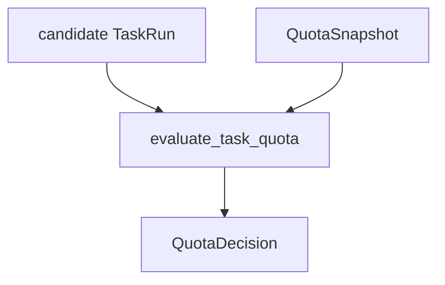

# M08-03 Quotas Spec

## Purpose

Add scheduler quota contracts that reject task acquisition when workspace or system concurrency limits would be exceeded.

## Product Context

Background work can become noisy and expensive. This slice adds deterministic quota evaluation before tasks are acquired from the queue.

## Scope

This spec delivers:

- `QuotaPolicy`
- `QuotaSnapshot`
- `QuotaDecision`
- `QuotaRejection`
- `evaluate_task_quota`
- queue acquisition integration point for quota checks

Owned by other specs:

- queue and leases: `M08-02-queue-leases`
- notification events for quota rejection: `M08-04-notifications`
- model/tool usage budgets: future production hardening

## Architecture

Quota evaluation is a pure `agent-scheduler` decision over a candidate `TaskRun` and a current `QuotaSnapshot`. Queue code calls it before returning a lease.



## File Layout

```text
crates/
  agent-scheduler/
    src/
      quota.rs
    tests/
      quotas.rs
```

## Public Contracts

```rust
pub struct QuotaPolicy {
    pub max_system_running: u32,
    pub max_workspace_running: u32,
    pub max_background_running: u32,
    pub max_cron_running: u32,
}

pub struct QuotaSnapshot {
    pub system_running: u32,
    pub workspace_running: u32,
    pub background_running: u32,
    pub cron_running: u32,
}

pub enum QuotaDecision {
    Allow,
    Reject(QuotaRejection),
}

pub struct QuotaRejection {
    pub code: String,
    pub message: String,
}

pub fn evaluate_task_quota(
    policy: &QuotaPolicy,
    snapshot: &QuotaSnapshot,
    candidate: &TaskRun,
) -> QuotaDecision;
```

## State and Failure Handling

- Quota evaluation does not mutate queue state.
- Rejections include stable machine-readable codes.
- A zero limit means no task of that class can run.
- Queue acquisition skips rejected tasks and leaves them queued unless every candidate is rejected.

## Security and Privacy

- Quotas are safety controls, not permissions.
- Quota rejection messages must not include task prompt content or secrets.
- Quota checks run before task execution and before side effects.

## Testing Strategy

- Unit tests cover system, workspace, background, and cron limits.
- Queue integration tests cover acquisition skipping over rejected candidates.
- Serialization tests cover stable quota policy shape.

## Acceptance Criteria

- Quota decisions are deterministic and typed.
- Queue acquisition can honor quota rejection.
- `cargo test -p agent-scheduler quotas` passes.

## Completion Signal

M08-03 is complete when quota policies and acquisition checks pass focused tests, full workspace verification passes, and active focus advances to `M08-04-notifications`.
