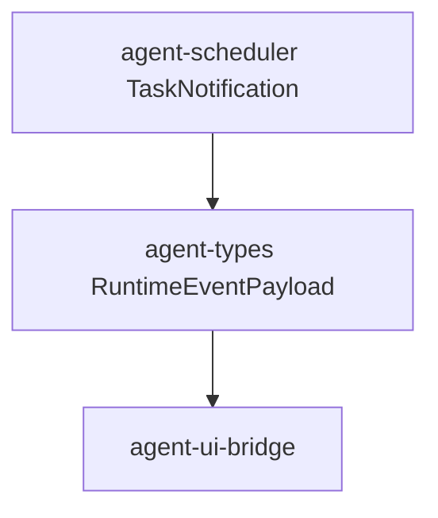

# M08-04 Notifications Spec

## Purpose

Expose task lifecycle notifications and trace-safe runtime events for waiting approval, completion, failure, cancellation, and quota rejection.

## Product Context

M08 background tasks need to be visible to CLI JSON mode and future Desktop clients. This slice adds notification contracts without building Desktop UI.

## Scope

This spec delivers:

- `TaskNotification`
- `TaskNotificationKind`
- `TaskNotificationSink`
- runtime event payloads for task queued, leased, waiting approval, completed, failed, cancelled, expired, and quota rejected
- UI bridge normalization for task notifications
- M08 completion status updates

Owned by other specs:

- task run state machine: `M08-01-task-state-machine`
- queue, leases, retries: `M08-02-queue-leases`
- quotas: `M08-03-quotas`
- Desktop task views: M10 Desktop Preview

## Architecture

Notification contracts live in `agent-scheduler`. Durable runtime event payloads live in `agent-types`. UI-safe summaries live in `agent-ui-bridge`.



## File Layout

```text
crates/
  agent-scheduler/
    src/
      notification.rs
    tests/
      notifications.rs
  agent-types/
    src/
      task.rs
      event.rs
  agent-ui-bridge/
    src/
      event.rs
    tests/
      m08_task_notifications.rs
```

## Public Contracts

```rust
#[serde(rename_all = "snake_case")]
pub enum TaskNotificationKind {
    Queued,
    Leased,
    WaitingApproval,
    Completed,
    Failed,
    Cancelled,
    Expired,
    QuotaRejected,
}

pub struct TaskNotification {
    pub task_id: TaskId,
    pub kind: TaskNotificationKind,
    pub summary: String,
    pub occurred_at: Timestamp,
}

pub trait TaskNotificationSink {
    fn notify(&mut self, notification: TaskNotification) -> Result<(), SchedulerError>;
}

pub struct TaskNotificationRecorded {
    pub task_id: TaskId,
    pub kind: String,
    pub summary: String,
}
```

## State and Failure Handling

- Notification creation is pure and deterministic.
- Empty summaries are rejected.
- Notification sink failures return typed scheduler errors; task state remains the source of truth.
- Waiting approval notifications are emitted when a task enters `WaitingApproval`.

## Security and Privacy

- Notifications contain task IDs, kinds, and safe summaries only.
- No raw prompts, tool inputs, tool outputs, secrets, or model content are copied into notifications.
- UI bridge normalization must preserve task IDs and kind while keeping summaries safe.

## Testing Strategy

- Scheduler tests cover notification validation and in-memory sink behavior.
- Runtime event tests cover task notification serialization.
- UI bridge tests cover safe normalization and absence of raw secret-like content.
- Integration tests cover waiting approval and completed task notification flow.

## Acceptance Criteria

- Task notifications can be represented as scheduler contracts, runtime events, and UI bridge payloads.
- Waiting approval and completion notifications are traceable.
- M08 milestone status is marked complete.
- Standard verification commands pass.

## Completion Signal

M08-04 is complete when task notifications pass focused tests, full workspace verification passes, M08 is marked complete, and active focus advances to M09 planning.
