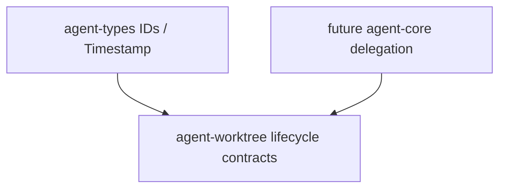

# M09-01 Worktree Manager Spec

## Purpose

Create the `agent-worktree` crate and define deterministic worktree lifecycle contracts for isolated subtask execution.

## Product Context

M09 starts safe parallel work. This slice establishes worktree lease identity, requested branch/path metadata, lifecycle state, cleanup policy, and a testable manager before conflict detection or subagent handoff is introduced.

## Scope

This spec delivers:

- `agent-worktree` crate scaffold
- `WorktreeLeaseId`
- `WorktreeLeaseState`
- `WorktreeRequest`
- `WorktreeLease`
- `WorktreeCleanupPolicy`
- `WorktreeManager` trait
- `InMemoryWorktreeManager`

Owned by other specs:

- changed-file conflict detection: `M09-02-conflict-detection`
- subagent roles and handoff envelopes: `M09-03-subagent-handoff`
- blackboard result sharing: `M09-04-team-blackboard`
- real Git command execution and platform-specific cleanup hardening: later production hardening

## Architecture

`agent-worktree` owns worktree lifecycle contracts and deterministic fixture behavior. It depends on `agent-types` for IDs and timestamps. It does not depend on `agent-core`, CLI/Desktop, model providers, tools, MCP, or storage in this slice.



## File Layout

```text
crates/
  agent-worktree/
    Cargo.toml
    src/
      lib.rs
      error.rs
      lease.rs
      manager.rs
    tests/
      worktree_manager.rs
```

## Public Contracts

```rust
pub struct WorktreeLeaseId(String);

#[serde(rename_all = "snake_case")]
pub enum WorktreeLeaseState {
    Planned,
    Active,
    Released,
    CleanupFailed,
}

#[serde(rename_all = "snake_case")]
pub enum WorktreeCleanupPolicy {
    DeleteOnRelease,
    KeepForReview,
}

pub struct WorktreeRequest {
    pub workspace_id: WorkspaceId,
    pub task_id: TaskId,
    pub base_branch: String,
    pub worktree_branch: String,
    pub worktree_path: String,
    pub cleanup_policy: WorktreeCleanupPolicy,
}

pub struct WorktreeLease {
    pub id: WorktreeLeaseId,
    pub workspace_id: WorkspaceId,
    pub task_id: TaskId,
    pub base_branch: String,
    pub worktree_branch: String,
    pub worktree_path: String,
    pub state: WorktreeLeaseState,
    pub created_at: Timestamp,
    pub updated_at: Timestamp,
}

pub trait WorktreeManager {
    fn plan(&self, request: WorktreeRequest, now: Timestamp) -> Result<WorktreeLease, WorktreeError>;
    fn activate(&mut self, lease_id: &WorktreeLeaseId, now: Timestamp) -> Result<WorktreeLease, WorktreeError>;
    fn release(&mut self, lease_id: &WorktreeLeaseId, now: Timestamp) -> Result<WorktreeLease, WorktreeError>;
    fn get(&self, lease_id: &WorktreeLeaseId) -> Option<&WorktreeLease>;
}
```

## State and Failure Handling

- `plan` creates a `Planned` lease without executing Git.
- `activate` transitions `Planned -> Active`.
- `release` transitions `Planned | Active -> Released`.
- `CleanupFailed` is terminal until a later cleanup repair flow.
- Invalid branch names, empty paths, duplicate lease IDs, and unknown leases return typed `WorktreeError` values.

## Security and Privacy

- Worktree paths are metadata and must stay inside configured workspace isolation roots.
- Branch and path names are untrusted input and must be validated.
- This slice does not execute shell or Git commands.
- Future Git execution must route through policy and audit.

## Testing Strategy

- Scaffold tests prove crate wiring.
- Serialization tests prove stable lease/request shapes.
- State tests cover plan, activate, release, duplicate release rejection, and unknown lease rejection.
- Validation tests reject empty branch names, empty paths, and parent traversal.

## Acceptance Criteria

- `agent-worktree` is a workspace member.
- Worktree lifecycle contracts serialize with stable snake_case states.
- `InMemoryWorktreeManager` plans, activates, releases, and looks up leases.
- `cargo test -p agent-worktree worktree_manager` passes.

## Completion Signal

M09-01 is complete when worktree manager contracts pass focused tests, full workspace verification passes, and active focus advances to `M09-02-conflict-detection`.
