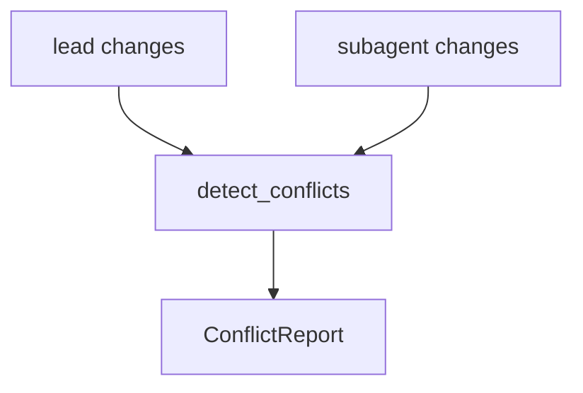

# M09-02 Conflict Detection Spec

## Purpose

Add deterministic conflict detection for lead-agent and subagent changed-file sets before worktree consolidation.

## Product Context

Parallel work is only safe if the runtime can identify overlapping edits before merging or applying subagent results. This slice adds pure conflict contracts without invoking Git merge.

## Scope

This spec delivers:

- `FileChange`
- `ChangeKind`
- `ConflictKind`
- `Conflict`
- `ConflictReport`
- `detect_conflicts`

Owned by other specs:

- worktree lease lifecycle: `M09-01-worktree-manager`
- subagent handoff and capability reduction: `M09-03-subagent-handoff`
- blackboard result sharing: `M09-04-team-blackboard`
- real merge, patch application, and conflict resolution UI: later milestones

## Architecture

Conflict detection lives in `agent-worktree`. It is a pure function over normalized path/change metadata and does not read the filesystem or execute Git.



## File Layout

```text
crates/
  agent-worktree/
    src/
      conflict.rs
    tests/
      conflict_detection.rs
```

## Public Contracts

```rust
#[serde(rename_all = "snake_case")]
pub enum ChangeKind {
    Added,
    Modified,
    Deleted,
}

pub struct FileChange {
    pub path: String,
    pub kind: ChangeKind,
    pub content_hash: Option<String>,
}

#[serde(rename_all = "snake_case")]
pub enum ConflictKind {
    BothModified,
    DeleteModify,
    AddAddDifferentContent,
}

pub struct Conflict {
    pub path: String,
    pub kind: ConflictKind,
    pub lead_change: FileChange,
    pub subagent_change: FileChange,
}

pub struct ConflictReport {
    pub conflicts: Vec<Conflict>,
    pub checked_paths: Vec<String>,
}

pub fn detect_conflicts(
    lead_changes: &[FileChange],
    subagent_changes: &[FileChange],
) -> Result<ConflictReport, WorktreeError>;
```

## State and Failure Handling

- Detection is pure and deterministic.
- Paths are normalized to forward-slash relative paths.
- Empty paths and parent traversal are rejected.
- Same-path identical adds are not conflicts.
- Same-path modified/modified, delete/modify, and different-content add/add are conflicts.

## Security and Privacy

- Conflict reports store paths and hashes only, not file contents.
- Paths are untrusted and validated before reporting.
- Hashes are opaque strings and must not contain secrets in tests.

## Testing Strategy

- Fixture tests cover non-overlap, modified/modified, delete/modify, add/add same hash, and add/add different hash.
- Serialization tests cover stable report shapes.
- Validation tests reject invalid paths.

## Acceptance Criteria

- Conflict reports are deterministic and sorted by path.
- Reports do not contain raw file contents.
- `cargo test -p agent-worktree conflict_detection` passes.

## Completion Signal

M09-02 is complete when conflict detection passes focused tests, full workspace verification passes, and active focus advances to `M09-03-subagent-handoff`.
