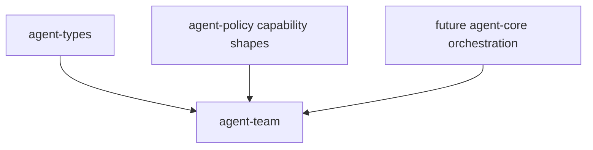

# M09-03 Subagent Handoff Spec

## Purpose

Add typed subagent profiles, handoff envelopes, and capability reduction contracts for delegated work.

## Product Context

Lead agents need to delegate tasks without giving subagents broader access than the parent, role, and task allow. This slice makes delegation auditable and serializable before team blackboard aggregation.

## Scope

This spec delivers:

- `agent-team` crate scaffold
- `SubagentRole`
- `SubagentProfile`
- `CapabilityGrant`
- `CapabilitySet`
- `HandoffEnvelope`
- `HandoffStatus`
- `reduce_capabilities`

Owned by other specs:

- worktree leases: `M09-01-worktree-manager`
- conflict detection: `M09-02-conflict-detection`
- blackboard and review protocols: `M09-04-team-blackboard`
- runtime orchestration that actually spawns workers: later integration

## Architecture

`agent-team` owns team and delegation contracts. It depends on `agent-types` for IDs and timestamps, and `agent-policy` for capability action/scope shapes. It does not execute tools, create worktrees, call models, or render UI.



## File Layout

```text
crates/
  agent-team/
    Cargo.toml
    src/
      lib.rs
      error.rs
      capability.rs
      handoff.rs
    tests/
      subagent_handoff.rs
```

## Public Contracts

```rust
#[serde(rename_all = "snake_case")]
pub enum SubagentRole {
    Implementer,
    Reviewer,
    Researcher,
}

pub struct SubagentProfile {
    pub agent_id: AgentId,
    pub role: SubagentRole,
    pub display_name: String,
    pub system_prompt_summary: String,
}

pub struct CapabilityGrant {
    pub action: CapabilityAction,
    pub scope: ResourceScope,
}

pub struct CapabilitySet {
    pub grants: Vec<CapabilityGrant>,
}

#[serde(rename_all = "snake_case")]
pub enum HandoffStatus {
    Created,
    Accepted,
    Completed,
    Failed,
    Cancelled,
}

pub struct HandoffEnvelope {
    pub task_id: TaskId,
    pub parent_agent_id: AgentId,
    pub subagent_profile: SubagentProfile,
    pub worktree_lease_id: String,
    pub capability_set: CapabilitySet,
    pub status: HandoffStatus,
    pub objective: String,
    pub created_at: Timestamp,
}

pub fn reduce_capabilities(
    parent: &CapabilitySet,
    role: &CapabilitySet,
    task: &CapabilitySet,
) -> CapabilitySet;
```

## State and Failure Handling

- Capability reduction returns the intersection of parent, role, and task grants.
- Handoff creation rejects empty objectives, names, worktree lease IDs, and empty capability sets.
- Status transitions are explicit and terminal statuses cannot transition.
- Serialization uses stable snake_case role/status values.

## Security and Privacy

- Subagents receive reduced capabilities only.
- Handoff envelopes contain summaries and references, not raw prompts or secrets.
- Capability grants are auditable and serializable.

## Testing Strategy

- Unit tests cover capability intersection and no privilege expansion.
- Serialization tests cover profile and envelope shapes.
- Validation tests reject empty objectives and empty capability sets.
- State tests cover handoff status transitions and terminal rejection.

## Acceptance Criteria

- `agent-team` is a workspace member.
- Subagent handoff envelopes serialize deterministically.
- Capability reduction cannot grant access absent from the parent set.
- `cargo test -p agent-team subagent_handoff` passes.

## Completion Signal

M09-03 is complete when handoff and capability tests pass, full workspace verification passes, and active focus advances to `M09-04-team-blackboard`.
