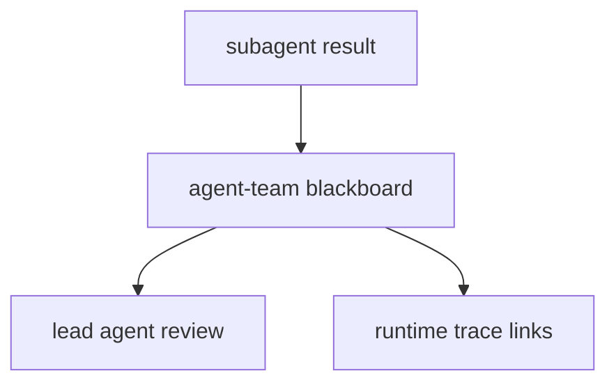

# M09-04 Team Blackboard Spec

## Purpose

Add a shared team blackboard for subagent findings, artifacts, review output, and trace links.

## Product Context

Once worktrees, conflicts, and handoff envelopes exist, lead agents need a deterministic way to collect subagent output before consolidation. This slice provides the shared context surface without building Desktop views.

## Scope

This spec delivers:

- `BlackboardEntryKind`
- `BlackboardEntry`
- `ArtifactRef`
- `ReviewVote`
- `BlackboardStore`
- `InMemoryBlackboardStore`
- M09 completion status updates

Owned by other specs:

- worktree leases: `M09-01-worktree-manager`
- conflict reports: `M09-02-conflict-detection`
- handoff envelopes and reduced capabilities: `M09-03-subagent-handoff`
- Desktop team views and visual review workflows: M10 Desktop Preview

## Architecture

Blackboard contracts live in `agent-team`. Entries reference existing `agent-types` IDs and trace event IDs, but do not store raw tool output or large artifacts inline.



## File Layout

```text
crates/
  agent-team/
    src/
      blackboard.rs
    tests/
      team_blackboard.rs
```

## Public Contracts

```rust
#[serde(rename_all = "snake_case")]
pub enum BlackboardEntryKind {
    Finding,
    DiffSummary,
    Review,
    Decision,
}

pub struct ArtifactRef {
    pub label: String,
    pub path: String,
    pub content_hash: Option<String>,
}

#[serde(rename_all = "snake_case")]
pub enum ReviewVote {
    Approve,
    RequestChanges,
    Block,
}

pub struct BlackboardEntry {
    pub team_id: TeamId,
    pub agent_id: AgentId,
    pub task_id: TaskId,
    pub kind: BlackboardEntryKind,
    pub summary: String,
    pub artifacts: Vec<ArtifactRef>,
    pub trace_event_ids: Vec<EventId>,
    pub review_vote: Option<ReviewVote>,
    pub created_at: Timestamp,
}

pub trait BlackboardStore {
    fn append(&mut self, entry: BlackboardEntry) -> Result<(), TeamError>;
    fn list_for_team(&self, team_id: TeamId) -> Vec<BlackboardEntry>;
}
```

## State and Failure Handling

- Appending entries preserves deterministic chronological order by `created_at`.
- Empty summaries, empty artifact labels, empty artifact paths, and parent-traversal artifact paths are rejected.
- Store operations are in-memory and deterministic in this slice.
- Later durable storage can implement the same trait.

## Security and Privacy

- Entries contain summaries, artifact references, and trace IDs only.
- Raw prompts, raw tool outputs, secrets, and full file contents are not stored in blackboard entries.
- Artifact paths are treated as untrusted metadata and validated.

## Testing Strategy

- Ordering tests cover append/list order.
- Validation tests reject unsafe summaries and artifact paths.
- Serialization tests cover stable entry, vote, and artifact shapes.
- Review tests cover approve/request-changes/block vote values.

## Acceptance Criteria

- Subagent outputs can be represented as findings, diffs, reviews, decisions, artifacts, and trace links.
- Entries are deterministic and safe to expose through future UI bridge surfaces.
- `cargo test -p agent-team team_blackboard` passes.

## Completion Signal

M09-04 is complete when blackboard tests pass, full workspace verification passes, M09 is marked complete, and active focus advances to M10 planning.
