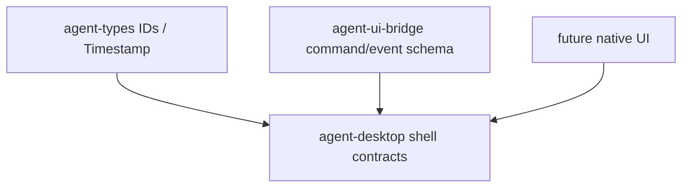

# M10-01 Desktop Shell Spec

## Purpose

Create the `agent-desktop` crate and define the first Desktop shell/session contracts over the existing runtime and UI bridge boundaries.

## Product Context

M10 starts the Desktop Preview milestone. This slice establishes a typed Desktop surface without choosing a native GUI framework, so CLI and Desktop can continue sharing the same runtime truth.

## Scope

This spec delivers:

- `agent-desktop` crate scaffold
- `DesktopSessionState`
- `DesktopRoute`
- `DesktopSession`
- session start, route switch, and disconnect helpers

Owned by other specs:

- conversation and task view models: `M10-02-conversation-tasks`
- permission and diff review: `M10-03-permissions-diffs`
- trace timeline: `M10-04-trace-timeline`
- settings model: `M10-05-settings`
- native windowing, packaging, and OS integration: later Desktop hardening

## Architecture

`agent-desktop` owns Desktop presentation contracts and depends on lower-level crates only. It may depend on `agent-types` and `agent-ui-bridge`, but it must not move runtime orchestration out of `agent-core`.



## File Layout

```text
crates/
  agent-desktop/
    Cargo.toml
    src/
      lib.rs
      error.rs
      session.rs
    tests/
      desktop_shell.rs
```

## Public Contracts

```rust
#[serde(rename_all = "snake_case")]
pub enum DesktopSessionState {
    Connected,
    Disconnected,
}

#[serde(rename_all = "snake_case")]
pub enum DesktopRoute {
    Conversation,
    Tasks,
    Trace,
    Settings,
}

pub struct DesktopSession {
    pub session_id: SessionId,
    pub workspace_id: WorkspaceId,
    pub client_version: String,
    pub route: DesktopRoute,
    pub state: DesktopSessionState,
    pub connected_at: Timestamp,
    pub updated_at: Timestamp,
}

pub fn start_desktop_session(
    workspace_id: WorkspaceId,
    client_version: impl Into<String>,
    now: Timestamp,
) -> Result<DesktopSession, DesktopError>;

pub fn switch_desktop_route(
    session: &DesktopSession,
    route: DesktopRoute,
    now: Timestamp,
) -> Result<DesktopSession, DesktopError>;

pub fn disconnect_desktop_session(
    session: &DesktopSession,
    now: Timestamp,
) -> Result<DesktopSession, DesktopError>;
```

## State and Failure Handling

- New sessions start as `Connected` on `Conversation`.
- Connected sessions can switch routes.
- Disconnecting moves `Connected -> Disconnected`.
- Disconnected sessions cannot switch routes.
- Empty client versions return `DesktopError::InvalidSession`.

## Security and Privacy

- The session contract stores client metadata and IDs only.
- No prompts, tool inputs, secrets, or file contents are stored in the shell session.
- Client version is untrusted input and must be validated.

## Testing Strategy

- Serialization tests cover stable snake_case session and route values.
- State tests cover start, route switch, disconnect, and rejected route changes after disconnect.
- Validation tests reject empty client versions.

## Acceptance Criteria

- `agent-desktop` is a workspace member.
- Desktop shell contracts serialize deterministically.
- `cargo test -p agent-desktop desktop_shell` passes.

## Completion Signal

M10-01 is complete when Desktop shell tests pass, full workspace verification passes, and active focus advances to `M10-02-conversation-tasks`.
