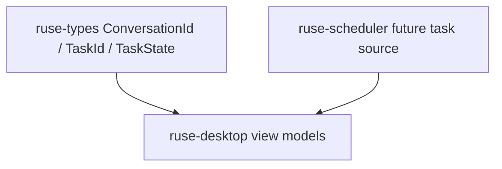

# M10-02 Conversation and Tasks Spec

## Purpose

Add Desktop view-model contracts for conversations, task lists, and the combined workspace snapshot shown by the Desktop shell.

## Product Context

Desktop users need to scan active conversations and background tasks without relying on CLI output. This slice turns runtime IDs and task states into UI-safe summary records.

## Scope

This spec delivers:

- `DesktopConversationItem`
- `DesktopTaskItem`
- `DesktopWorkspaceSnapshot`
- deterministic conversation and task sorting
- validation for UI-visible titles and summaries

Owned by other specs:

- shell session and routes: `M10-01-desktop-shell`
- permissions and diffs: `M10-03-permissions-diffs`
- trace timeline: `M10-04-trace-timeline`
- durable conversation metadata storage: later storage milestone

## Architecture

Conversation and task view models live in `ruse-desktop`. They depend on `ruse-types` state and ID contracts, not on CLI rendering or model providers.



## File Layout

```text
crates/
  ruse-desktop/
    src/
      conversation.rs
      task.rs
      snapshot.rs
    tests/
      conversation_tasks.rs
```

## Public Contracts

```rust
pub struct DesktopConversationItem {
    pub conversation_id: ConversationId,
    pub title: String,
    pub last_activity_at: Timestamp,
    pub unread_count: u32,
}

pub struct DesktopTaskItem {
    pub task_id: TaskId,
    pub workspace_id: WorkspaceId,
    pub conversation_id: Option<ConversationId>,
    pub state: TaskState,
    pub summary: String,
    pub updated_at: Timestamp,
}

pub struct DesktopWorkspaceSnapshot {
    pub workspace_id: WorkspaceId,
    pub active_conversation_id: Option<ConversationId>,
    pub conversations: Vec<DesktopConversationItem>,
    pub tasks: Vec<DesktopTaskItem>,
}

pub fn build_workspace_snapshot(
    workspace_id: WorkspaceId,
    active_conversation_id: Option<ConversationId>,
    conversations: Vec<DesktopConversationItem>,
    tasks: Vec<DesktopTaskItem>,
) -> Result<DesktopWorkspaceSnapshot, DesktopError>;
```

## State and Failure Handling

- Conversations sort by `last_activity_at` descending, then title ascending.
- Tasks sort by non-terminal state first, then `updated_at` descending, then summary ascending.
- Empty conversation titles and task summaries return `DesktopError::InvalidSnapshot`.
- The active conversation may be `None` when the workspace has no selected conversation.

## Security and Privacy

- View models contain summaries, IDs, counts, and states only.
- Raw prompts, model deltas, tool input JSON, and secrets are not included.
- Titles and summaries are treated as untrusted UI text.

## Testing Strategy

- Serialization tests cover stable snapshot shape.
- Sorting tests cover deterministic conversation and task order.
- Validation tests reject empty titles and summaries.
- Privacy tests assert no raw prompt or tool input field exists in the public shape.

## Acceptance Criteria

- Desktop can represent conversations and tasks using shared typed IDs.
- Snapshot ordering is deterministic for repeated renders.
- `cargo test -p ruse-desktop conversation_tasks` passes.

## Completion Signal

M10-02 is complete when conversation/task tests pass, full workspace verification passes, and active focus advances to `M10-03-permissions-diffs`.
