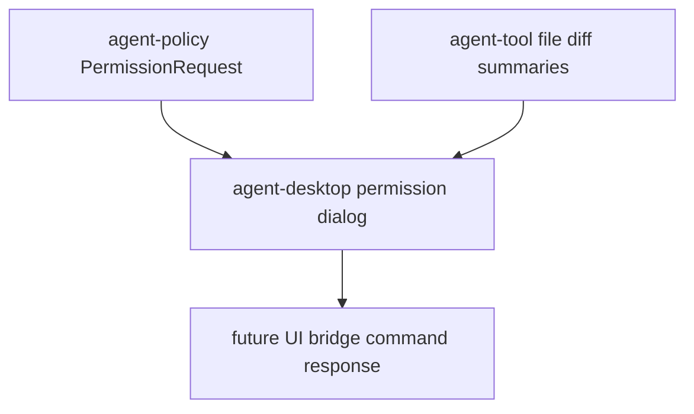

# M10-03 Permissions and Diffs Spec

## Purpose

Add Desktop contracts for permission approval dialogs and diff review panels.

## Product Context

Desktop must expose the same policy decisions and file-change review flow as CLI while making approval state explicit and auditable.

## Scope

This spec delivers:

- `PermissionDialogStatus`
- `PermissionDialog`
- `DesktopPermissionDecision`
- `DiffReviewStatus`
- `DiffFileSummary`
- `DiffReview`
- state transitions for permission and diff review decisions

Owned by other specs:

- shell route/session: `M10-01-desktop-shell`
- task and conversation lists: `M10-02-conversation-tasks`
- trace timeline: `M10-04-trace-timeline`
- actual file patch application: `agent-tool` and later Desktop integration

## Architecture

Permission and diff review contracts live in `agent-desktop`. The permission dialog references `agent-policy` request shape; diff review stores file summaries and hunk metadata, not direct tool execution.



## File Layout

```text
crates/
  agent-desktop/
    Cargo.toml
    src/
      permission.rs
      diff.rs
    tests/
      permissions_diffs.rs
```

## Public Contracts

```rust
#[serde(rename_all = "snake_case")]
pub enum PermissionDialogStatus {
    Pending,
    Allowed,
    Denied,
    Expired,
}

#[serde(rename_all = "snake_case")]
pub enum DesktopPermissionDecision {
    AllowOnce,
    Deny,
}

pub struct PermissionDialog {
    pub request_id: String,
    pub action: CapabilityAction,
    pub scope: ResourceScope,
    pub reason: String,
    pub status: PermissionDialogStatus,
    pub created_at: Timestamp,
    pub decided_at: Option<Timestamp>,
}

#[serde(rename_all = "snake_case")]
pub enum DiffReviewStatus {
    Pending,
    Approved,
    Rejected,
}

pub struct DiffFileSummary {
    pub path: String,
    pub added_lines: u32,
    pub removed_lines: u32,
    pub summary: String,
}

pub struct DiffReview {
    pub task_id: TaskId,
    pub files: Vec<DiffFileSummary>,
    pub status: DiffReviewStatus,
    pub created_at: Timestamp,
    pub decided_at: Option<Timestamp>,
}
```

## State and Failure Handling

- Permission dialogs start as `Pending`.
- Pending dialogs can become `Allowed`, `Denied`, or `Expired`.
- Terminal permission dialogs cannot transition again.
- Diff reviews start as `Pending`.
- Pending diff reviews can become `Approved` or `Rejected`.
- Empty request IDs, reasons, file summaries, and unsafe paths return `DesktopError` values.

## Security and Privacy

- Permission dialogs show action, scope, reason, and request ID only.
- Diff review stores path, counts, and summaries, not full file content or secret-like tool inputs.
- Paths are untrusted metadata and must reject absolute paths and parent traversal.

## Testing Strategy

- Serialization tests cover stable permission and diff shapes.
- State tests cover allowed, denied, expired, approved, rejected, and terminal rejection.
- Validation tests reject empty request IDs, empty summaries, and unsafe paths.
- Privacy tests assert diff review does not store raw tool input JSON.

## Acceptance Criteria

- Desktop can represent permission prompts and diff summaries without direct runtime side effects.
- State transitions are explicit and auditable.
- `cargo test -p agent-desktop permissions_diffs` passes.

## Completion Signal

M10-03 is complete when permission/diff tests pass, full workspace verification passes, and active focus advances to `M10-04-trace-timeline`.
