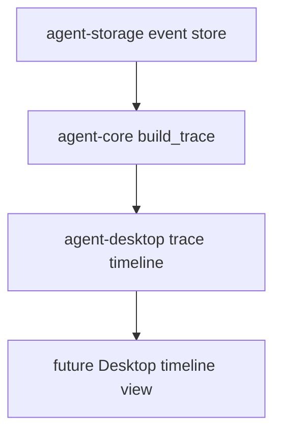

# M10-04 Trace Timeline Spec

## Purpose

Add Desktop trace timeline contracts that turn runtime trace entries into ordered, UI-safe timeline items.

## Product Context

Desktop users need to inspect model, tool, policy, checkpoint, and final-response activity without reading raw event logs. This slice provides the typed timeline model for that view.

## Scope

This spec delivers:

- `TraceTimelineSeverity`
- `TraceTimelineItem`
- `TraceTimeline`
- `build_trace_timeline`
- filtering and ordering rules for trace entries

Owned by other specs:

- trace extraction from event store: M04 `agent-core::build_trace`
- shell route/session: `M10-01-desktop-shell`
- full visual timeline rendering: later native Desktop UI

## Architecture

The Desktop timeline lives in `agent-desktop` and consumes `agent-core::TraceEntry`. It does not query storage directly and does not expose raw tool input JSON.



## File Layout

```text
crates/
  agent-desktop/
    Cargo.toml
    src/
      trace.rs
    tests/
      trace_timeline.rs
```

## Public Contracts

```rust
#[serde(rename_all = "snake_case")]
pub enum TraceTimelineSeverity {
    Info,
    Warning,
    Error,
}

pub struct TraceTimelineItem {
    pub seq: u64,
    pub kind: String,
    pub title: String,
    pub summary: String,
    pub severity: TraceTimelineSeverity,
}

pub struct TraceTimeline {
    pub conversation_id: ConversationId,
    pub items: Vec<TraceTimelineItem>,
}

pub fn build_trace_timeline(
    conversation_id: ConversationId,
    entries: Vec<TraceEntry>,
) -> Result<TraceTimeline, DesktopError>;
```

## State and Failure Handling

- Timeline items sort by sequence ascending.
- Empty trace kinds and summaries are rejected.
- Tool and policy errors map to `Error` severity.
- Checkpoints and final responses map to `Info` severity.
- Duplicate sequence numbers are rejected to keep timeline replay deterministic.

## Security and Privacy

- Timeline items use redacted trace summaries from `agent-core::build_trace`.
- Desktop timeline must not reintroduce raw tool input JSON or secret fields.
- Trace entries are treated as untrusted input and validated.

## Testing Strategy

- Serialization tests cover stable timeline shape.
- Ordering tests cover sequence sorting.
- Validation tests reject empty kind/summary and duplicate sequences.
- Privacy tests assert secret-like keys are not present in serialized timeline fixtures.

## Acceptance Criteria

- Desktop can represent runtime traces as ordered timeline items.
- Timeline output is deterministic and UI-safe.
- `cargo test -p agent-desktop trace_timeline` passes.

## Completion Signal

M10-04 is complete when trace timeline tests pass, full workspace verification passes, and active focus advances to `M10-05-settings`.
