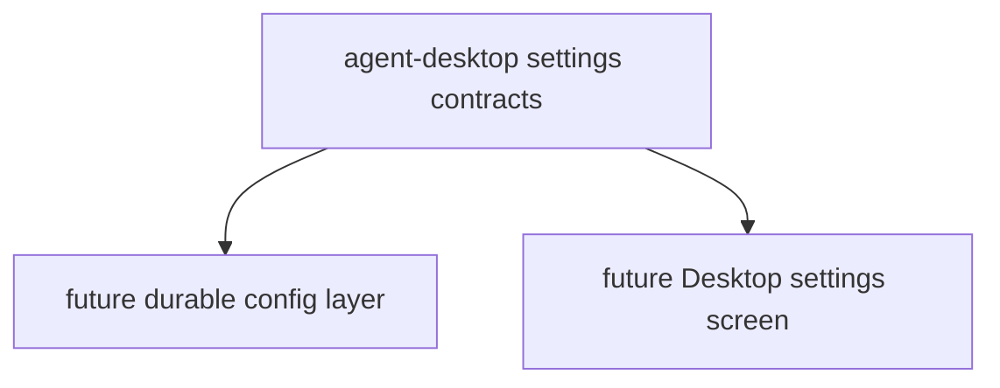

# M10-05 Settings Spec

## Purpose

Add Desktop settings contracts for model, policy, memory, MCP, and UI preferences.

## Product Context

The Desktop Preview needs a typed settings surface before a native settings screen exists. This slice provides validated local configuration snapshots without introducing migrations or secret storage.

## Scope

This spec delivers:

- `DesktopSettings`
- `ModelSettings`
- `PolicySettings`
- `MemorySettings`
- `McpSettings`
- `UiSettings`
- validation and stable serialization
- M10 completion status updates

Owned by other specs:

- durable config files and migrations: M12 Production Hardening
- plugin runtime settings: M11 Plugin Runtime
- secret storage and OS keychain integration: later security hardening

## Architecture

Settings contracts live in `agent-desktop` as UI-facing configuration snapshots. They avoid storing raw API keys and can later be mapped to durable config layers.



## File Layout

```text
crates/
  agent-desktop/
    src/
      settings.rs
    tests/
      settings.rs
```

## Public Contracts

```rust
pub struct DesktopSettings {
    pub model: ModelSettings,
    pub policy: PolicySettings,
    pub memory: MemorySettings,
    pub mcp: McpSettings,
    pub ui: UiSettings,
}

pub struct ModelSettings {
    pub provider: String,
    pub model: String,
}

pub struct PolicySettings {
    pub default_decision: String,
    pub require_approval_for_shell: bool,
}

pub struct MemorySettings {
    pub project_memory_enabled: bool,
    pub long_term_memory_enabled: bool,
}

pub struct McpSettings {
    pub enabled: bool,
    pub server_count: u32,
}

#[serde(rename_all = "snake_case")]
pub enum DesktopTheme {
    System,
    Light,
    Dark,
}

pub struct UiSettings {
    pub theme: DesktopTheme,
    pub show_trace_timeline: bool,
}
```

## State and Failure Handling

- Provider and model names cannot be empty.
- `default_decision` must be one of `ask`, `allow`, or `deny`.
- Settings validation returns `DesktopError::InvalidSettings`.
- This slice does not read or write config files.

## Security and Privacy

- Settings do not include API keys, tokens, passwords, or raw environment variables.
- MCP settings expose enablement and server count only.
- Future secret-backed fields must reference secret handles, not secret values.

## Testing Strategy

- Serialization tests cover stable settings shape and theme values.
- Validation tests reject empty provider/model and invalid policy decisions.
- Privacy tests assert serialized settings contain no secret-like key names.
- Defaults tests cover conservative default approval behavior.

## Acceptance Criteria

- Desktop settings can represent model, policy, memory, MCP, and UI preferences safely.
- M10 has slice-level specs/plans and implementation status recorded.
- `cargo test -p agent-desktop settings` passes.

## Completion Signal

M10-05 is complete when settings tests pass, full workspace verification passes, M10 is marked complete, and active focus advances to M11 planning.
