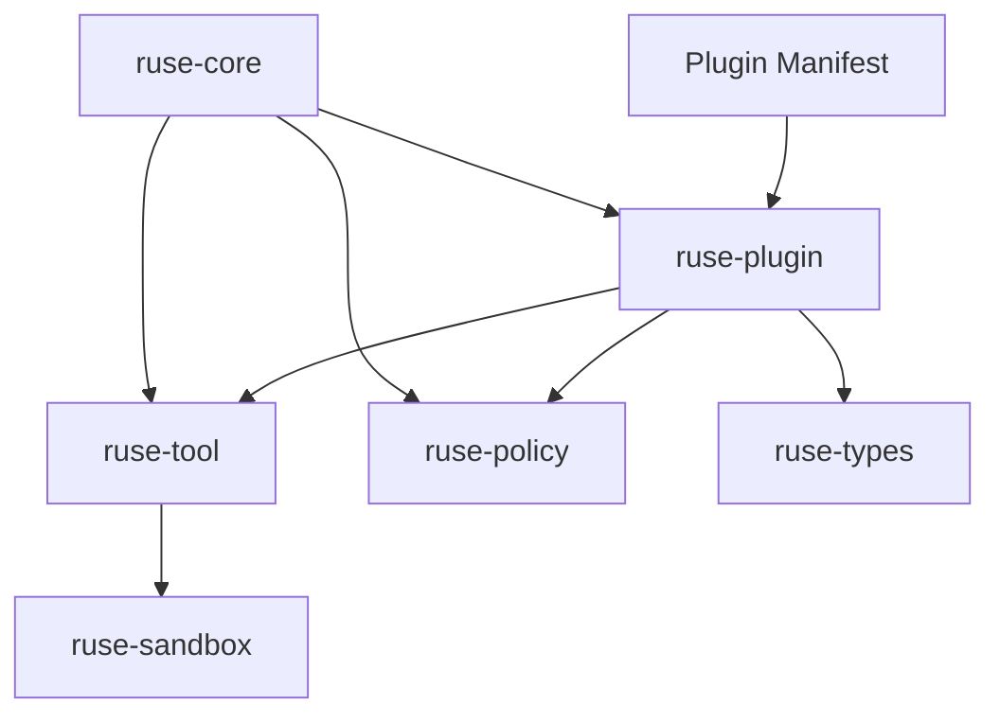

# M11-00 Plugin Runtime Technical Design Spec

## Purpose

Define the architecture baseline for the M11 plugin runtime so every plugin slice implements the same manifest model, compatibility rules, isolation boundary, permission path, registration flow, and audit behavior.

## Product Context

M11 turns `agent` from a closed local runtime into a controlled extension platform. The runtime must accept external capabilities without allowing plugins to bypass tool policy, sandboxing, event sourcing, replay safety, or UI bridge contracts.

## Scope

This design governs:

- plugin crate ownership and dependency direction
- manifest schema and compatibility model
- plugin isolation modes
- process plugin protocol
- capability declaration and policy mapping
- plugin tool registration and execution
- lifecycle hook contracts
- WASM prototype constraints
- configuration, trace, audit, and testing requirements

Owned by implementation slices:

- `M11-01-plugin-manifest`: manifest schema, validation, compatibility checks
- `M11-02-process-plugin-host`: process host protocol and fixture execution
- `M11-03-plugin-capabilities`: capability validation and policy mapping
- `M11-04-plugin-tools-hooks`: tool adapter, registry integration, hook contracts
- `M11-05-wasm-prototype`: constrained WASM host prototype

## Architecture

`ruse-plugin` owns plugin-specific contracts and host adapters. `ruse-core` orchestrates plugin registration and calls plugin tools only through `ruse-tool`. `ruse-policy` remains the only decision point for runtime permissions. `ruse-types` owns durable event payloads that are needed for trace and audit.



Dependency rules:

- `ruse-plugin` may depend on `ruse-tool`, `ruse-policy`, `ruse-types`, `serde`, `serde_json`, `thiserror`, and small validation crates.
- `ruse-plugin` must not depend on `ruse-core`, `ruse-cli`, `ruse-desktop`, or storage crates.
- `ruse-core` may depend on `ruse-plugin` for orchestration.
- UI crates observe plugin behavior through runtime events and bridge snapshots only.

## File Layout

```text
crates/
  ruse-plugin/
    Cargo.toml
    src/
      lib.rs
      capability.rs
      compatibility.rs
      error.rs
      host.rs
      manifest.rs
      process.rs
      tool.rs
      wasm.rs
    tests/
      manifest.rs
      process_host.rs
      capabilities.rs
      plugin_tools_hooks.rs
      wasm_host.rs
```

## Manifest Model

The manifest is declarative data. It never grants permission by itself.

Required fields:

- `schema_version`: manifest schema version, initially `1`
- `name`: stable plugin id using lowercase registry-safe characters
- `version`: plugin package version
- `runtime_compatibility`: minimum agent version and plugin API version
- `isolation`: `process`, `wasm`, or `builtin`
- `capabilities`: requested capability declarations
- `tools`: contributed tool declarations
- `hooks`: lifecycle hook declarations
- `configuration_schema`: JSON schema-like object for plugin config

Validation rules:

- `schema_version` must equal the current supported schema for M11.
- plugin names use lowercase ASCII letters, numbers, `_`, `-`, and `.`.
- process and WASM plugins require an entrypoint.
- built-in plugins must not declare an external entrypoint.
- every declared tool must be backed by a tool capability of the same name.
- every declared hook must be backed by a hook capability of the same name.
- configuration schema must be an object.

## Versioning

M11 uses four version gates:

| Gate | Owner | M11 Rule |
|---|---|---|
| manifest schema version | `ruse-plugin` | exact match on `1` |
| runtime API version | `ruse-plugin` | exact match on `1` |
| agent package version | workspace | plugin `min_agent_version` must be less than or equal to workspace version |
| capability version | `ruse-plugin` | implicit version `1` for M11 capability kinds |

Breaking changes after M11 require either a compatibility adapter or a manifest rejection with a stable diagnostic.

## Isolation Modes

| Mode | Trust | Use | M11 Behavior |
|---|---|---|---|
| `process` | untrusted by default | local integrations and tools | spawn executable, pass request JSON, read response JSON, enforce timeout and output limits |
| `wasm` | constrained | portable pure extensions | validate module and expose a tiny host ABI prototype |
| `builtin` | trusted | workspace-packaged extensions | no process boundary, still routes tool calls through policy and audit |

Dynamic libraries are intentionally out of scope for M11 because they share process memory.

## Process Protocol

Process plugins communicate through one newline-terminated JSON request and one newline-terminated JSON response per call in M11.

Tool call request:

```json
{
  "protocol_version": 1,
  "type": "tool_call",
  "call_id": "call-1",
  "tool_name": "example.read",
  "input": { "path": "README.md" }
}
```

Tool result response:

```json
{
  "protocol_version": 1,
  "type": "tool_result",
  "call_id": "call-1",
  "ok": true,
  "output": { "content": "..." }
}
```

Tool error response:

```json
{
  "protocol_version": 1,
  "type": "tool_result",
  "call_id": "call-1",
  "ok": false,
  "error_code": "plugin_error",
  "message": "read failed",
  "recoverable": true
}
```

The process host treats invalid JSON, mismatched `call_id`, non-zero exit, timeout, oversized output, and protocol version mismatch as typed recoverable host errors unless the caller marks the task terminal.

## Capability And Policy Model

Plugin capabilities declare intent. Runtime policy decides permission.

M11 capability kinds:

- `tool`: declares one tool contribution
- `hook`: declares one lifecycle hook contribution
- `filesystem`: declares filesystem access intent
- `command`: declares process or executable intent
- `network`: declares outbound network intent
- `mcp`: declares MCP server/tool intent
- `secret`: declares named secret intent

Capability mapping rules:

- plugin tool invocation maps to `CapabilityAction::Read` and `ResourceKind::Tool` in the existing M11 tool loop.
- filesystem, command, network, MCP, and secret capability declarations are validated and preserved for future policy expansion.
- plugin capabilities can narrow tool execution but cannot bypass `PolicyEngine`.
- subagent or background task plugin use inherits the already reduced actor capability set.

## Tool Registration

Plugin tools become normal `ruse-tool` entries:

- manifest tool declaration becomes `ToolDefinition`
- `PluginTool` implements `ruse_tool::Tool`
- `ToolRegistry::register` handles duplicate names
- `ToolLoop` handles tool proposal, permission decision, execution, observation, and events
- plugin host failures become `ToolError::Execution`

This keeps plugin tool execution auditable through the same path as built-in tools.

## Hooks

Hooks subscribe to lifecycle events but must not mutate core state directly.

M11 hook points:

- `turn_started`
- `tool_completed`
- `turn_completed`
- `task_failed`

Hook execution rules:

- hooks receive redacted event summaries
- hooks have timeouts and output limits
- hooks cannot recursively trigger the same hook for the same correlation id
- hook failures emit diagnostics but do not hide the original runtime result

## Configuration

Plugin configuration is layered by the existing configuration model:

1. manifest defaults
2. user plugin config
3. workspace plugin config
4. session overrides
5. task overrides

M11 validates configuration schema shape but does not implement durable config migrations. Secrets are referenced by handle only.

## Events And Audit

M11 adds durable event payloads only when needed for trace and replay:

- plugin manifest loaded
- plugin compatibility rejected
- plugin capability validated
- plugin tool registered
- plugin hook executed

Events store metadata and summaries, never raw secret values or unbounded plugin output.

## Failure And Recovery

Failure rules:

- manifest validation failures prevent plugin activation
- compatibility failures prevent plugin activation
- process host failures fail the plugin tool call, not the runtime
- hook failures record diagnostics and continue unless policy marks them terminal
- repeated host failures can be used later to quarantine a plugin

Idempotency rules:

- plugin tool calls use the existing tool call id as the first idempotency boundary
- process execution must not be replayed from stored events
- replay reconstructs plugin observations from events

## Security And Privacy

- default stance is deny or ask, never implicit allow
- plugin manifests and process outputs are untrusted input
- plugin entrypoints are confined by workspace policy and sandbox profile
- plugins cannot read secrets from config files or runtime events
- UI bridge payloads expose plugin names, decisions, and summaries, not raw sensitive inputs

## Testing Strategy

Required tests:

- manifest parser and validation tests
- serialized manifest shape snapshots
- compatibility matrix tests
- process plugin fixture test
- process protocol failure tests
- capability validation tests
- plugin tool registry integration tests
- plugin tool policy path tests
- hook timeout or failure tests
- WASM host prototype validation tests

Required verification:

```bash
cargo fmt --all -- --check
cargo clippy --workspace --all-targets -- -D warnings
cargo test --workspace
```

## Acceptance Criteria

- M11 slices reference this technical design.
- Plugin contracts have a single owner crate.
- Plugin tools cannot bypass `ToolRegistry`, `PolicyEngine`, runtime events, or audit.
- Process and WASM plugins have explicit isolation constraints.
- Future extension points have named version gates and failure modes.

## Completion Signal

M11-00 is complete when this design is committed, M11 slice specs/plans reference it, and `docs/milestones/README.md` points active implementation to `M11-01-plugin-manifest`.
