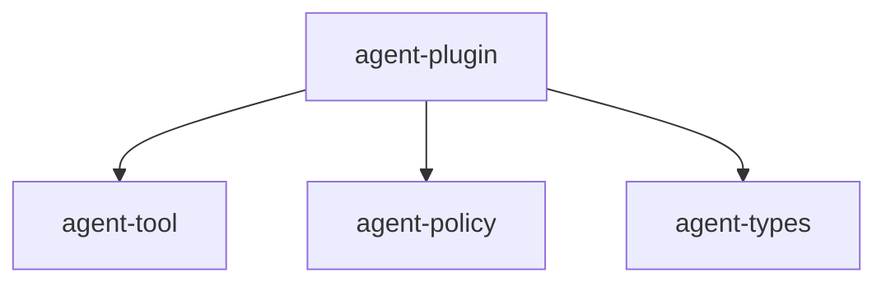

# M11-01 Plugin Manifest Spec

## Purpose

Create the `agent-plugin` crate and implement the typed plugin manifest contract, validation rules, and compatibility checks that all later M11 slices depend on.

## Product Context

The plugin runtime starts with a trustworthy declaration boundary. Before `agent` can execute process plugins, register tools, or run hooks, it must parse manifests into typed Rust contracts and reject unsupported or unsafe declarations.

## Scope

This spec delivers:

- `agent-plugin` workspace crate
- `PluginManifest`
- `PluginName`
- `PluginRuntimeCompatibility`
- `PluginIsolation`
- `PluginIsolationMode`
- `PluginToolManifest`
- `PluginHookManifest`
- `PluginManifestError`
- `parse_plugin_manifest_json`
- `validate_plugin_manifest`
- `check_plugin_compatibility`

Owned by other specs:

- process execution: `M11-02-process-plugin-host`
- capability-to-policy mapping: `M11-03-plugin-capabilities`
- tool adapter and hook execution: `M11-04-plugin-tools-hooks`
- WASM host behavior: `M11-05-wasm-prototype`

## Architecture

`agent-plugin` owns plugin contracts and depends only on lower-level crates and serde utilities. This slice does not touch `agent-core` orchestration.



## File Layout

```text
Cargo.toml
crates/
  agent-plugin/
    Cargo.toml
    src/
      lib.rs
      compatibility.rs
      error.rs
      manifest.rs
    tests/
      manifest.rs
```

## Public Contracts

```rust
pub const PLUGIN_MANIFEST_SCHEMA_VERSION: u32 = 1;
pub const PLUGIN_RUNTIME_API_VERSION: u32 = 1;

pub struct PluginManifest {
    pub schema_version: u32,
    pub name: PluginName,
    pub version: String,
    pub runtime_compatibility: PluginRuntimeCompatibility,
    pub isolation: PluginIsolation,
    pub capabilities: Vec<PluginCapabilityManifest>,
    pub tools: Vec<PluginToolManifest>,
    pub hooks: Vec<PluginHookManifest>,
    pub configuration_schema: serde_json::Value,
}

pub struct PluginRuntimeCompatibility {
    pub min_agent_version: String,
    pub api_version: u32,
}

#[serde(rename_all = "snake_case")]
pub enum PluginIsolationMode {
    Process,
    Wasm,
    Builtin,
}

pub struct PluginIsolation {
    pub mode: PluginIsolationMode,
    pub entrypoint: Option<String>,
}

pub struct PluginToolManifest {
    pub name: agent_tool::ToolName,
    pub description: String,
    pub input_schema: serde_json::Value,
    pub output_schema: serde_json::Value,
}

pub struct PluginHookManifest {
    pub name: String,
    pub event: String,
}
```

`PluginCapabilityManifest` is introduced in `M11-01` as a raw typed declaration with `kind`, `name`, and `permissions`; deeper validation is owned by `M11-03`.

## State And Failure Handling

- Invalid JSON returns `PluginManifestError::Parse`.
- Invalid plugin name returns `PluginManifestError::InvalidName`.
- Unsupported manifest schema returns `PluginManifestError::UnsupportedSchema`.
- Unsupported runtime API returns `PluginManifestError::IncompatibleRuntime`.
- Invalid isolation entrypoint returns `PluginManifestError::InvalidIsolation`.
- Duplicate tool or hook declarations return `PluginManifestError::DuplicateContribution`.
- Empty descriptions, hook names, hook events, versions, or configuration schemas return `PluginManifestError::InvalidManifest`.

## Security And Privacy

- Manifest fields are untrusted.
- Entrypoints are stored as strings in M11-01 and are not executed.
- Manifests must not include secret values.
- Configuration schema must be an object; secret values are deferred to named secret references in later config work.

## Testing Strategy

- Parse the template manifest from `docs/templates/plugin-manifest.template.json`.
- Reject unsupported `schema_version`.
- Reject unsupported runtime API version.
- Reject invalid plugin names.
- Reject process and WASM manifests without entrypoints.
- Reject built-in manifests with entrypoints.
- Reject duplicate tools and hooks.
- Verify stable serialized shape.

## Acceptance Criteria

- `agent-plugin` is a workspace crate.
- Template plugin manifest parses and validates.
- Compatibility checks reject unsupported manifest/API versions.
- Validation errors are typed and stable enough for CLI/Desktop diagnostics.
- `cargo test -p agent-plugin manifest` passes.

## Completion Signal

M11-01 is complete when manifest tests pass, workspace verification passes, and `docs/milestones/README.md` marks `M11-01 implementation` complete.
