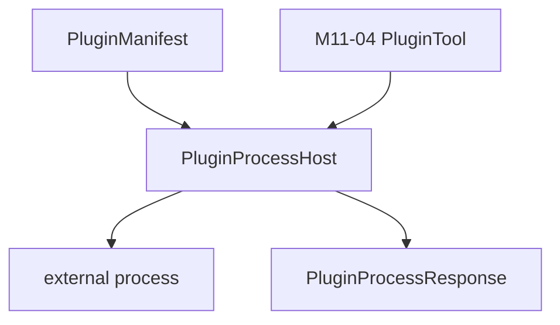

# M11-02 Process Plugin Host Spec

## Purpose

Implement a process-based plugin host that can invoke a declared plugin tool through a typed JSON protocol and deterministic fixture process.

## Product Context

Process isolation is the default M11 plugin runtime because it gives local integrations a useful extension path without sharing memory with the core runtime.

## Scope

This spec delivers:

- `PluginProcessHost`
- `PluginProcessConfig`
- `PluginProcessRequest`
- `PluginProcessResponse`
- `PluginProcessError`
- fixture process test protocol
- timeout and output-limit configuration contracts

Owned by other specs:

- manifest parsing: `M11-01-plugin-manifest`
- policy validation: `M11-03-plugin-capabilities`
- tool registry adapter: `M11-04-plugin-tools-hooks`

## Architecture

Process host code lives in `agent-plugin`. It does not register tools directly and does not evaluate policy.

M11 process calls use one newline-terminated JSON request and one newline-terminated JSON response per invocation.



## File Layout

```text
crates/
  agent-plugin/
    src/
      host.rs
      process.rs
    tests/
      process_host.rs
```

## Public Contracts

```rust
pub const PLUGIN_PROCESS_PROTOCOL_VERSION: u32 = 1;

pub struct PluginProcessConfig {
    pub entrypoint: String,
    pub timeout_ms: u64,
    pub max_stdout_bytes: usize,
}

pub struct PluginProcessRequest {
    pub protocol_version: u32,
    pub kind: PluginProcessRequestKind,
    pub call_id: String,
    pub tool_name: agent_tool::ToolName,
    pub input: serde_json::Value,
}

pub struct PluginProcessResponse {
    pub protocol_version: u32,
    pub kind: PluginProcessResponseKind,
    pub call_id: String,
    pub result: PluginProcessResult,
}
```

## State And Failure Handling

- Missing entrypoint returns `PluginProcessError::InvalidConfig`.
- Spawn failure returns `PluginProcessError::Spawn`.
- Non-zero exit returns `PluginProcessError::Exit`.
- Timeout returns `PluginProcessError::Timeout`.
- Oversized stdout returns `PluginProcessError::OutputTooLarge`.
- Invalid JSON returns `PluginProcessError::Protocol`.
- Mismatched `call_id` returns `PluginProcessError::Protocol`.
- Plugin error responses are recoverable host errors.

## Security And Privacy

- Process environment starts empty except for an explicit allowlist.
- Request JSON does not include secrets in M11.
- Output is bounded and treated as untrusted.
- Process host does not bypass future sandbox profiles.

## Testing Strategy

- fixture process echoes successful tool result
- fixture process emits plugin error response
- invalid JSON response fails
- mismatched call id fails
- missing entrypoint fails before spawn
- output limit is enforced
- timeout is enforced

## Acceptance Criteria

- A fixture process can receive one tool call request and return one typed result.
- Host failures are typed and recoverable.
- `cargo test -p agent-plugin process_host` passes.

## Completion Signal

M11-02 is complete when process host tests pass, workspace verification passes, and active implementation advances to `M11-03-plugin-capabilities`.
